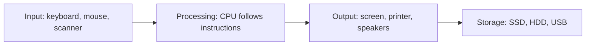

# Lesson 1 — Introduction to Computers and Computer History

**Course:** Computer Fundamentals and Artificial Intelligence Foundation Course  
**Week:** 1 — Computer Fundamentals and Hardware  
**Duration:** 120 minutes  
**Level:** Beginner  
**Delivery:** Instructor-led, classroom and computer lab  
**Learning balance:** Approximately 20% explanation and 80% guided/practical learning

## 1. Learning outcomes

By the end of this lesson, students should be able to:
1. Explain what a computer is in simple words.
2. Distinguish data from information.
3. Describe the input–process–output–storage (IPOS) cycle.
4. Give examples of computers used in everyday life.
5. Name important early calculating devices and describe why computers developed.

## 2. Key terms

- **Computer:** An electronic device that accepts data, processes it according to instructions, produces information, and can store results.
- **Data:** Raw facts, such as names, numbers, or marks.
- **Information:** Data that has been processed and organized so it is useful.
- **Input:** Data or instructions entered into a computer.
- **Processing:** Work performed on data according to instructions.
- **Output:** The result produced by a computer.
- **Storage:** Keeping data and information for later use.

## 3. Student lecture notes

### What is a computer?
A computer is an electronic machine that follows instructions. It can perform calculations, organize information, create documents, communicate, and run many kinds of software. A computer does not understand a task in the same way a human does; it follows instructions and processes data.

### Data and information
Suppose a teacher has these marks: 65, 80, 72, and 83. These numbers are data. When they are arranged in a marks sheet and the average is calculated, the result becomes useful information.

### The IPOS cycle
1. **Input:** A student types marks using a keyboard.
2. **Processing:** A spreadsheet calculates the total and average.
3. **Output:** The result appears on the screen or printer.
4. **Storage:** The teacher saves the file for future use.

A computer system needs instructions and suitable hardware and software to complete these steps.

### Visual: The IPOS cycle

The diagram shows how a computer accepts data, processes it, presents a result, and stores it.

**Example:** A teacher enters student marks (input), a spreadsheet calculates the average (processing), displays the result (output), and saves the workbook (storage).

### Characteristics and limitations
Computers can work quickly, repeat tasks consistently, store large amounts of data, and communicate with other devices. However, they can make errors when data or instructions are incorrect. They also need electricity or a charged battery, maintenance, and human direction.

### Early calculating devices and computer history
- **Abacus:** An ancient counting tool using beads. It helped people perform arithmetic.
- **Mechanical calculating machines:** Devices such as Blaise Pascal's Pascaline (17th century) used mechanical parts to help with arithmetic.
- **Charles Babbage's designs:** The Difference Engine and Analytical Engine were important ideas in the history of programmable computing. The Analytical Engine included concepts similar to memory and a processor.
- **Herman Hollerith's punched-card tabulating system:** Used punched cards and electromechanical tabulating equipment to process large sets of census data. It was an important step in the development of data-processing systems.
- **Electronic computers:** In the 20th century, electronic components made much faster and more flexible computing possible. Some early electronic computers were designed for particular scientific or military tasks; later systems became more general-purpose.
- **Personal computers:** Microprocessor technology helped make smaller computers practical for homes, schools, and offices. The personal-computer era developed through many companies and designs, not one single machine.
- **Modern computing:** Smartphones, cloud services, connected devices, and AI systems are now part of daily life.

History is a gradual development. No single invention created the modern computer by itself.

## 4. Lesson delivery plan

**Practical-first structure:** 20 minutes of focused explanation, 90 minutes of guided student activity, and 10 minutes of review. Keep explanations short and return to the practical task whenever a new term is introduced.

| Time | Instructor activity | Student activity |
|---|---|---|
| 0–20 min | Explain the computer definition, data vs information, IPOS, and one short historical overview using familiar examples | Answer quick questions and predict the IPOS stages in a marks-sheet example |
| 20–35 min | Demonstrate the IPOS activity once, then give clear task instructions | Watch the demonstration and prepare the recording table |
| 35–60 min | Supervise Practical A and check each group's IPOS labels | Use a calculator or spreadsheet; record input, processing, output, and storage |
| 60–85 min | Guide Practical B and prompt students to think about inputs and outputs | Survey classroom/everyday computer systems and complete the table |
| 85–105 min | Provide historical-device cards or approved images; correct misconceptions | Match devices to descriptions and build a short timeline |
| 105–110 min | Ask students to explain one example to a partner | Explain an IPOS example and one historical milestone |
| 110–120 min | Review key ideas, check learning outcomes, and assign homework | Complete an exit check and record homework |

## 5. Guided practical activities

### Activity A — Identify the IPOS cycle
Use a calculator or spreadsheet to add three numbers.
- Write down the input values.
- Identify what processing takes place.
- Record the output.
- Save the result or write where it could be stored.

### Activity B — Computers around us
In pairs, list at least ten devices or systems that contain computers. Examples may include phones, ATMs, traffic-control systems, smart televisions, and vehicle systems. For each, state what input it receives and what output it provides.

### Activity C — Data or information?
Classify these examples:
- A list of unorganized marks.
- A report showing the class average.
- Names entered on a registration form.
- A sorted student attendance report.

## 6. Check for understanding

1. What is a computer?
2. What is the difference between data and information?
3. What do the letters in IPOS represent?
4. Give one example of input and one example of output.
5. Name two early calculating devices.
6. Why was the Analytical Engine important in computer history?
7. State two strengths and two limitations of computers.

## 7. Homework

1. Write a 5–7 sentence explanation of a computer.
2. Draw and label the IPOS cycle.
3. Give five examples of data and five examples of information.
4. Create a short timeline with at least four milestones in computer history.
5. List five places where computers are used and explain one use for each.

## 8. Instructor notes and safety

- Use familiar examples before introducing technical terms.
- Do not present computer history as a simple story of one inventor.
- Explain that historical dates and classifications can vary between sources.
- Encourage students to explain concepts in their own words rather than memorize definitions.
- No hardware disassembly is required in this lesson.

## 9. Lesson completion checklist

- [ ] Student can explain what a computer does.
- [ ] Student can distinguish data and information.
- [ ] Student can explain all four IPOS stages.
- [ ] Student can give everyday examples.
- [ ] Student can name early calculating devices and explain their role.
