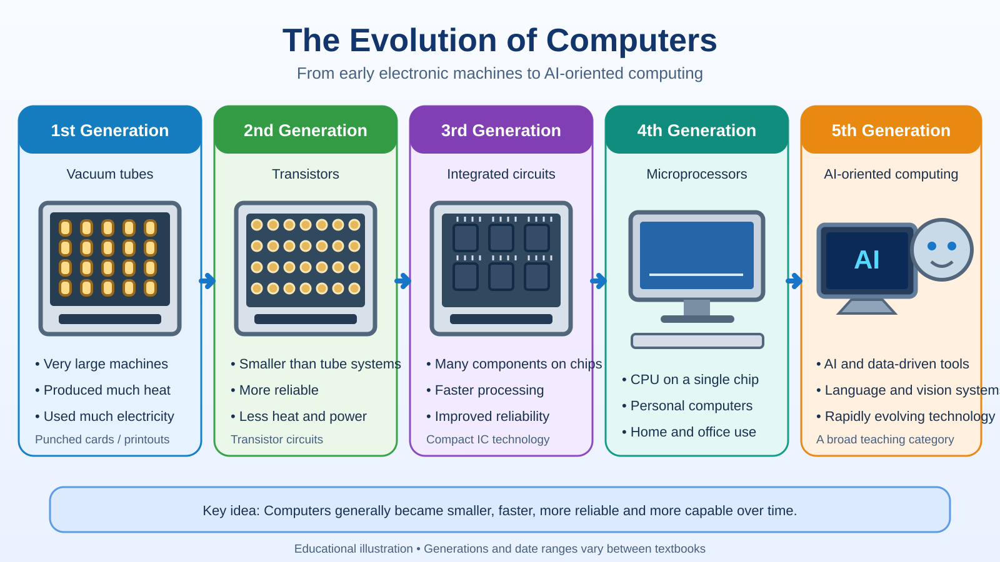
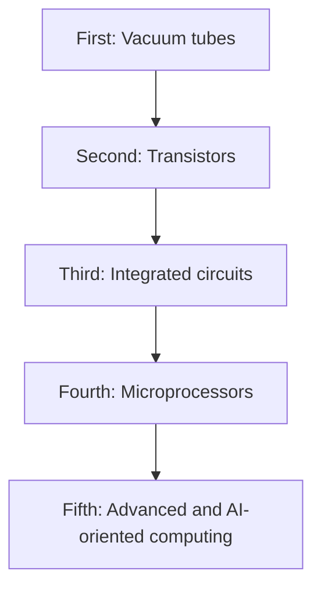

# Lesson 2 — Computer Generations and Evolution

**Course:** Computer Fundamentals and Artificial Intelligence Foundation Course  
**Week:** 1 — Computer Fundamentals and Hardware  
**Duration:** 120 minutes | **Level:** Beginner

## 1. Learning outcomes
Students will be able to:
1. Explain why computers changed over time.
2. Describe the five commonly taught computer generations.
3. Match major technologies to the correct generation.
4. Compare early computers with modern personal computers.
5. Explain that generation boundaries are teaching categories, not exact universal dates.

## 2. Key terms
Vacuum tube, transistor, integrated circuit (IC), microprocessor, artificial intelligence (AI), size, speed, reliability, power consumption.

## 3. Student lecture notes

Computer generations are a common way to organize the history of electronic computers by the main technology used. Textbooks may use slightly different dates and descriptions.

### First generation — Vacuum tubes
Early electronic computers used vacuum tubes for switching and processing. They were very large, produced considerable heat, used much electricity, and required maintenance. Input and output often used punched cards, paper tape, or printouts.

### Second generation — Transistors
Transistors replaced many vacuum tubes. They were smaller, more reliable, used less power, and produced less heat. Computers became more practical for scientific and business work.

### Third generation — Integrated circuits
An integrated circuit places many electronic components on a small chip. This made computers smaller, faster, more reliable, and less expensive to produce.

### Fourth generation — Microprocessors
A microprocessor places the central processing unit (CPU) on a chip. This development helped make personal computers, laptops, and many embedded systems possible.

### Fifth generation — Advanced and AI-oriented computing
The term is often used for advanced computing, including AI, natural-language systems, parallel processing, and other emerging technologies. There is no single universally accepted start date or definition for this generation.

### How computers evolved
Across many decades, computers generally became more compact, powerful, affordable, connected, and energy-efficient. These changes did not happen at the same speed in every type of computer, and older technologies continued to be used while newer ones developed. Modern systems can use cloud computing and AI services, but they still depend on hardware, software, data, and human decisions.

### Visual: Five commonly taught computer generations

*This is an educational vector illustration, not a set of authentic historical photographs. The fifth-generation label is a broad teaching category; its definition and dates vary between sources.*

**Remember:** This is a traditional teaching framework. Dates and the meaning of the fifth generation vary between sources; not every computer fits neatly into one category.

## 4. Comparison table

| Common generation | Main technology | General change |
|---|---|---|
| First | Vacuum tubes | Early electronic computing |
| Second | Transistors | Smaller and more reliable |
| Third | Integrated circuits | More components on compact chips |
| Fourth | Microprocessors | Personal computing expands |
| Fifth | Advanced/AI-oriented computing | Intelligent and highly connected applications |

## 5. Lesson delivery plan

**Practical-first structure:** 20 minutes of focused explanation, 90 minutes of guided student activity, and 10 minutes of review.

| Time | Instructor activity | Student activity |
|---|---|---|
| 0–20 min | Explain why computer technology changed and introduce the five commonly taught generations | Match the five technology names to the correct sequence |
| 20–35 min | Demonstrate how to read the timeline and compare one early and one modern computer | Identify the main technology and one visible difference |
| 35–60 min | Supervise a five-column generation timeline | Build the timeline with technology, features, and one improvement per stage |
| 60–80 min | Provide image/card sorting and correct inaccurate matches | Match vacuum tubes, transistors, ICs, and microprocessors to descriptions |
| 80–100 min | Guide a comparison task using approved historical and current computer images | Compare size, components, input/output, power use, and typical use |
| 100–110 min | Ask groups to explain why the fifth-generation label is less precise | Present one comparison and one limitation of the framework |
| 110–120 min | Review the four hardware milestones, clarify terminology, and assign homework | Complete an exit check and record homework |

## 6. Practical activity — Build a computer timeline

## 6. Practical activity — Build a computer timeline
In groups, prepare a five-column chart. For each generation, include:
- Main technology.
- One important feature.
- One advantage over earlier technology.
- A simple drawing or image.

Then compare a historical computer image with a current desktop or laptop. Record at least four differences.

## 7. Check for understanding
1. Which technology is associated with the first generation?
2. What replaced vacuum tubes in the second generation?
3. What is an integrated circuit?
4. What is a microprocessor?
5. Which generation is commonly associated with personal computers?
6. Why do textbooks sometimes describe the fifth generation differently?
7. Name three ways modern computers differ from early electronic computers.

## 8. Homework
1. Draw a five-generation timeline.
2. Write two features of each generation.
3. Explain the difference between a transistor and an integrated circuit in simple English.
4. Find one example of a modern AI application and explain what it helps people do.

## 9. Instructor notes
- Teach the five generations as a useful traditional framework, not as an exact scientific law.
- Do not claim that every computer fits neatly into one generation.
- Avoid suggesting that AI is a single device or that modern computers all think like humans.
- Use a visual timeline and actual computer photographs where possible.

## 10. Lesson completion checklist
- [ ] Student can name the five commonly taught generations.
- [ ] Student can match each generation to its main technology.
- [ ] Student can compare early and modern computers.
- [ ] Student understands that generation boundaries vary.
