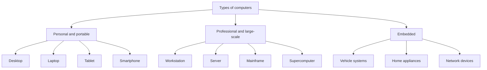

# Lesson 3 — Types of Computers

**Course:** Computer Fundamentals and Artificial Intelligence Foundation Course  
**Week:** 1 — Computer Fundamentals and Hardware  
**Duration:** 120 minutes | **Level:** Beginner

## 1. Learning outcomes
Students will be able to:
1. Identify common types of computers.
2. Explain how computers are classified by size, purpose, and capability.
3. Match a computer type to a suitable task.
4. Recognize that phones and many everyday devices are computers too.

## Key terms

- **Personal computer:** A computer designed mainly for one person at a time.
- **Portable computer:** A computer designed to be carried, such as a laptop or tablet.
- **Workstation:** A powerful computer for demanding professional work.
- **Server:** A computer that provides services or resources to other computers.
- **Mainframe:** A large system designed for reliable high-volume processing and many users.
- **Supercomputer:** A system designed for extremely complex calculations.
- **Embedded computer:** A computer built into another device to control a specific function.

## 2. Student lecture notes

A computer is not always a desktop machine. Computers come in many forms. Some are designed for one person, while others support many users or perform specialized tasks.

### Personal and portable computers
- **Desktop:** Usually kept on a desk; often has a separate monitor, keyboard, mouse, and system unit.
- **Laptop:** Portable computer with a built-in screen, keyboard, touchpad, and battery.
- **Tablet:** Touchscreen portable computer, usually without a permanently attached physical keyboard.
- **Smartphone:** Handheld computer with communication, camera, apps, sensors, and internet access.

### Professional and large-scale computers
- **Workstation:** High-performance computer for demanding professional tasks such as engineering, design, or scientific work.
- **Server:** A computer that provides services or resources to other computers, such as websites, files, or databases.
- **Mainframe:** A powerful system designed to process large volumes of transactions and support many users reliably.
- **Supercomputer:** A system built to perform extremely large and complex calculations, such as weather modelling or scientific research.

### Embedded computers
An embedded computer is built into another product to control or manage specific functions. Examples include washing machines, cars, routers, smart televisions, and industrial machines.

### Choosing the right type
The best computer depends on the task, required performance, portability, budget, reliability, and software. A student writing documents may need a basic laptop or desktop. A research organization running complex simulations may need high-performance computing.

### Visual: Common types of computers

**Example:** A student may use a laptop, a company may use servers, and a washing machine may contain an embedded computer.

## 3. Lesson delivery plan

**Practical-first structure:** 20 minutes of focused explanation, 90 minutes of guided student activity, and 10 minutes of review.

| Time | Instructor activity | Student activity |
|---|---|---|
| 0–20 min | Explain personal/portable, professional/large-scale, and embedded computer categories | Give familiar examples and ask classification questions |
| 20–35 min | Demonstrate the classification table and explain server, mainframe, and supercomputer differences | Review task cards and ask questions |
| 35–60 min | Supervise device sorting using real devices or printed cards | Classify devices and write the reason for each choice |
| 60–80 min | Guide scenario-based computer selection | Recommend a suitable type for each scenario and justify the choice |
| 80–100 min | Demonstrate a desktop/laptop comparison | Compare portability, upgrade options, power, screen, and typical use |
| 100–110 min | Check group answers and correct overgeneralizations | Explain one choice to another group |
| 110–120 min | Review key distinctions and assign homework | Complete an exit check and record homework |

## 4. Practical activities

### Activity A — Device classification
Classify each item as personal/portable, professional/large-scale, or embedded:
- Laptop
- Smartphone
- Server in a data centre
- Computer controlling a vehicle function
- Workstation used for 3D design
- Supercomputer used for climate research
- Tablet

### Activity B — Choose the right computer
Recommend a suitable type for each situation and explain why:
1. A student preparing assignments.
2. A bank processing a very large number of transactions.
3. A scientist running complex simulations.
4. A business hosting a website.
5. A driver using a car's built-in navigation system.

### Activity C — Compare two devices
Compare a desktop and a laptop using portability, upgrade options, power, screen, and typical use.

## 5. Check for understanding
1. What makes a laptop portable?
2. How is a tablet different from a desktop?
3. What is a server used for?
4. What is a supercomputer designed to do?
5. Give two examples of embedded computers.
6. Why might a designer use a workstation?
7. Does a smartphone count as a computer? Explain.

## 6. Homework
Create a table of ten computers or computer-based devices you see at home, school, or in public. Include:
- Device/type.
- Main purpose.
- One input.
- One output.

## 7. Instructor notes
- Do not teach a strict ranking in which every server is more powerful than every workstation; systems vary.
- Explain that a mainframe and a supercomputer are designed for different workloads.
- Use locally familiar examples such as phones, ATMs, routers, and school computers.

## 8. Lesson completion checklist
- [ ] Student can identify at least six types of computers.
- [ ] Student can explain the purpose of a server.
- [ ] Student can give examples of embedded computers.
- [ ] Student can select a suitable computer for a basic scenario.
