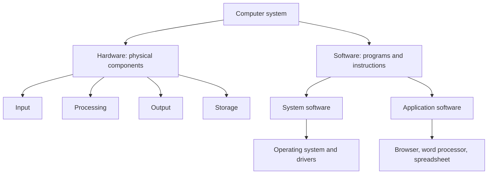

# Lesson 4 — Computer Hardware and Software

**Course:** Computer Fundamentals and Artificial Intelligence Foundation Course  
**Week:** 1 — Computer Fundamentals and Hardware  
**Duration:** 120 minutes | **Level:** Beginner

## 1. Learning outcomes
Students will be able to:
1. Explain the difference between hardware and software.
2. Identify input, output, processing, and storage hardware.
3. Distinguish system software from application software.
4. Explain the role of an operating system and device drivers.
5. Describe how hardware and software work together.

## 2. Key terms
Hardware, software, input device, output device, processing, storage, operating system, application, device driver.

## 3. Student lecture notes

### Hardware
Hardware means the physical parts of a computer that can be seen or touched. Examples include the monitor, keyboard, mouse, motherboard, CPU, RAM, SSD, and printer.

Hardware can be grouped by function:
- **Input:** Keyboard, mouse, scanner, microphone, webcam.
- **Processing:** CPU and, for specialized work, GPU.
- **Output:** Monitor, printer, speakers, projector.
- **Storage:** SSD, hard disk drive, USB flash drive, memory card.

Some devices perform more than one role. A touchscreen, for example, can display output and receive input.

### Software
Software is a set of programs and instructions that tells hardware what to do. Software cannot be physically touched like a keyboard or monitor.

Two broad categories are:
- **System software:** Helps operate and manage the computer. Examples include operating systems, drivers, and utility tools.
- **Application software:** Helps users complete tasks. Examples include word processors, spreadsheets, web browsers, presentation software, and media players.

### Operating system
An operating system (OS) manages hardware and provides a way for users and applications to work with the computer. Examples include Microsoft Windows, macOS, Linux, Android, and iOS.

### Device drivers
A driver is software that helps the operating system communicate with a hardware device. For example, a printer driver helps the computer send suitable instructions to a printer. Drivers should come from trusted, official sources.

### How hardware and software work together
When a student types a document:
1. The keyboard sends input.
2. The operating system and application receive and process the input.
3. The CPU performs instructions using data in memory.
4. The monitor displays the document.
5. The student saves the document to storage.

Hardware without useful software cannot perform most user tasks. Software also needs compatible hardware to run.

### Visual: Hardware and software work together

**Example:** When you type a document, the keyboard provides input, the operating system and word processor manage the task, the monitor displays the document, and the SSD stores the saved file.

## 4. Lesson delivery plan

**Practical-first structure:** 20 minutes of focused explanation, 90 minutes of guided student activity, and 10 minutes of review.

| Time | Instructor activity | Student activity |
|---|---|---|
| 0–20 min | Explain hardware/software, hardware functions, system software, application software, and drivers | Identify examples from the classroom |
| 20–35 min | Demonstrate the sorting method and trace a simple typing task through hardware and software | Observe and prepare the classification table |
| 35–60 min | Supervise hardware/software sorting | Sort real peripherals, component cards, and software examples |
| 60–80 min | Guide input, processing, output, and storage classification | Classify devices and explain devices with more than one role |
| 80–100 min | Demonstrate a document-creation workflow | Trace keyboard, OS, application, CPU/RAM, monitor, and storage roles |
| 100–110 min | Check answers and correct common misconceptions | Explain one system/application software example |
| 110–120 min | Review key distinctions and assign homework | Complete an exit check and record homework |

## 5. Practical activities

## 5. Practical activities

### Activity A — Hardware or software?
Classify: keyboard, Windows, monitor, browser, SSD, printer, spreadsheet app, CPU, printer driver, speakers.

### Activity B — Functional groups
Place available peripherals or picture cards into input, output, storage, or processing groups. Explain any device that has more than one role.

### Activity C — Follow a task
Describe what happens when a student opens a browser, types a web address, views a page, and saves a file. Identify the hardware and software involved.

## 6. Check for understanding
1. What is hardware?
2. What is software?
3. Give three input devices.
4. Give three output devices.
5. What is an operating system?
6. What is a device driver?
7. Is a web browser system software or application software? Explain.

## 7. Homework
1. Draw two columns titled Hardware and Software.
2. List at least ten examples in each column.
3. Explain the difference between system software and application software.
4. Write a short paragraph describing how hardware and software work together when creating a document.

## 8. Instructor notes
- Use real devices and familiar applications where possible.
- Do not describe the CPU as the only component involved in processing; GPUs and other processors also perform specialized work.
- Explain that software categories can overlap in complex systems, but the beginner distinction is useful.
- Avoid asking students to download drivers from unofficial websites.

## 9. Lesson completion checklist
- [ ] Student can distinguish hardware from software.
- [ ] Student can classify common devices by function.
- [ ] Student can explain system and application software.
- [ ] Student can describe the role of an operating system and driver.
