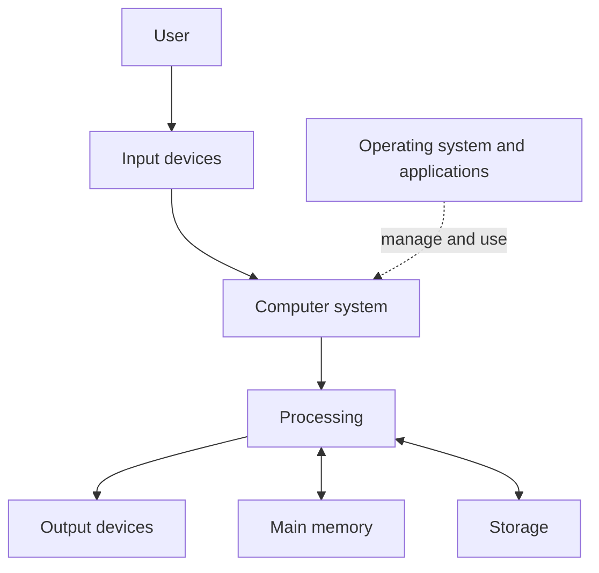
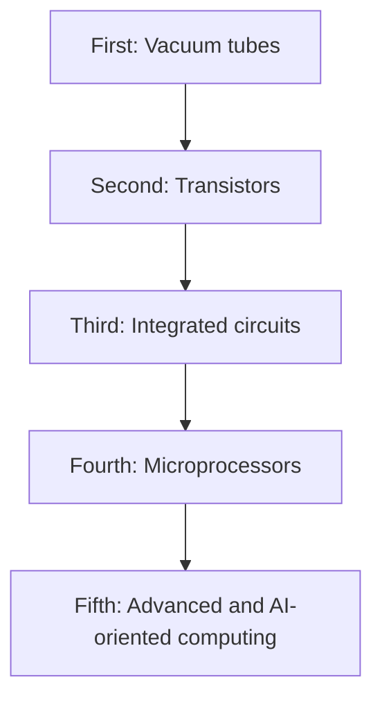
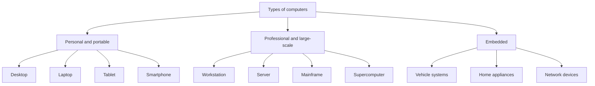
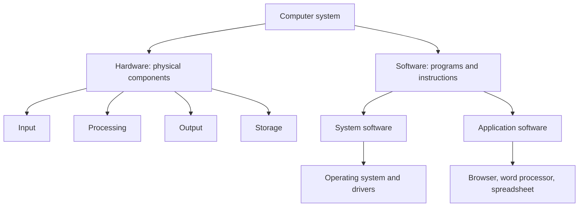
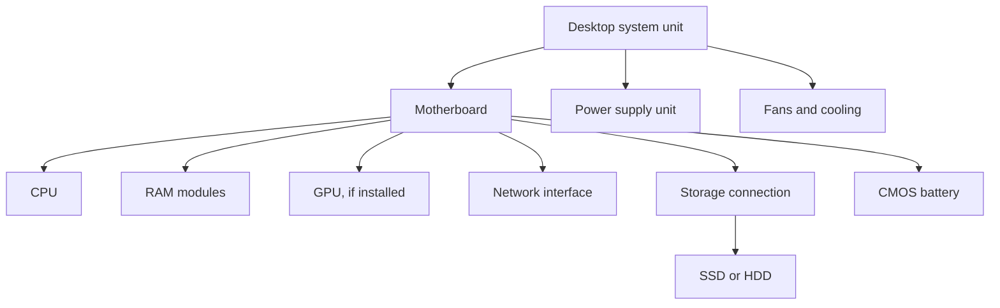
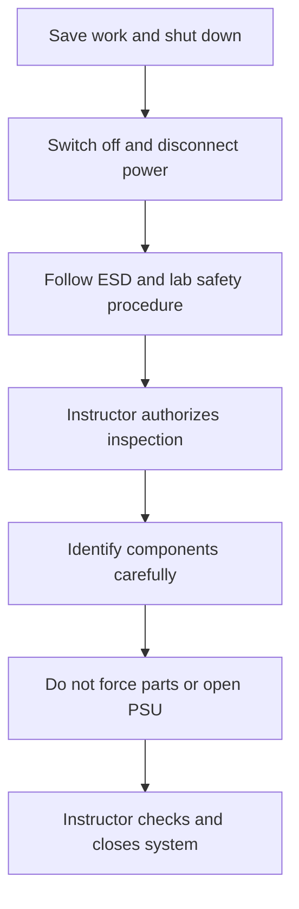

# Week 1 — Visual Learning Aids

**Course:** Computer Fundamentals and Artificial Intelligence Foundation Course

This file provides editable diagrams that GitHub can render from Mermaid code. Instructors can display them during lessons. Add high-resolution PNG/SVG exports and suitable photographs in the course visual-assets folder as they are prepared.

## Visual 1 — The IPOS cycle
Use in Lesson 1.

Teaching point: Use a student marks example. Students enter marks, a spreadsheet calculates, the result appears, and the file is saved.

## Visual 2 — A simplified computer system
Use in Lessons 1 and 4.

Teaching point: This is a learning model, not a complete electrical or motherboard architecture diagram.

## Visual 3 — Common computer generations
Use in Lesson 2.

Teaching point: This is the traditional five-generation framework. Dates and fifth-generation definitions differ among sources.

## Visual 4 — Types of computers
Use in Lesson 3.

## Visual 5 — Hardware and software
Use in Lesson 4.

## Visual 6 — Inside a desktop system unit
Use in Lesson 5. This is a conceptual map; actual component placement varies by case and motherboard.

Safety: Never open a PSU. Never work inside a powered computer. Internal inspection is only on an instructor-approved spare desktop under direct supervision.

## Visual 7 — Safe hardware inspection sequence
Use in Lesson 5.

## Screenshot and photograph plan

| Lesson | Recommended visual asset | Requirements |
|---|---|---|
| 1 | IPOS examples and early calculating-device timeline | Label each stage and identify historical devices |
| 2 | Vacuum tube, transistor, IC and microprocessor comparison | Identify each technology accurately |
| 2 | Historical computer vs modern computer | Add captions; avoid misleading scale |
| 3 | Desktop, laptop, tablet and smartphone | Label device types |
| 3 | Server, mainframe and supercomputer examples | Explain their different purposes |
| 4 | Hardware vs software comparison | Use real device photos and software screenshots |
| 5 | Motherboard overview | Labels must match the pictured board |
| 5 | CPU, RAM, SSD/HDD, PSU, GPU and fan | Use clear close-up photos |
| 5 | USB, HDMI, DisplayPort, Ethernet and audio ports | Identify connector types accurately |

## Image and screenshot quality rules
1. Every image must teach a specific concept; avoid decorative images that add no learning value.
2. Add a useful caption and meaningful alternative text.
3. Use readable labels and high contrast.
4. Use genuine screenshots from the software version used in class.
5. Hide student names, email addresses, passwords, license keys, serial numbers, and other personal information.
6. Prefer academy-created photos. Obtain permission before photographing students.
7. Check licenses and attribution requirements for third-party images. Do not copy random images from Google Images.
8. Keep image files reasonably sized and use descriptive names.
9. Review screenshots after software updates.
10. Never let a diagram simplify a safety rule in a misleading way.

## Suggested asset naming
Use lowercase descriptive names, for example:
- week-01-lesson-01-ipos-cycle.svg
- week-01-lesson-02-computer-generations.png
- week-01-lesson-03-computer-types.jpg
- week-01-lesson-04-hardware-vs-software.png
- week-01-lesson-05-motherboard-labelled.jpg

Store images under DIAGRAMS-AND-VISUAL-RESOURCES/week-01/. Keep editable Mermaid source even when exported images are also included.
