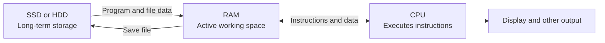

# Lesson 6 — CPU, RAM, Storage and How Computers Work

**Course:** Computer Fundamentals and Artificial Intelligence Foundation Course  
**Week:** 2 — Windows and Computer Operations  
**Duration:** 120 minutes | **Level:** Beginner

## 1. Learning outcomes

By the end of this lesson, students will be able to:
1. Explain the basic roles of the CPU, RAM, and long-term storage.
2. Describe what happens when a computer opens and uses a program.
3. Compare HDDs and SSDs at a beginner level.
4. Read common computer storage units.
5. Find basic system information in Windows without changing system settings.

## 2. Key terms

CPU, processor, core, RAM, temporary memory, storage, HDD, SSD, cache, bit, byte, kilobyte, megabyte, gigabyte, terabyte, firmware, Task Manager.

## 3. Student lecture notes

### 3.1 The three important parts

A computer uses several components together. Three especially important parts are the CPU, RAM, and storage.

- **CPU (Central Processing Unit):** Executes program instructions and performs general-purpose calculations and control tasks. It is often called the processor.
- **RAM (Random Access Memory):** Holds programs and data that the computer is actively using. RAM is fast working space. Its contents are normally lost when the computer is turned off.
- **Storage:** Keeps files and programs for long-term use, even after the computer is turned off. Common storage devices are HDDs and SSDs.

**Simple example:** Think of preparing a school assignment. The desk is like RAM because it holds the work you are using now. The filing cabinet is like storage because it keeps documents for later. The person doing the work is like the CPU.

### 3.2 How they work together

When you open a word processor:
1. The computer reads the program from storage.
2. The operating system loads the required parts into RAM.
3. The CPU executes instructions.
4. The program and operating system use RAM while you work.
5. The monitor displays the result.
6. When you save, the computer writes the file to storage.

The CPU does not permanently keep your documents. RAM is not a replacement for storage. Saving a file is important because unsaved work can be lost if power is interrupted or an application closes unexpectedly.

### Visual: A simplified working relationship

This is a simplified learning diagram. Real computers use caches, memory controllers, buses, and many other components.

### 3.3 CPU basics

The CPU executes instructions. Modern CPUs commonly contain multiple **cores**, which can work on different tasks at the same time. More cores do not automatically make every task faster; performance also depends on architecture, clock speed, cooling, memory, software, and workload.

A CPU may also include cache memory, a small and very fast memory used to keep frequently needed data close to the processor. Students do not need to configure cache; they should understand its purpose.

### 3.4 RAM basics

RAM is temporary working memory. When many programs or browser tabs are open, the computer may need more RAM. If available RAM becomes low, the computer may slow down because the operating system has to manage memory more heavily and may use storage as additional backing space.

More RAM can help with multitasking, but it does not guarantee that every computer becomes faster. The operating system, CPU, storage, and the type of work also matter.

### 3.5 HDD and SSD

| Feature | HDD | SSD |
|---|---|---|
| How it stores data | Magnetic disks that rotate | Flash memory chips |
| Moving parts | Yes | No moving disk parts |
| Typical speed | Usually slower | Usually faster |
| Sound/vibration | May make mechanical noise | Silent in normal operation |
| Common use | Large or older storage systems | Modern system and file storage |

An SSD is generally faster than a traditional HDD, especially when starting Windows or opening programs. Both are storage devices. Neither is the same as RAM.

### 3.6 Storage units

Computers store information as bits and bytes.

- **Bit (b):** A single binary digit, 0 or 1.
- **Byte (B):** Usually 8 bits.
- **KB, MB, GB, TB:** Common units used for files, memory, and storage.

In many everyday product descriptions, decimal units are used: 1 GB = 1,000 MB. Some operating-system tools and technical contexts use binary units such as GiB, where 1 GiB = 1,024 MiB. This is why a drive's displayed capacity can differ from its advertised capacity.

Do not confuse **GB** (gigabyte) with **Gb** (gigabit). Internet speeds are often measured in bits per second; file sizes are usually shown in bytes.

### 3.7 ROM and firmware — a short introduction

**Firmware** is software stored in a device to help it start or control hardware. A computer's UEFI firmware helps initialize hardware and begin the boot process. Some textbooks use the term ROM when introducing non-volatile memory. Modern firmware storage is commonly rewritable flash memory, so avoid saying all ROM can never be changed.

## 4. Find basic system information in Windows

The exact screen may differ by Windows version and device.

1. Open **Settings**.
2. Select **System**.
3. Select **About**.
4. Find the processor name, installed RAM, system type, and Windows edition.
5. Do not change any settings during this activity.

You may also open Task Manager with **Ctrl + Shift + Esc** and select **Performance** to view CPU, memory, and disk activity. If the screen looks different, ask the instructor rather than changing settings.

## 5. Lesson delivery plan

**Practical-first structure:** 20 minutes of focused explanation, 90 minutes of guided practical work, and 10 minutes of review.

| Time | Instructor activity | Student activity |
|---|---|---|
| 0–20 min | Explain CPU, RAM, storage and the desk and filing-cabinet analogy | Identify each role in a familiar example |
| 20–35 min | Demonstrate the simplified program-opening and saving process | Arrange process cards in the correct order |
| 35–55 min | Explain HDD/SSD and storage units using labelled examples | Compare drive labels and convert simple units |
| 55–75 min | Demonstrate Settings > System > About | Locate processor, RAM, system type and Windows edition |
| 75–100 min | Demonstrate Task Manager > Performance | In pairs, observe CPU, memory and disk information |
| 100–110 min | Give a short system-information recording task | Record findings without changing settings |
| 110–120 min | Review and check understanding | Complete exit questions and record homework |

## 6. Guided practical activities

### Activity A — Identify the system specifications

On an instructor-approved computer:
1. Open Settings.
2. Select System, then About.
3. Record the processor name, installed RAM, system type, and Windows edition.
4. Do not share device serial numbers or other identifying information.

| Item | Observation |
|---|---|
| Processor name | |
| Installed RAM | |
| System type (for example, 64-bit) | |
| Windows edition | |

### Activity B — Observe Task Manager

1. Press **Ctrl + Shift + Esc**.
2. Select **Performance**.
3. Observe CPU, Memory, and Disk.
4. Open one ordinary application if instructed.
5. Observe whether the graphs change.
6. Close Task Manager normally.

Do not end tasks, disable startup items, or change settings in this lesson.

### Activity C — Storage size comparison

Arrange these example file sizes from smallest to largest: 700 KB, 2 MB, 500 MB, 4 GB. Explain why a 4 GB file needs much more storage than a 700 KB file.

## 7. Check for understanding

1. What is the main job of the CPU?
2. Why is RAM called temporary working memory?
3. What is the difference between RAM and an SSD?
4. What happens when a program is opened from storage?
5. What does a CPU core do?
6. Give one difference between an HDD and an SSD.
7. What is a byte?
8. Why might the displayed capacity of a drive differ from its advertised capacity?
9. Where can you find the installed RAM in Windows?
10. Why should students avoid changing Task Manager settings during this lesson?

## 8. Homework

1. Explain CPU, RAM, and storage in your own words.
2. Draw a simple diagram showing how CPU, RAM, and storage work together.
3. Make a comparison table with at least four differences between HDD and SSD.
4. Write the correct order for opening, using, and saving a document.
5. Find the advertised storage size of one device at home, if known. Do not open the device or share private serial numbers.

## 9. Instructor notes

- Use a real computer and, if available, an old HDD and SSD as physical examples.
- Do not promise that adding RAM or an SSD will solve every performance problem.
- Explain that Task Manager readings change constantly; students should observe rather than compare computers as a competition.
- Windows screens and labels vary. Prepare a demonstration machine before class.
- Avoid asking students to install benchmarking or system-cleaning utilities.

## 10. Lesson completion checklist

- [ ] Student explains CPU, RAM, and storage.
- [ ] Student distinguishes RAM from long-term storage.
- [ ] Student compares HDD and SSD accurately.
- [ ] Student reads common storage units.
- [ ] Student finds basic system information in Windows safely.
- [ ] Student observes Task Manager without changing settings.
