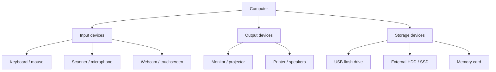

# Lesson 7 — Input, Output and Storage Devices

**Course:** Computer Fundamentals and Artificial Intelligence Foundation Course  
**Week:** 2 — Windows and Computer Operations  
**Duration:** 120 minutes | **Level:** Beginner

## 1. Learning outcomes

Students will be able to:
1. Recognize common input, output, and storage devices.
2. Explain the purpose of common ports and connections.
3. Connect basic peripherals safely with instructor guidance.
4. Use removable storage carefully and understand safe ejection.
5. Identify devices that perform more than one function.

## 2. Key terms

Peripheral, input, output, storage, USB, HDMI, DisplayPort, Ethernet, audio jack, flash drive, memory card, external drive, safe removal, touchscreen, webcam.

## 3. Student lecture notes

### 3.1 What is a peripheral?

A **peripheral** is a device connected to a computer to provide input, output, storage, or communication. Some peripherals are built into a laptop; others are connected externally.

### 3.2 Input devices

Input devices send data or instructions to a computer.

| Device | Common purpose |
|---|---|
| Keyboard | Enter text, numbers and commands |
| Mouse | Point, select, drag and click |
| Touchpad | Control the pointer on many laptops |
| Scanner | Convert paper documents or photos into digital files |
| Microphone | Capture sound |
| Webcam | Capture video or images |
| Barcode reader | Read product or inventory codes |
| Touchscreen | Accept touch input |

### 3.3 Output devices

Output devices present information from a computer.

| Device | Common purpose |
|---|---|
| Monitor | Display text, pictures and video |
| Printer | Produce paper output |
| Speakers/headphones | Play sound |
| Projector | Display a larger image for a group |
| Plotter | Produce large technical drawings or designs |

A touchscreen is both an input and output device: it displays information and detects touch.

### 3.4 Storage devices

Storage devices keep data so it can be used later.

- **USB flash drive:** Small portable flash storage.
- **External HDD/SSD:** Additional storage connected by USB or another interface.
- **Memory card:** Removable flash storage used in cameras and other devices.
- **Optical disc:** CD, DVD, or Blu-ray disc read by a compatible drive.
- **Internal HDD/SSD:** Storage installed inside a computer.

A USB port is a connection point; a USB flash drive is a storage device. They are not the same thing.

### 3.5 Common ports and connections

| Connection | Typical purpose |
|---|---|
| USB-A / USB-C | Connect peripherals and transfer data; supported power and speed vary |
| HDMI | Carry digital video and usually audio to a display |
| DisplayPort | Carry digital video and audio to a display |
| Ethernet (RJ45) | Wired network connection |
| 3.5 mm audio | Connect compatible headphones, speakers or microphones |
| Power connector | Supply electrical power to a device |

USB-C describes the connector shape, not a guarantee of one speed or every feature. A USB-C port may support different data speeds, charging, or display output depending on the computer. Check the device manual or port symbols.

### 3.6 Connect devices safely

1. Check that the connector matches the port.
2. Keep liquids away from equipment.
3. Hold the connector, not the cable, when plugging or unplugging.
4. Do not force a connector.
5. Follow instructor instructions for printers, projectors, and shared devices.
6. Use only trusted storage devices. Unknown USB devices can contain malware.

### 3.7 Safely use removable storage

Before removing a USB drive:
1. Finish copying files.
2. Close files that are open from the drive.
3. Use the Windows **Safely Remove Hardware / Eject** option when available.
4. Wait for the confirmation that it is safe to remove.
5. Remove the drive gently.

If Windows says the device is in use, close any open files or applications and try again. Do not pull the drive out while data is being copied.

### Visual: Device roles

## 4. Lesson delivery plan

**Practical-first structure:** 20 minutes of focused explanation, 90 minutes of guided practical work, and 10 minutes of review.

| Time | Instructor activity | Student activity |
|---|---|---|
| 0–20 min | Explain input, output, storage, and multi-purpose devices | Give examples from home and school |
| 20–35 min | Demonstrate common ports and safe connection handling | Match connector cards to port names |
| 35–55 min | Set up device identification stations | Identify and classify available peripherals |
| 55–75 min | Demonstrate connecting keyboard, mouse, headset and display where available | Connect approved devices under supervision |
| 75–95 min | Demonstrate USB file copy and safe ejection | Copy a practice file to a training USB and eject it safely |
| 95–110 min | Give device-role and troubleshooting scenarios | Complete the practical record and explain solutions |
| 110–120 min | Review and check understanding | Complete exit questions |

## 5. Guided practical activities

### Activity A — Peripheral identification stations

At each station, identify the device, its role, and one safe-use rule.

| Device | Input, output, storage or multiple? | Purpose | Safe-use rule |
|---|---|---|---|
| Keyboard | | | |
| Mouse | | | |
| Monitor | | | |
| Printer | | | |
| Microphone | | | |
| USB flash drive | | | |
| Touchscreen | | | |
| External drive | | | |

### Activity B — Match ports and connectors

Using an unplugged demonstration computer, port photographs, or labelled port cards:
- Identify USB-A and USB-C where present.
- Identify HDMI or DisplayPort.
- Identify Ethernet and audio.
- Match each port to a suitable cable or connector.

Never insert a connector simply to test whether it fits. Do not connect or disconnect power cables unless instructed.

### Activity C — Copy and safely eject a practice file

1. Use an instructor-provided, non-confidential practice file.
2. Connect an approved training USB drive.
3. Open File Explorer.
4. Copy the practice file to the USB drive.
5. Confirm the copied file appears.
6. Close the file and any window using the drive.
7. Use the Eject option and wait for confirmation.
8. Remove the drive carefully.

Do not use a student's private USB drive for this exercise.

## 6. Check for understanding

1. What is a peripheral?
2. Give three examples of input devices.
3. Give three examples of output devices.
4. Why is a touchscreen both input and output?
5. What is the difference between a USB port and a USB flash drive?
6. What is HDMI commonly used for?
7. What is Ethernet used for?
8. Why should you not pull out a USB drive while files are copying?
9. What should you do if a connector does not fit?
10. Why should unknown USB drives be treated carefully?

## 7. Homework

Create a table of eight devices found at home, school, or a shop. Include the device name, role, purpose, and one safe-use rule. Draw or paste a labelled picture of three different connectors if available.

## 8. Instructor notes

- Prepare a station with working and non-working demonstration devices, clearly label any faulty item as "do not use".
- Use practice files only. Never copy real student records or confidential files.
- USB-C capabilities vary; do not teach that every USB-C port supports video or fast charging.
- Printer setup may require drivers and network access; keep this lesson focused on identification and basic use.
- If no projector or printer is available, use printed photographs and explain the workflow.

## 9. Lesson completion checklist

- [ ] Student classifies input, output, and storage devices.
- [ ] Student identifies common ports.
- [ ] Student connects approved peripherals without forcing connectors.
- [ ] Student copies a practice file to removable storage.
- [ ] Student uses the safe-eject procedure.
