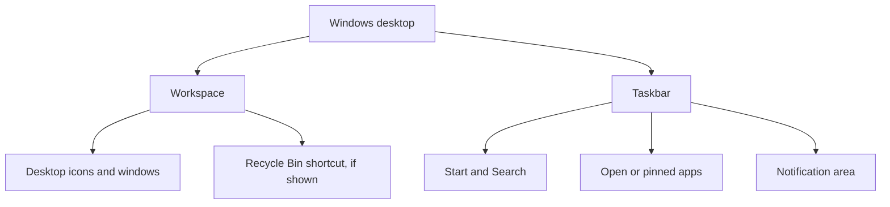

# Lesson 8 — Operating Systems and Windows Basics

**Course:** Computer Fundamentals and Artificial Intelligence Foundation Course  
**Week:** 2 — Windows and Computer Operations  
**Duration:** 120 minutes | **Level:** Beginner

## 1. Learning outcomes

Students will be able to:
1. Explain what an operating system does.
2. Recognize common operating systems.
3. Identify the main areas of the Windows desktop.
4. Open, switch between, minimize, maximize, and close application windows.
5. Use basic keyboard shortcuts and shut down a computer correctly.

## 2. Key terms

Operating system, desktop, Start menu, taskbar, notification area, window, title bar, minimize, maximize, restore, close, shortcut, sign in, sign out, lock, restart, shut down.

## 3. Student lecture notes

### 3.1 What is an operating system?

An **operating system (OS)** is the main system software that manages computer hardware and provides services for applications and users. It helps manage files, memory, devices, security, and the user interface.

Examples include:
- Microsoft Windows.
- macOS.
- Linux distributions.
- Android.
- iOS.

Different devices use different operating systems. A phone and a desktop may have different interfaces, but both need an OS to manage hardware and applications.

### 3.2 What Windows helps you do

Windows provides a graphical user interface (GUI). You can use icons, menus, windows, and a pointer to work with the computer. Windows also manages hardware, user accounts, files, applications, and security features.

### 3.3 Main parts of the Windows desktop

The exact appearance depends on the Windows version and settings.

- **Desktop:** The main workspace shown after signing in.
- **Start menu:** Helps find applications, settings, power options, and search.
- **Taskbar:** Usually shows pinned and open applications.
- **Search:** Helps find apps, files, and settings.
- **Notification area / system tray:** Shows items such as network, sound, battery, and background-app icons.
- **Recycle Bin:** Holds many deleted local files temporarily until they are restored or permanently removed.

### Visual: Simplified desktop areas

This is a concept map, not a screenshot. Your Windows screen may look different.

### 3.4 Working with application windows

A window is the on-screen area used by an application or folder.

- **Minimize:** Hide the window from the desktop while keeping the app open.
- **Maximize:** Make the window fill the available screen.
- **Restore:** Return a maximized window to a smaller size.
- **Close:** Close the window or application. Save your work first.

You can switch between open applications with **Alt + Tab**. The taskbar can also help you select an open app.

### 3.5 Useful beginner keyboard shortcuts

| Shortcut | Action |
|---|---|
| Ctrl + C | Copy selected item |
| Ctrl + V | Paste |
| Ctrl + X | Cut selected item |
| Ctrl + Z | Undo the last supported action |
| Ctrl + A | Select all in the current area |
| Alt + Tab | Switch between open apps |
| Windows key | Open Start |
| Windows + E | Open File Explorer |
| Windows + L | Lock the computer |
| Ctrl + Shift + Esc | Open Task Manager |

Shortcuts may behave differently depending on the active application.

### 3.6 Lock, sign out, restart, and shut down

- **Lock:** Protects the current session while leaving programs running.
- **Sign out:** Ends the current user session. Unsaved work may be lost.
- **Restart:** Closes Windows and starts it again. Useful after some updates or troubleshooting.
- **Shut down:** Turns the computer off through the normal Windows process.

Save your work before signing out, restarting, or shutting down. Do not switch off the power at the wall as a normal shutdown method.

## 4. Lesson delivery plan

**Practical-first structure:** 20 minutes of focused explanation, 90 minutes of guided practical work, and 10 minutes of review.

| Time | Instructor activity | Student activity |
|---|---|---|
| 0–20 min | Explain OS purpose and show examples of operating systems | Identify the OS on familiar devices |
| 20–35 min | Demonstrate Windows desktop areas and Start/Search | Locate each area on their screen |
| 35–55 min | Demonstrate opening and arranging windows | Open two approved apps and switch between them |
| 55–75 min | Teach beginner keyboard shortcuts | Practise each shortcut using a safe practice document |
| 75–95 min | Demonstrate lock, sign out, restart, and shutdown options without interrupting class machines | Identify the correct option for each scenario |
| 95–110 min | Supervise a desktop navigation challenge | Complete a sequence of navigation tasks |
| 110–120 min | Review and check understanding | Complete exit questions |

## 5. Guided practical activities

### Activity A — Desktop navigation

1. Sign in using your own assigned classroom account.
2. Identify the desktop, Start menu, taskbar, Search, and notification area.
3. Open the Start menu and find an instructor-approved application.
4. Open File Explorer using Windows + E.
5. Return to the desktop.

### Activity B — Manage application windows

1. Open Calculator.
2. Open Notepad or another instructor-approved text editor.
3. Use Alt + Tab to switch between them.
4. Minimize one window.
5. Restore it from the taskbar.
6. Maximize and restore the other window.
7. Close both applications.

Do not close another student's work or an application with unsaved data.

### Activity C — Keyboard shortcut practice

Type this sentence in a practice document: "I am learning to use Windows confidently."

1. Select the sentence using the mouse.
2. Copy and paste it.
3. Undo the paste.
4. Select all text.
5. Save the practice file only when instructed.

### Activity D — Choose the right power action

For each situation, choose Lock, Sign out, Restart, or Shut down:
- You are leaving your desk briefly but will return.
- Your class session has ended and another student will sign in.
- The instructor asks you to restart after an update.
- The computer lab is closing for the day.

## 6. Check for understanding

1. What is an operating system?
2. Name three operating systems.
3. What is the Windows desktop?
4. What is the taskbar used for?
5. What is the difference between minimize and close?
6. Which shortcut opens File Explorer?
7. Which shortcut locks the computer?
8. Why should you save work before restarting?
9. What is the difference between sign out and shut down?
10. Why should you not use the wall switch as your normal shutdown method?

## 7. Homework

1. Draw a simple Windows desktop and label at least five areas.
2. Write the purpose of eight keyboard shortcuts.
3. Explain the difference between Lock, Sign out, Restart, and Shut down.
4. Practise opening and closing two applications on an approved device.

## 8. Instructor notes

- Windows 10 and Windows 11 layouts differ. Teach the concepts and point out version-specific differences on the lab computers.
- Avoid changing personalization, account, or power settings unless required for a supervised demonstration.
- Do not ask students to reveal passwords. Use assigned accounts and the academy's account policy.
- Lock shared computers when leaving them unattended.
- Demonstrate power actions on one instructor machine or use screenshots so that the class is not interrupted.

## 9. Lesson completion checklist

- [ ] Student explains the purpose of an operating system.
- [ ] Student identifies the main Windows desktop areas.
- [ ] Student manages application windows.
- [ ] Student uses at least six keyboard shortcuts.
- [ ] Student distinguishes Lock, Sign out, Restart, and Shut down.
