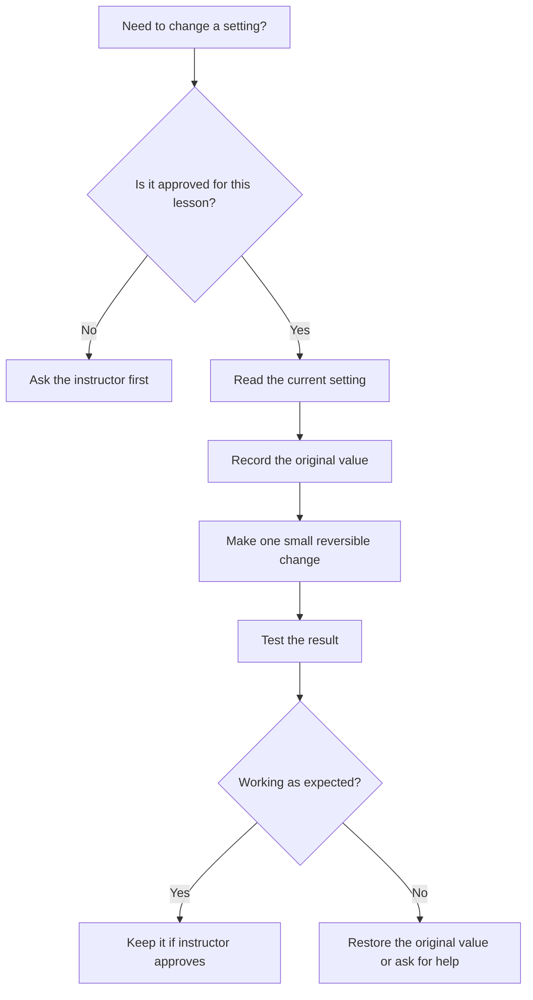

# Lesson 9 — Windows Settings and Basic System Management

**Course:** Computer Fundamentals and Artificial Intelligence Foundation Course  
**Week:** 2 — Windows and Computer Operations  
**Duration:** 120 minutes | **Level:** Beginner

## 1. Learning outcomes

Students will be able to:
1. Open Windows Settings and find common settings areas.
2. View display, sound, network, date/time, and device information.
3. Recognize the purpose of user accounts and basic account security.
4. Explain why Windows and security updates matter.
5. Make only approved, reversible personal settings changes.

## 2. Key terms

Settings, display resolution, brightness, sound output, Wi-Fi, Ethernet, user account, administrator, standard user, Windows Update, Windows Security, firewall, antivirus, privacy, permission.

## 3. Student lecture notes

### 3.1 Open Windows Settings

Windows Settings is the main place to manage many computer options. Press **Windows + I** to open it, or use Start and select Settings. The categories and labels can differ by Windows version.

### 3.2 Display settings

Display settings may include:
- Brightness on supported screens.
- Display resolution.
- Scale and text size.
- Multiple-display arrangement.
- Orientation.

Use the recommended resolution unless the instructor gives another instruction. Changing resolution can make text too small or the screen difficult to use.

### 3.3 Sound settings

Sound settings help select an output device (such as speakers or headphones) and an input device (such as a microphone). If sound does not work, first check:
1. Volume is not muted.
2. The correct output device is selected.
3. Headphones or speakers are connected properly.
4. The application is using the expected audio device.

Do not change advanced audio settings without instructor help.

### 3.4 Network settings

Windows may show Wi-Fi and Ethernet status. Wi-Fi connects wirelessly; Ethernet uses a network cable. A network icon may show whether Windows believes it is connected, but a connected icon does not guarantee that every website or service is working.

Never connect to an unknown network or share a Wi-Fi password publicly. Use the academy's approved network.

### 3.5 Date, time, and language

Correct date and time help with file timestamps, websites, security certificates, and scheduled tasks. Some computers set time automatically. Students should not change time zone or language settings on shared lab computers without permission.

### 3.6 User accounts and permissions

A user account gives a person a separate sign-in and workspace.

- **Standard user:** Suitable for everyday work; has limited permission to change important system settings.
- **Administrator:** Can make major system changes, install software, and manage accounts.

Use standard accounts for routine student activities. Do not share passwords or use another student's account. Never ask students to disclose passwords to the instructor or to AI tools.

### 3.7 Windows Update and Windows Security

Windows Update provides operating-system updates and security fixes. Updates should be installed according to the academy's lab schedule so they do not interrupt lessons.

Windows Security includes protections such as Microsoft Defender Antivirus and firewall features, depending on the system and configuration. Keep security protections enabled. Do not disable antivirus or firewall to make a program run.

### 3.8 Privacy and permissions

Applications may request access to the camera, microphone, location, contacts, or files. Give only permissions needed for a legitimate task. On shared computers, avoid storing personal information and sign out when finished.

### Visual: Safe settings decision process

## 4. Lesson delivery plan

**Practical-first structure:** 20 minutes of focused explanation, 90 minutes of guided practical work, and 10 minutes of review.

| Time | Instructor activity | Student activity |
|---|---|---|
| 0–20 min | Explain Settings, accounts, updates, and security | Identify safe and unsafe changes |
| 20–35 min | Demonstrate Windows + I and locate key categories | Find each category without changing settings |
| 35–55 min | Demonstrate display and sound settings | View current display and sound options |
| 55–75 min | Demonstrate Wi-Fi/Ethernet status and date/time | Observe connection status and current time settings |
| 75–95 min | Explain standard/admin accounts and Windows Security | Identify security status without disabling protection |
| 95–110 min | Supervise a reversible settings task approved for the lab | Make one approved change and restore it if needed |
| 110–120 min | Review and check understanding | Complete exit questions |

## 5. Guided practical activities

### Activity A — Find common settings

1. Press Windows + I.
2. Find System and locate Display and Sound.
3. Find Network & Internet.
4. Find Time & Language.
5. Find Accounts.
6. Find Windows Update.
7. Find Privacy & Security or the equivalent section.
8. Do not change anything unless the instructor authorizes it.

### Activity B — Observe display and sound

Record the current display resolution and the selected sound output device if visible. Do not change resolution on a shared machine unless the instructor approves.

| Item | Current observation |
|---|---|
| Display resolution | |
| Brightness control available? | |
| Selected sound output | |
| Microphone/input device | |

### Activity C — Security awareness

1. Open Windows Security from Start or Settings.
2. Observe the protection status shown.
3. Identify where virus/threat protection and firewall information can be found.
4. Do not disable, pause, or change any security protection.
5. Tell the instructor if Windows reports a warning.

### Activity D — One approved reversible change

The instructor may choose a safe change, such as adjusting brightness on a laptop or changing volume. Record the original value, make the change, test it, and restore it. Skip this activity if the computer is shared in a way that makes a change disruptive.

## 6. Check for understanding

1. Which shortcut opens Windows Settings?
2. Why should you use the recommended display resolution?
3. What is the difference between Wi-Fi and Ethernet?
4. Why is correct date and time important?
5. What is the difference between a standard user and an administrator?
6. Why should students not share passwords?
7. What is the purpose of Windows Update?
8. Why should antivirus and firewall protections remain enabled?
9. What should you do when an application requests unnecessary permission?
10. What is the safest way to test a settings change?

## 7. Homework

1. Write the steps to open Windows Settings.
2. List five settings categories and explain what each controls.
3. Explain standard user vs administrator.
4. Write five good computer-account security habits.
5. Describe why updates and security protection matter.

## 8. Instructor notes

- Use a demonstration account with no student personal data.
- Prepare a known-good machine and check for pending updates before class.
- Do not reveal or collect passwords. Follow academy account management procedures.
- Do not disable Defender, firewall, updates, or User Account Control for teaching convenience.
- Keep changes reversible and restore shared computers to their approved state after class.
- Settings may be controlled by school policies or unavailable on some editions.

## 9. Lesson completion checklist

- [ ] Student opens Settings and locates common categories.
- [ ] Student can identify display, sound, and network settings.
- [ ] Student explains standard vs administrator accounts.
- [ ] Student explains the purpose of updates and Windows Security.
- [ ] Student follows the approval process before changing settings.
