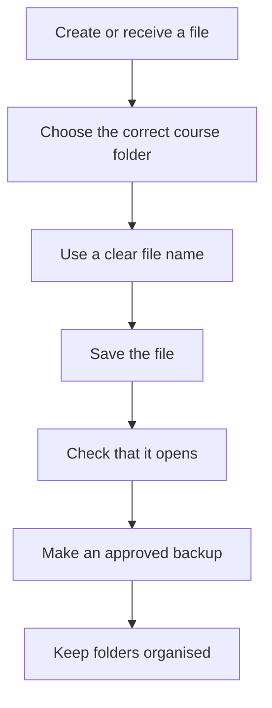

# Lesson 10 — File Explorer, Files and Folders

**Course:** Computer Fundamentals and Artificial Intelligence Foundation Course  
**Week:** 2 — Windows and Computer Operations  
**Duration:** 120 minutes | **Level:** Beginner

## 1. Learning outcomes

Students will be able to:
1. Use File Explorer to navigate drives, folders, and files.
2. Create a clear folder structure for course work.
3. Rename, copy, move, and delete practice files safely.
4. Recognize common file extensions.
5. Create and extract a ZIP archive.
6. Use Recycle Bin and removable storage carefully.
7. Explain why backups are important.

## 2. Key terms

File, folder, File Explorer, drive, path, file extension, rename, copy, move, delete, Recycle Bin, ZIP, extract, backup, cloud storage, USB drive.

## 3. Student lecture notes

### 3.1 Files and folders

A **file** stores information, such as a document, picture, video, or spreadsheet. A **folder** helps organize files and other folders. A folder can contain many files and subfolders.

A **drive** is a storage location shown in Windows. It may be an internal drive, removable USB drive, or a mapped network location.

### 3.2 Open File Explorer

Use **Windows + E** or select File Explorer from the taskbar or Start menu.

Common areas include:
- **Home / Quick access:** Shortcuts to frequently used or recent locations (names vary by version).
- **This PC:** Shows available drives and common folders.
- **Navigation pane:** Helps move between locations.
- **Address bar:** Shows the current folder path.
- **Search box:** Searches the current location or a selected scope.
- **File list:** Shows files and folders in the current location.

### 3.3 Create a useful folder structure

A clear folder structure makes work easier to find and back up.

Example:

```text
Documents
└── Next Generation Academy
    └── Foundation Course
        ├── Week 01
        ├── Week 02
        ├── Week 03
        ├── Word Assignments
        └── Final Project
```

Use short, meaningful folder names. Avoid confusing names such as "new folder 2 final final". Do not save important work only on the desktop or only on a USB drive.

### 3.4 File names and extensions

A file name usually has a name and an extension separated by a dot.

Examples:
- `computer-notes.docx` — Word document.
- `marks.xlsx` — Excel workbook.
- `presentation.pptx` — PowerPoint presentation.
- `photo.jpg` — image.
- `lesson.pdf` — PDF document.
- `video.mp4` — video.
- `website.html` — web page.
- `archive.zip` — compressed archive.

The extension helps Windows and applications identify a file type. Renaming the extension does not convert the file format. For example, changing `.jpg` to `.pdf` does not turn a picture into a real PDF.

### 3.5 Copy, move, rename, and delete

- **Copy:** Creates another copy while keeping the original.
- **Move:** Changes the file's location.
- **Rename:** Changes the file or folder name.
- **Delete:** Usually moves a local file to the Recycle Bin, depending on location and method.

Useful shortcuts:
- Ctrl + C — Copy.
- Ctrl + X — Cut.
- Ctrl + V — Paste.
- F2 — Rename a selected item.
- Delete — Delete selected item.
- Ctrl + Z — Undo some recent actions.

Be careful with Shift + Delete, which can bypass the Recycle Bin. Do not use it in beginner practice.

### 3.6 Recycle Bin

The Recycle Bin can help restore files deleted from supported local locations. It is not a backup. Files deleted from removable drives, network locations, or with permanent-delete methods may not appear there. Emptying the Recycle Bin removes its contents from normal restoration.

### 3.7 ZIP files

A ZIP archive combines files and folders into a compressed package. Compression may reduce file size, but the amount depends on the content. Already compressed images and videos may not become much smaller.

To create a ZIP in Windows:
1. Select the practice files or folder.
2. Right-click.
3. Choose the compress-to-ZIP option available in your Windows version.
4. Give the ZIP file a clear name.

To extract:
1. Right-click the ZIP file.
2. Select Extract All or the equivalent option.
3. Choose a suitable destination.
4. Open the extracted folder and check the contents.

Do not open unexpected ZIP attachments from unknown senders. Archives can contain harmful files.

### 3.8 Backups and cloud storage

A backup is an additional copy of important files kept separately so they can be recovered after loss, damage, or accidental deletion. Keep more than one copy of important work where possible. A USB drive can be lost or damaged, so it should not be the only copy.

Cloud storage keeps files on an online service. Use only academy-approved services and accounts. Do not upload private student information or sensitive documents without authorization.

### Visual: Organising a file safely



## 4. Lesson delivery plan

**Practical-first structure:** 20 minutes of focused explanation, 90 minutes of guided practical work, and 10 minutes of review.

| Time | Instructor activity | Student activity |
|---|---|---|
| 0–20 min | Explain files, folders, drives, paths and file extensions | Identify familiar file types |
| 20–35 min | Demonstrate File Explorer areas and folder navigation | Locate Documents and This PC |
| 35–55 min | Demonstrate creating a course folder structure | Create the assigned folders |
| 55–75 min | Demonstrate copy, move, rename and delete using practice files | Complete file-management tasks |
| 75–90 min | Demonstrate Recycle Bin and restore | Restore a deliberately deleted practice file |
| 90–105 min | Demonstrate ZIP creation and extraction | Create and extract a ZIP archive |
| 105–110 min | Explain backup habits and safe USB handling | Identify a safe backup plan |
| 110–120 min | Review and check understanding | Complete exit questions |

## 5. Guided practical activities

### Activity A — Create your course folders

1. Open File Explorer.
2. Open Documents.
3. Create a folder named `Next Generation Academy`.
4. Inside it, create `Foundation Course`.
5. Inside that folder, create `Week 01`, `Week 02`, `Assignments`, and `Final Project`.
6. Check the folder structure before continuing.

### Activity B — File-management practice

The instructor provides sample files. Complete these tasks:
1. Copy one file into Week 02.
2. Rename it using a clear name.
3. Move a second file into Assignments.
4. Delete a designated practice copy.
5. Restore the practice copy from Recycle Bin.

Do not practise deletion on real student work.

### Activity C — Recognize file extensions

| File name | Likely file type | Application or use |
|---|---|---|
| `report.docx` | | |
| `marks.xlsx` | | |
| `slides.pptx` | | |
| `image.jpg` | | |
| `notes.pdf` | | |
| `clip.mp4` | | |
| `page.html` | | |
| `backup.zip` | | |

### Activity D — Create and extract a ZIP

1. Select the instructor's sample folder.
2. Create a ZIP archive.
3. Open the ZIP to inspect its contents.
4. Extract it to a new folder.
5. Compare the extracted folder with the original.

### Activity E — Make a backup plan

Write where you will keep:
- Your main course folder.
- A second copy of important assignments.
- Any files that should not be uploaded to a public or shared location.

## 6. Check for understanding

1. What is the difference between a file and a folder?
2. What does File Explorer help you do?
3. What is a file extension?
4. Does changing a file extension convert the file? Explain.
5. What is the difference between copy and move?
6. What does the Recycle Bin do?
7. Why is the Recycle Bin not a complete backup?
8. What is a ZIP archive?
9. What should you do before removing a USB drive?
10. Why should important files have a separate backup?

## 7. Homework

Create a neat folder structure for your course work on an approved computer. Write down:
1. The folder names you created.
2. Five file extensions and their meanings.
3. The steps to copy, rename, and restore a practice file.
4. The steps to create and extract a ZIP archive.
5. A simple backup plan for your course assignments.

## 8. Instructor notes

- Prepare sample files that contain no personal or confidential data.
- Confirm each student has permission to save in the selected location.
- Demonstrate carefully before students practise delete and restore.
- Do not use Shift + Delete in beginner exercises.
- Windows context-menu wording differs across versions.
- Do not assume all files deleted from USB or network drives can be restored from Recycle Bin.
- Explain that syncing is not always the same as a separate backup; accidental deletion may sync too.

## 9. Lesson completion checklist

- [ ] Student opens and navigates File Explorer.
- [ ] Student creates the required folder structure.
- [ ] Student copies, moves, renames and restores a practice file.
- [ ] Student recognizes common file extensions.
- [ ] Student creates and extracts a ZIP archive.
- [ ] Student explains a safe backup plan.
