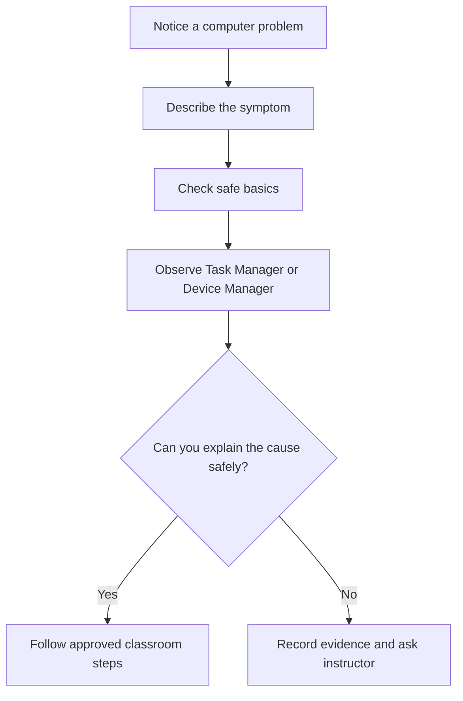

# Lesson 11 — Task Manager, Device Manager and Drivers

**Course:** Computer Fundamentals and Artificial Intelligence Foundation Course  
**Academy:** Next Generation Academy  
**Week:** 3 — Windows Management, Installation, Internet and Networking  
**Duration:** 120 minutes  
**Level:** Beginner | **Teaching balance:** approximately 20 minutes theory, 90 minutes practical, 10 minutes review

## Lesson purpose
Diagnose common performance and hardware-status questions without making risky system changes.

## Learning outcomes
- Open Task Manager and identify CPU, memory, disk, network and process information.
- Explain the difference between an application, a process, a service and a startup app at beginner level.
- Open Device Manager and interpret common device-status indicators.
- Explain what a driver does and use approved, safe update methods.
- Record observations and decide when to ask an instructor or technician for help.

## Key terms
Task Manager; process; performance; CPU; memory; disk; network; startup app; Device Manager; device driver; hardware; warning icon; Windows Update.

## Student lecture notes

## 1. Task Manager

Task Manager is a Windows tool that shows what the computer is doing. Open it with **Ctrl + Shift + Esc**, or right-click the taskbar and choose Task Manager (the wording can differ by Windows version).

The **Processes** view lists running apps and background processes. The **Performance** view shows graphs for CPU, memory, disk, Wi-Fi or Ethernet, and sometimes GPU. The **Startup apps** view helps you see which apps are configured to start when you sign in.

A high percentage is not automatically a fault. A computer may use more CPU while installing updates or opening a large file. Look at the computer's behaviour, the process name, and whether the activity continues. Do not end an unfamiliar process just because its number is high.

**Safe rule:** close an app normally first. Do not end Windows system processes, security tools, or unfamiliar processes during practice. Ask the instructor before changing startup settings.

## 2. Processes, apps and services

An app is a program a person uses. A process is a running instance of a program or part of one. Windows also runs background services that support system functions. Students do not need to manage services in this course.

## 3. Device Manager

Device Manager lists hardware Windows can detect, such as display adapters, network adapters, keyboards, sound devices and storage controllers. Expand a category to inspect its devices. A down-arrow may mean a device is disabled. A yellow warning symbol can indicate a problem, but it does not explain every cause by itself.

Open it by right-clicking Start and selecting **Device Manager**, or search for it from Start. Do not uninstall devices or change advanced properties during this lesson.

## 4. Drivers

A device driver is software that helps Windows communicate with hardware. A printer, graphics adapter, audio device and Wi-Fi adapter may each need an appropriate driver. Windows Update and the computer manufacturer's official support page are safer sources than random driver-download websites.

Before an update, identify the exact computer model and device. Follow academy policy and instructor direction. Never install a driver from an unknown website or a pop-up.

## 5. A simple troubleshooting method

1. Describe the symptom in plain language.
2. Check simple causes: power, cable, volume, Wi-Fi switch or restart requirement.
3. Observe Task Manager or Device Manager without changing settings.
4. Record the message or warning exactly.
5. Ask the instructor before installing, disabling or removing anything.

## Instructor preparation
- Read these notes and test the demonstration before class.
- Prepare a projector/board, student workbook, and one instructor-controlled computer.
- Check that student accounts and lab devices are ready; do not expose personal or network credentials.
- For system-management activities, use academy-approved computers with standard student permissions.
- For installation/partition demonstrations, use only a disposable virtual machine or dedicated spare training PC.

## 120-minute lesson plan

| Time | Teaching activity | Method |
|---|---|---|
| 0–10 min | Welcome, prior-knowledge check and lesson outcomes | Questions and discussion |
| 10–20 min | Explain key ideas and vocabulary | Short explanation and diagram |
| 20–35 min | Instructor demonstration | Projected step-by-step demonstration |
| 35–75 min | Guided practical activity | Instructor models; students follow |
| 75–100 min | Independent or paired task | Student practice and evidence |
| 100–110 min | Review common errors and safety | Demonstration and discussion |
| 110–120 min | Exit quiz, reflection and homework | Individual check |

## Instructor demonstration
Demonstrate opening Task Manager, switching between Processes and Performance, and finding a network adapter in Device Manager. Explain one normal high-usage example and one warning icon without changing anything.

## Practical exercises
1. Open Task Manager using the keyboard shortcut.
2. Identify the CPU, Memory, Disk and Network areas in Performance. Record one observation; do not aim to make every value low.
3. In Processes, identify two familiar apps. Do not select End task.
4. Open Device Manager and expand Display adapters, Network adapters and Keyboards. Record the visible device names.
5. If a device shows a warning symbol, record its name and status. Do not uninstall or update it.
6. Write a three-sentence troubleshooting report using symptom, observation and safe next step.

## Understanding checks
1. What keyboard shortcut opens Task Manager?
2. Name four areas shown in the Performance view.
3. What is a process?
4. Does high CPU use always mean a computer is broken? Explain.
5. What does a device driver do?

## Homework
Create a one-page system observation sheet: Windows version (if known), CPU, memory and disk observations, two device categories, and one paragraph explaining why unknown driver websites are risky.

## Student completion checklist
- [ ] I can explain the main terms in simple English.
- [ ] I completed the practical task using the approved safe procedure.
- [ ] I recorded observations or produced the requested evidence.
- [ ] I can explain one safety or privacy rule from this lesson.
- [ ] I completed the exit quiz and understand what I need to practise.

## Instructor notes and differentiation
- Ask students to explain each step before they click or change a setting.
- Pair confident students with beginners, but require each learner to perform the key task.
- Offer a printed sequence/checklist to students who need extra support.
- Extend confident learners with a written troubleshooting scenario, not unsupervised system changes.
- Record misconceptions and revisit them at the start of the next lesson.

## Instructor-only quick answer guide
1. Ctrl + Shift + Esc.
2. CPU, Memory, Disk, Network (GPU may also appear).
3. A running instance of a program or part of one.
4. No; updates or demanding tasks can temporarily use CPU.
5. It helps Windows communicate with a hardware device.
6. Windows Update or the computer manufacturer's official support site, following instructor policy.
7. A device or driver may have a problem; inspect details with supervision.
8. It may stop important system or security functions.
9. Symptom, observations/evidence, actions already taken and safe next step.
10. Do not download it; close/report it and ask the instructor.

> **Assessment note:** The answer guide is for instructor use. Use the separate Week 3 instructor answer-key file for consolidated marking and the full quiz bank.
