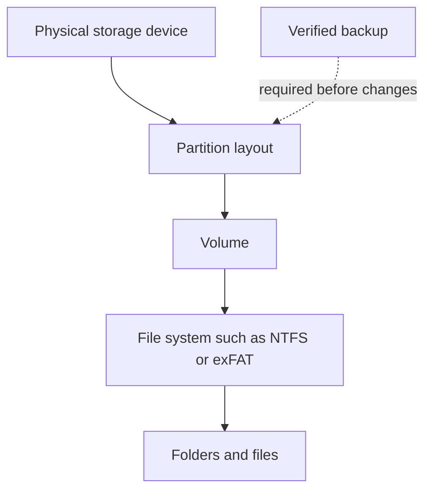

# Lesson 12 — Disk Management, Partitions and File Systems

**Course:** Computer Fundamentals and Artificial Intelligence Foundation Course  
**Academy:** Next Generation Academy  
**Week:** 3 — Windows Management, Installation, Internet and Networking  
**Duration:** 120 minutes  
**Level:** Beginner | **Teaching balance:** approximately 20 minutes theory, 90 minutes practical, 10 minutes review

## Lesson purpose
Understand storage layout and file systems while treating every destructive storage operation as high risk.

## Learning outcomes
- Distinguish a physical storage device, partition, volume and drive letter.
- Open Disk Management and identify disks, partitions and volumes without changing them.
- Explain NTFS, FAT32 and exFAT at a basic level.
- Describe MBR and GPT as partition styles.
- Explain why backup and verification must happen before formatting or partition changes.

## Key terms
physical disk; partition; volume; drive letter; Disk Management; file system; NTFS; FAT32; exFAT; MBR; GPT; format; backup; data loss.

## Student lecture notes

## 1. Physical disk, partition and volume

A **physical disk** is a storage device such as an HDD or SSD. A **partition** is a defined section of that disk. A **volume** is a usable storage area that Windows can format with a file system and assign a drive letter to. In everyday use, people often call a volume a drive, such as C: or D:.

A computer may have one physical SSD divided into more than one partition, or several physical drives. A drive letter does not always mean a separate physical disk.

## 2. Disk Management

Disk Management is a Windows utility for viewing and managing disks, partitions and volumes. Search for **Create and format hard disk partitions** or right-click Start and choose Disk Management.

For this lesson, use **view-only observation**. Identify Disk 0, any additional disk, volume labels, drive letters, capacity and file system. The screen may differ between computers.

**Do not click** Delete Volume, Format, Shrink, Extend, Initialize or Convert during the student observation activity.

## 3. File systems

A file system organizes how files and folders are stored.

- **NTFS** is commonly used for Windows system and internal drives. It supports Windows permissions and large files.
- **FAT32** is widely compatible with many devices, but an individual file cannot be larger than 4 GB.
- **exFAT** is often useful for removable drives shared across modern operating systems and supports files larger than FAT32's limit.

Compatibility depends on the device and operating system. Always check the destination device's requirements before formatting.

## 4. MBR and GPT

MBR and GPT are partition styles. GPT is the modern standard for most UEFI-based computers and supports large disks and many partitions. MBR is older and has limitations. Do not convert a disk as a classroom experiment; conversion can make data inaccessible or require repartitioning.

## 5. Backups and formatting

Formatting prepares a volume with a file system and can erase access to existing files. Deleting a partition can remove access to its data and may affect Windows startup. A backup is a separate, verified copy of important data, not merely a second folder on the same drive.

Before any real storage change, a qualified person must confirm the target disk, backup completeness, recovery plan, power stability and user permission.

## Instructor preparation
- Read these notes and test the demonstration before class.
- Prepare a projector/board, student workbook, and one instructor-controlled computer.
- Check that student accounts and lab devices are ready; do not expose personal or network credentials.
- For system-management activities, use academy-approved computers with standard student permissions.
- For installation/partition demonstrations, use only a disposable virtual machine or dedicated spare training PC.

## 120-minute lesson plan

| Time | Teaching activity | Method |
|---|---|---|
| 0–10 min | Welcome, prior-knowledge check and lesson outcomes | Questions and discussion |
| 10–20 min | Explain key ideas and vocabulary | Short explanation and diagram |
| 20–35 min | Instructor demonstration | Projected step-by-step demonstration |
| 35–75 min | Guided practical activity | Instructor models; students follow |
| 75–100 min | Independent or paired task | Student practice and evidence |
| 100–110 min | Review common errors and safety | Demonstration and discussion |
| 110–120 min | Exit quiz, reflection and homework | Individual check |

## Instructor demonstration
Show Disk Management on an instructor-controlled training PC or screenshot. Point out disk number, capacity, partitions, volume labels, drive letters and file-system column. Keep the demonstration read-only.

## Practical exercises
1. Open Disk Management on an instructor-approved machine.
2. Record the number of disks shown and their displayed capacities.
3. For each visible volume, record its label, drive letter, file system and approximate capacity where shown.
4. Explain why C: and D: could be partitions on one physical disk.
5. Match NTFS, FAT32 and exFAT to the simple use cases in the workbook.
6. Complete the storage safety checklist. Do not initialize, format, resize, delete or convert any disk.

## Understanding checks
1. What is a physical disk?
2. What is a partition?
3. Does a drive letter always represent a separate physical disk?
4. Which file system is commonly used for Windows internal drives?
5. What is the FAT32 individual-file size limit?

## Homework
Draw a labelled storage diagram showing one physical SSD divided into two partitions/volumes. Write three differences between NTFS, FAT32 and exFAT, and explain what makes a backup trustworthy.

## Student completion checklist
- [ ] I can explain the main terms in simple English.
- [ ] I completed the practical task using the approved safe procedure.
- [ ] I recorded observations or produced the requested evidence.
- [ ] I can explain one safety or privacy rule from this lesson.
- [ ] I completed the exit quiz and understand what I need to practise.

## Instructor notes and differentiation
- Ask students to explain each step before they click or change a setting.
- Pair confident students with beginners, but require each learner to perform the key task.
- Offer a printed sequence/checklist to students who need extra support.
- Extend confident learners with a written troubleshooting scenario, not unsupervised system changes.
- Record misconceptions and revisit them at the start of the next lesson.

## Instructor-only quick answer guide
1. A physical storage device such as an HDD or SSD.
2. A defined section of a physical disk.
3. No.
4. NTFS.
5. 4 GB maximum for an individual file.
6. It supports large files and broad modern-device compatibility.
7. Partition styles.
8. It can erase access to existing files / cause data loss.
9. It is not a separate copy if the same disk fails or is damaged.
10. Confirm correct target, verified backup, recovery plan, permission, power and qualified supervision (any three).

> **Assessment note:** The answer guide is for instructor use. Use the separate Week 3 instructor answer-key file for consolidated marking and the full quiz bank.
