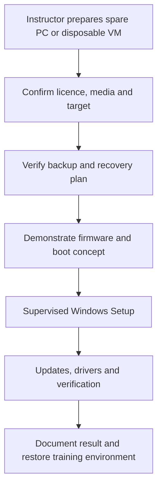

# Lesson 13 — Windows Installation and BIOS/UEFI

**Course:** Computer Fundamentals and Artificial Intelligence Foundation Course  
**Academy:** Next Generation Academy  
**Week:** 3 — Windows Management, Installation, Internet and Networking  
**Duration:** 120 minutes  
**Level:** Beginner | **Teaching balance:** approximately 20 minutes theory, 90 minutes practical, 10 minutes review

## Lesson purpose
Understand the installation process and practise only in a controlled training environment.

## Learning outcomes
- Explain BIOS/UEFI, firmware setup and the boot sequence.
- Distinguish upgrade, reset and clean installation at a basic level.
- Identify official Windows installation media and licensing considerations.
- Describe the major Windows Setup stages.
- Follow a strict safety checklist and identify actions that must never be performed on a personal device without authorization.

## Key terms
firmware; BIOS; UEFI; boot; boot order; USB installer; Windows Setup; upgrade; clean installation; partition; activation; licence; backup; virtual machine.

## Student lecture notes

## 1. BIOS and UEFI

BIOS and UEFI are firmware interfaces that help a computer start and prepare hardware before Windows loads. UEFI is the modern successor to traditional BIOS. The firmware checks hardware and starts a boot device according to its boot configuration.

The key is to understand the purpose, not to change settings unnecessarily. The key used to enter setup varies by manufacturer (often a function key or Delete). Follow the device manual or instructor instructions.

## 2. Installation choices

- **Upgrade:** installs a newer Windows version while aiming to keep supported files, settings and apps.
- **Reset:** reinstalls Windows using Windows recovery options; the selected option determines what is kept or removed.
- **Clean installation:** installs Windows as a fresh system and may remove existing partitions, apps and files.

These options are not interchangeable. Students must never choose an option on a real computer without clear owner permission, a verified backup and instructor supervision.

## 3. Official installation media

Use Microsoft's official Windows download and installation-media guidance. Avoid modified ISO files, unofficial activators and third-party installer bundles. Windows installation and activation are separate: installation does not automatically grant a licence. Use a valid licence appropriate to the device and organization.

## 4. Typical Windows Setup stages

1. Start the training PC or virtual machine from approved installation media.
2. Select language, time and keyboard settings.
3. Start Setup and review the installation choice.
4. Select the intended installation location only after instructor confirmation.
5. Allow file copying and restart stages to complete.
6. Complete first-run setup using academy-approved account and privacy procedures.
7. Install approved updates and required drivers.
8. Verify activation/licensing status and basic hardware operation.

Screens and labels vary by Windows edition and release. This course teaches the concepts; the instructor should use a spare training computer or a disposable virtual machine.

## 5. Non-negotiable safety rules

- Never practise installation on a student's everyday laptop or academy production computer.
- Back up important data to a separate location and verify that files open.
- Confirm the exact target device and disk before starting.
- Keep the device connected to reliable power.
- Do not delete, format or create partitions unless the instructor is controlling the demonstration and has confirmed the training target.
- Do not bypass licensing, security controls or organizational management.
- Stop if the screen differs from the instructor's approved procedure.

## Instructor preparation
- Read these notes and test the demonstration before class.
- Prepare a projector/board, student workbook, and one instructor-controlled computer.
- Check that student accounts and lab devices are ready; do not expose personal or network credentials.
- For system-management activities, use academy-approved computers with standard student permissions.
- For installation/partition demonstrations, use only a disposable virtual machine or dedicated spare training PC.

## 120-minute lesson plan

| Time | Teaching activity | Method |
|---|---|---|
| 0–10 min | Welcome, prior-knowledge check and lesson outcomes | Questions and discussion |
| 10–20 min | Explain key ideas and vocabulary | Short explanation and diagram |
| 20–35 min | Instructor demonstration | Projected step-by-step demonstration |
| 35–75 min | Guided practical activity | Instructor models; students follow |
| 75–100 min | Independent or paired task | Student practice and evidence |
| 100–110 min | Review common errors and safety | Demonstration and discussion |
| 110–120 min | Exit quiz, reflection and homework | Individual check |

## Instructor demonstration
Use a disposable VM or dedicated spare training computer. First show a non-destructive firmware/boot overview. Then demonstrate Setup screens only on the approved target. Narrate each decision and pause before any disk/partition choice. Do not use a student's personal device.

## Practical exercises
1. On paper, arrange the installation stages in the correct order.
2. Identify the official Microsoft download page supplied by the instructor; check the domain carefully.
3. Observe a firmware/UEFI screen or instructor screenshot. Record the boot-device concept; do not change settings.
4. In a disposable VM or designated spare machine, follow the instructor's demonstration. Students may perform only the steps explicitly assigned.
5. Before any disk screen, point to the target disk and ask the instructor to confirm it. Do not click destructive options independently.
6. Complete the installation safety checklist and write one reason each for backup, licensing and stable power.

## Understanding checks
1. What is firmware?
2. What is UEFI used for during startup?
3. What is the difference between an upgrade and a clean installation?
4. Does Reset always keep every file and app?
5. Where should installation media be obtained?

## Homework
Create a one-page Windows installation safety poster. Include the difference between upgrade and clean installation, five safety checks, and why unofficial activators and modified installers are unsafe.

## Student completion checklist
- [ ] I can explain the main terms in simple English.
- [ ] I completed the practical task using the approved safe procedure.
- [ ] I recorded observations or produced the requested evidence.
- [ ] I can explain one safety or privacy rule from this lesson.
- [ ] I completed the exit quiz and understand what I need to practise.

## Instructor notes and differentiation
- Ask students to explain each step before they click or change a setting.
- Pair confident students with beginners, but require each learner to perform the key task.
- Offer a printed sequence/checklist to students who need extra support.
- Extend confident learners with a written troubleshooting scenario, not unsupervised system changes.
- Record misconceptions and revisit them at the start of the next lesson.

## Instructor-only quick answer guide
1. Low-level software built into a device that helps initialize and control hardware.
2. It initializes hardware and helps start the selected boot device/operating system.
3. An upgrade aims to retain supported items; clean installation starts fresh and can remove data/apps.
4. No; the selected reset option determines what is kept or removed.
5. Microsoft's official website / approved official source.
6. No; valid licensing/activation requirements still apply.
7. To avoid erasing the wrong disk or data.
8. A disposable virtual machine or dedicated spare training computer under supervision.
9. Verified backup, permission, correct target confirmation and instructor control.
10. Stop and ask the instructor; do not guess or click ahead.

> **Assessment note:** The answer guide is for instructor use. Use the separate Week 3 instructor answer-key file for consolidated marking and the full quiz bank.
