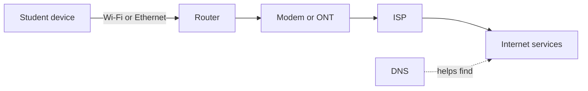

# Lesson 14 — Internet and Computer Networks

**Course:** Computer Fundamentals and Artificial Intelligence Foundation Course  
**Academy:** Next Generation Academy  
**Week:** 3 — Windows Management, Installation, Internet and Networking  
**Duration:** 120 minutes  
**Level:** Beginner | **Teaching balance:** approximately 20 minutes theory, 90 minutes practical, 10 minutes review

## Lesson purpose
Explain how devices connect and practise safe, basic network diagnosis.

## Learning outcomes
- Distinguish a network, LAN, WAN and the internet.
- Explain the roles of router, modem/ONT and Internet Service Provider.
- Distinguish Wi-Fi from internet access and Ethernet from Wi-Fi.
- Recognize IP address, DNS, bandwidth and latency at an introductory level.
- Use a safe troubleshooting sequence and report network observations.

## Key terms
network; LAN; WAN; internet; router; modem; ONT; ISP; Ethernet; Wi-Fi; IP address; DNS; bandwidth; latency; hotspot.

## Student lecture notes

## 1. What is a computer network?

A network connects devices so they can communicate and share resources. A **LAN** (Local Area Network) covers a limited place such as a home, office or academy. A **WAN** (Wide Area Network) connects networks across larger distances. The internet is a global network of interconnected networks.

## 2. How a home or academy connection works

An **ISP** (Internet Service Provider) supplies internet service. A modem or optical network terminal (ONT) connects the premises to the provider's service. A **router** directs traffic between the local network and other networks and often provides Wi-Fi. Some devices combine modem/ONT and router functions.

A Wi-Fi connection means your device has joined a wireless local network. It does not guarantee that the network has working internet access.

## 3. Ethernet and Wi-Fi

Ethernet uses a network cable and is often stable for fixed computers. Wi-Fi uses radio signals and allows mobility. Both can connect a device to a local network. Use only academy-approved networks; do not attempt to access a neighbour's or unknown network.

## 4. IP address, DNS, bandwidth and latency

An **IP address** identifies a device or network interface for communication on an IP network. A private address is commonly used inside a home or academy network; a public address is used for communication on the wider internet.

**DNS** (Domain Name System) helps translate a human-friendly domain name into the address needed to reach a service. **Bandwidth** describes the capacity of a connection. **Latency** is the time it takes data to travel between points. A connection can have high bandwidth but still feel slow if latency or other problems are high.

## 5. Safe troubleshooting sequence

1. Check whether Wi-Fi is on or the Ethernet cable is connected.
2. Check whether other approved devices have the same problem.
3. Confirm that the correct academy network is selected.
4. Try opening a known trusted website.
5. If authorized, restart the device or router only under instructor direction.
6. Record the error and report it; do not reset router settings or share passwords.

## Instructor preparation
- Read these notes and test the demonstration before class.
- Prepare a projector/board, student workbook, and one instructor-controlled computer.
- Check that student accounts and lab devices are ready; do not expose personal or network credentials.
- For system-management activities, use academy-approved computers with standard student permissions.
- For installation/partition demonstrations, use only a disposable virtual machine or dedicated spare training PC.

## 120-minute lesson plan

| Time | Teaching activity | Method |
|---|---|---|
| 0–10 min | Welcome, prior-knowledge check and lesson outcomes | Questions and discussion |
| 10–20 min | Explain key ideas and vocabulary | Short explanation and diagram |
| 20–35 min | Instructor demonstration | Projected step-by-step demonstration |
| 35–75 min | Guided practical activity | Instructor models; students follow |
| 75–100 min | Independent or paired task | Student practice and evidence |
| 100–110 min | Review common errors and safety | Demonstration and discussion |
| 110–120 min | Exit quiz, reflection and homework | Individual check |

## Instructor demonstration
Draw the academy's generic connection path without exposing passwords or internal network details. Show where Wi-Fi status appears in Windows. If allowed, demonstrate viewing connection properties without changing the router or sharing private IP/network details publicly.

## Practical exercises
1. Label a network diagram with device, router, modem/ONT, ISP and internet.
2. On an academy-approved PC, identify whether the connection is Wi-Fi or Ethernet.
3. Open Windows network settings and observe connection status. Do not share screenshots containing passwords or sensitive network details.
4. Explain in your own words what an IP address and DNS do.
5. Use the instructor's safe test website to check basic connectivity.
6. Complete a troubleshooting report for a simulated case: Wi-Fi connected, but a website will not load.

## Understanding checks
1. What is a network?
2. What does LAN stand for?
3. How is a WAN different from a LAN?
4. What does an ISP provide?
5. What is the main role of a router?

## Homework
Draw a LAN diagram for a small academy computer lab. Label router, internet connection, instructor PC and student PCs. Explain LAN, WAN, ISP, DNS and bandwidth in simple sentences.

## Student completion checklist
- [ ] I can explain the main terms in simple English.
- [ ] I completed the practical task using the approved safe procedure.
- [ ] I recorded observations or produced the requested evidence.
- [ ] I can explain one safety or privacy rule from this lesson.
- [ ] I completed the exit quiz and understand what I need to practise.

## Instructor notes and differentiation
- Ask students to explain each step before they click or change a setting.
- Pair confident students with beginners, but require each learner to perform the key task.
- Offer a printed sequence/checklist to students who need extra support.
- Extend confident learners with a written troubleshooting scenario, not unsupervised system changes.
- Record misconceptions and revisit them at the start of the next lesson.

## Instructor-only quick answer guide
1. Connected devices that communicate/share resources.
2. Local Area Network.
3. A WAN connects networks over larger geographical areas; LAN is local.
4. Internet service/connectivity.
5. Directs traffic between networks and commonly provides local Wi-Fi.
6. No.
7. A device or network interface on an IP network.
8. Helps translate domain names into network addresses.
9. Connection capacity.
10. It can expose access to the network and create a security risk.

> **Assessment note:** The answer guide is for instructor use. Use the separate Week 3 instructor answer-key file for consolidated marking and the full quiz bank.
