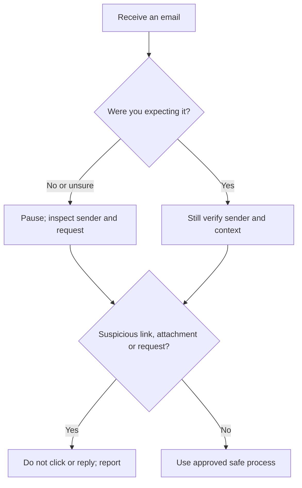

# Lesson 15 — World Wide Web, Browsers and Online Communication

**Course:** Computer Fundamentals and Artificial Intelligence Foundation Course  
**Academy:** Next Generation Academy  
**Week:** 3 — Windows Management, Installation, Internet and Networking  
**Duration:** 120 minutes  
**Level:** Beginner | **Teaching balance:** approximately 20 minutes theory, 90 minutes practical, 10 minutes review

## Lesson purpose
Build confident browser, search and email habits with strong privacy and phishing awareness.

## Learning outcomes
- Explain the difference between the internet and the World Wide Web.
- Identify browser, search engine, website, webpage, URL, domain, hosting, HTTP and HTTPS.
- Use search techniques and evaluate basic source credibility.
- Create or use an email account only through approved academy procedures.
- Send a professional email with a safe attachment and recognize common phishing signals.

## Key terms
internet; World Wide Web; browser; search engine; website; webpage; URL; domain; hosting; HTTP; HTTPS; hyperlink; email; attachment; phishing; multi-factor authentication.

## Student lecture notes

## 1. Internet and World Wide Web

The **internet** is the global network infrastructure connecting networks and devices. The **World Wide Web** is a service that uses the internet to access linked pages and resources. Email, online games and file-transfer services can use the internet without being webpages.

## 2. Browser, search engine and web address

A **browser** (such as Edge, Chrome or Firefox) is software used to open websites. A **search engine** helps find pages and information. A website is a collection of related webpages; a webpage is one page or document.

A **URL** is a web address. It may include a protocol (https), domain name and path. A **domain** is a human-readable name such as example.com. **Hosting** is a service that stores a website's files and makes them available online.

**HTTP** is a protocol for transferring web resources. **HTTPS** uses encryption through TLS to protect the connection. HTTPS helps protect data in transit, but it does not prove that a website is honest or safe. Check the exact domain and the purpose of the page.

## 3. Search and evaluate information

Use clear keywords. Add quotation marks when searching for an exact phrase. Compare more than one reliable source. Check the author or organization, publication/update date, evidence and purpose. Do not assume the first search result is the best or that a polished page is accurate.

## 4. Email basics

Email is used for professional communication. A useful subject line summarizes the purpose. Begin with a greeting, write a short and clear message, mention attachments, use a polite closing and check the recipient before sending.

The **To** field is for the main recipient. **CC** sends a visible copy to others. **BCC** sends a copy without showing those recipients to other recipients. Use BCC carefully and according to the academy's communication policy.

## 5. Phishing and account protection

Phishing is a deceptive message designed to make someone reveal information, open a harmful attachment or visit a fake website. Warning signs include unexpected urgency, threats, prizes, unusual sender addresses, spelling mistakes, mismatched links, requests for passwords or payment, and unexpected attachments.

- Do not click suspicious links or open unexpected attachments.
- Check the full sender address and domain carefully.
- Never send a password or one-time verification code by email or chat.
- Use a unique password and multi-factor authentication (MFA) where available.
- Report suspicious messages to the instructor or responsible IT person.
- Do not enter personal information after following an unsolicited link.

## Instructor preparation
- Read these notes and test the demonstration before class.
- Prepare a projector/board, student workbook, and one instructor-controlled computer.
- Check that student accounts and lab devices are ready; do not expose personal or network credentials.
- For system-management activities, use academy-approved computers with standard student permissions.
- For installation/partition demonstrations, use only a disposable virtual machine or dedicated spare training PC.

## 120-minute lesson plan

| Time | Teaching activity | Method |
|---|---|---|
| 0–10 min | Welcome, prior-knowledge check and lesson outcomes | Questions and discussion |
| 10–20 min | Explain key ideas and vocabulary | Short explanation and diagram |
| 20–35 min | Instructor demonstration | Projected step-by-step demonstration |
| 35–75 min | Guided practical activity | Instructor models; students follow |
| 75–100 min | Independent or paired task | Student practice and evidence |
| 100–110 min | Review common errors and safety | Demonstration and discussion |
| 110–120 min | Exit quiz, reflection and homework | Individual check |

## Instructor demonstration
Demonstrate browser address bar, a URL's parts, a search query and checking the domain of a trusted organization. Use a clearly labelled fictional phishing example; never display a real student's inbox, passwords or personal email. Demonstrate composing an email to an instructor-controlled test address only.

## Practical exercises
1. Open the approved browser and identify the address bar, tabs, back button, refresh and downloads area.
2. Compare a browser with a search engine using one example.
3. Break a sample URL into protocol, domain and path.
4. Search for a computer topic and compare two sources for author, date and evidence.
5. Draft an email with a meaningful subject, greeting, concise message and closing. Do not send until the instructor checks it.
6. Attach a harmless practice file only when instructed. Verify the recipient and attachment before sending.
7. Mark warning signs in the fictional phishing examples. Explain the safe response.

## Understanding checks
1. What is the difference between the internet and the Web?
2. What is a browser?
3. How is a search engine different from a browser?
4. What is a URL?
5. What does HTTPS help protect?

## Homework
Write a professional email to request information about a course. Include a clear subject and polite structure. Then annotate a fictional phishing message with at least five warning signs and explain what you would do.

## Student completion checklist
- [ ] I can explain the main terms in simple English.
- [ ] I completed the practical task using the approved safe procedure.
- [ ] I recorded observations or produced the requested evidence.
- [ ] I can explain one safety or privacy rule from this lesson.
- [ ] I completed the exit quiz and understand what I need to practise.

## Instructor notes and differentiation
- Ask students to explain each step before they click or change a setting.
- Pair confident students with beginners, but require each learner to perform the key task.
- Offer a printed sequence/checklist to students who need extra support.
- Extend confident learners with a written troubleshooting scenario, not unsupervised system changes.
- Record misconceptions and revisit them at the start of the next lesson.
