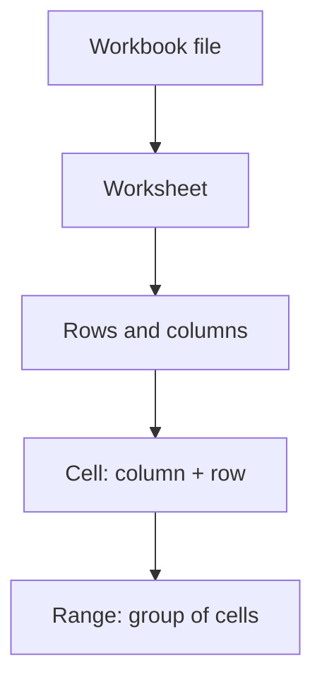

# Lesson 18 — Excel Fundamentals

**Week:** 4 | **Duration:** 120 minutes | **Practical focus:** 80%

## Learning outcomes
Students can identify workbook and worksheet parts, enter and edit data, select cells and ranges, format a simple table, sort and filter records, freeze headings and save a workbook safely.

## Key terms
Workbook, worksheet, row, column, cell, cell reference, range, formula bar, data type, number format, sort, filter, Freeze Panes.

## 1. What is a spreadsheet?
A spreadsheet organizes information in rows and columns. It can calculate values, summarize records and create charts. Microsoft Excel is a common spreadsheet application. LibreOffice Calc is an alternative.

A workbook is the complete file. A worksheet is one sheet inside the workbook. A cell is where a row and column meet. For example, B3 means column B, row 3. A range such as A1:C5 includes multiple cells.

## 2. Understand the interface
Common areas include the ribbon, name box, formula bar, column headings, row numbers, worksheet tabs, status bar and active cell. The selected cell has a border. The name box can show its address.

## 3. Enter and edit data
Click a cell, type a value and press Enter. Use Tab to move across a row. Use the formula bar to inspect or edit cell contents. Common data types include text, numbers, dates and formulas.

Keep one clear header row. Put one record in each row and one field in each column. Avoid blank rows inside a data table and avoid combining multiple pieces of information in one cell.

Example:
| Student ID | Student Name | Course | Score |
|---|---|---|---:|
| NGA001 | Ayesha Khan | Computer Foundation | 82 |
| NGA002 | Bilal Ahmad | Computer Foundation | 76 |
| NGA003 | Sana Ali | Computer Foundation | 91 |

Use fictional practice data. Do not upload real student records to public websites or AI tools.

## 4. Format cells
Use number formats for dates, percentages and currency. Formatting changes how a value appears; it does not necessarily change the stored value. Adjust column width so text can be read. Use bold for headings and restrained colours.

## 5. Create a table
Select the data range and use Format as Table or the equivalent command. Confirm that the table has headers. Tables can help with consistent formatting, sorting and filtering.

## 6. Sort and filter
Sort changes record order, for example highest score to lowest. Select the full table so records stay together. Filtering temporarily shows records that match selected conditions. Clear filters to show all rows again. Never sort only one column in a multi-column record table; it can separate names from their scores.

## 7. Freeze headings
Freeze Panes keeps selected rows or columns visible while scrolling. Select the cell below the rows and to the right of columns you want to keep visible, then use View > Freeze Panes. The command may vary slightly by version.

## 8. Save and organize
Save as an Excel workbook (.xlsx). Use a clear filename and the academy course folder. Keep a backup. Check that the correct worksheet is active before entering data.

## Guided practical — Student registration table
Create a workbook with columns: Student ID, Student Name, Course, Registration Date and City. Enter at least eight fictional records. Format as a table, adjust widths, sort by Student Name, filter by City, clear the filter and freeze the header row. Save as `Student-Registration-Practice.xlsx`.

## 120-minute teaching plan
| Time | Activity |
|---|---|
| 0–20 min | Spreadsheet purpose, workbook/worksheet/cell concepts |
| 20–40 min | Interface tour and data entry |
| 40–65 min | Edit, select ranges and format values |
| 65–85 min | Build a structured table |
| 85–105 min | Sort, filter and clear filters |
| 105–115 min | Freeze headings and save |
| 115–120 min | Quick review |

## Understanding check
1. What is the difference between a workbook and worksheet?
2. What does cell C4 mean?
3. Why should one record occupy one row?
4. What is the risk of sorting only one column?
5. Does number formatting always change the underlying value?

## Homework
Create a fictional class attendance workbook with at least ten records. Include Student ID, Name, Date and Attendance Status. Format it as a table and demonstrate a filter.

## Instructor notes
Teach the data structure before decorative formatting. Use fictional records. Check students understand that a cell reference identifies a location. Demonstrate sorting the entire table and undo an intentionally incorrect single-column sort so students see the risk.

## Completion checklist
- [ ] Identify workbook, worksheet, row, column and cell.
- [ ] Enter and edit data.
- [ ] Format dates and numbers.
- [ ] Create a table.
- [ ] Sort and filter full records safely.
- [ ] Freeze headings and save the workbook.

## Visual learning aid — spreadsheet structure

