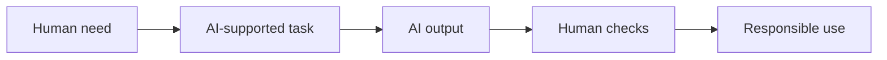

# Lesson 21 — Why AI Matters and Introduction to AI

**Course:** Computer Fundamentals and Artificial Intelligence Foundation Course  
**Academy:** Next Generation Academy  
**Week:** 5 — AI Foundations and Professional Prompt Engineering  
**Duration:** 120 minutes  
**Level:** Beginner | **Teaching balance:** approximately 20 minutes theory, 90 minutes practical, 10 minutes review

## Lesson purpose
Understand what artificial intelligence means, where it is used, and how people can use it responsibly.

## Learning outcomes
- Define AI in simple words and give everyday examples.
- Distinguish an AI system from a human being and from ordinary fixed-rule software.
- Identify benefits, limitations and risks of AI.
- Explain why human judgement, creativity and responsibility remain important.

## Key terms
Artificial intelligence (AI), automation, prediction, recommendation, recognition, generative AI, training data, output, bias, human oversight.

## Student lecture notes

### 1. What is AI?
Artificial intelligence is a broad field of computing that builds systems able to perform tasks that normally require some human-like abilities, such as recognizing patterns, understanding language, making predictions, recommending items or generating content. AI does not mean a computer has human feelings, personal experience or human understanding.

### 2. Everyday examples
- A phone camera recognizes a face or improves a photograph.
- A map app estimates travel time and suggests a route.
- An email service filters suspected spam.
- A video platform recommends content.
- A voice assistant responds to spoken requests.
- A generative AI tool drafts text, creates images or helps explain a topic.

### 3. Traditional software and AI
Traditional software often follows rules written directly by developers. Many AI systems use patterns learned from data to produce a prediction or output. Real products may combine both approaches. AI is not always the best solution; a clear rule or simple calculation may be more reliable and cheaper.

### 4. Benefits and limitations
AI can save time, help people explore ideas, support accessibility, summarize large amounts of information and assist with repetitive work. However, it can make mistakes, reflect bias in data, misunderstand context, produce fabricated details and expose information if used carelessly. Output quality depends on the task, data, model and instructions.

### 5. Human responsibility
A person remains responsible for checking important work. Do not use AI as the sole decision-maker for medical, legal, financial, employment or safety-critical decisions. Ask a qualified professional when needed. Students must understand and be able to explain work they submit.

### 6. Jobs and future skills
AI may automate some tasks, change others and create new kinds of work. Useful human abilities include communication, problem solving, creativity, teamwork, subject knowledge, ethical judgement and the ability to verify information.

## Classroom examples
Compare a calculator's fixed arithmetic with a generative assistant's drafted explanation. Discuss why a correct-looking answer still needs checking.

## Practical activity — AI in daily life
Create a table of five AI examples. For each, record the task, possible benefit, possible mistake and how a human checks the result. Use only public examples; do not enter personal data.

## Understanding check
1. Define AI in your own words.
2. Give two examples of AI in everyday life.
3. Why is an AI answer not automatically true?
4. Name one task where human review is essential.
5. Give two skills that remain valuable as AI tools improve.

## Homework
Interview a family member or observe a public digital service. Describe one possible AI use, one benefit, one risk and one human check. Do not collect private information.

## Instructor notes
Use familiar examples and avoid suggesting that all software is AI. Explain that AI capabilities differ by product and version. Invite critical thinking rather than fear or hype.

## Completion checklist
- [ ] Student explains AI in simple language.
- [ ] Student identifies benefits and risks.
- [ ] Student understands human responsibility.
- [ ] Practical table completed.

## Lesson delivery plan
| Time | Activity |
|---|---|
| 0–10 min | Welcome, connect to prior learning and introduce outcomes |
| 10–20 min | Explain key ideas using simple examples |
| 20–35 min | Instructor demonstration with an approved tool or offline example |
| 35–80 min | Guided student practical activity |
| 80–105 min | Independent challenge, peer review and verification |
| 105–115 min | Review misconceptions, privacy and responsible use |
| 115–120 min | Exit question and homework |

## Topic workflow diagram

## Instructor assessment notes
Observe whether each student can explain their choices, identify limitations and verify output. Do not grade students on access to a paid product or on how much text an AI generates.

## Student sign-off
- [ ] I can explain today's key terms.
- [ ] I completed the practical activity.
- [ ] I checked the result rather than trusting it automatically.
- [ ] I followed privacy and academy rules.
