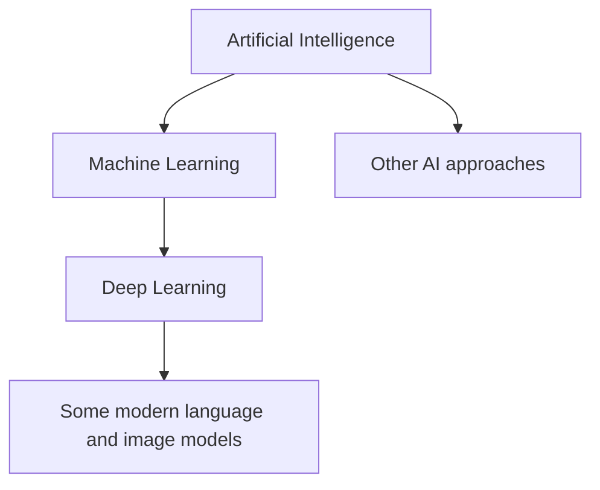
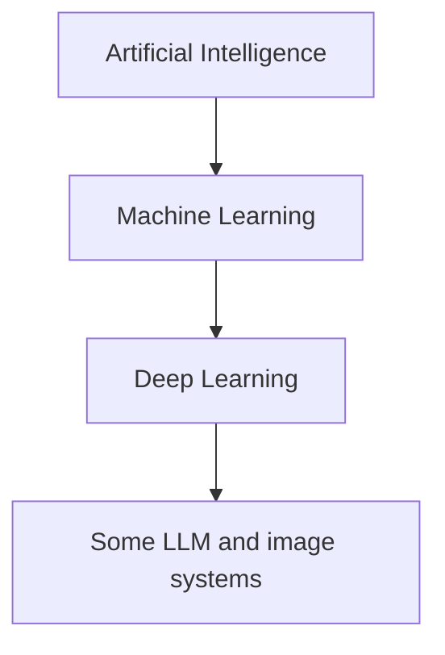

# Lesson 22 — AI, Machine Learning, Deep Learning and Large Language Models

**Course:** Computer Fundamentals and Artificial Intelligence Foundation Course  
**Academy:** Next Generation Academy  
**Week:** 5 — AI Foundations and Professional Prompt Engineering  
**Duration:** 120 minutes  
**Level:** Beginner | **Teaching balance:** approximately 20 minutes theory, 90 minutes practical, 10 minutes review

## Lesson purpose
Build a beginner-friendly mental model of AI, machine learning, deep learning, language models and generative AI.

## Learning outcomes
- Explain the relationship between AI, machine learning and deep learning.
- Describe training and inference at a high level.
- Explain what a large language model does.
- Recognize tokens, context windows, multimodal input and hallucinations.
- Avoid treating model output as verified fact.

## Key terms
AI, machine learning (ML), deep learning (DL), neural network, training, inference, dataset, model, large language model (LLM), token, context window, multimodal, hallucination.

## Student lecture notes

### 1. The relationship
AI is the broad field. Machine learning is one approach within AI in which a system learns patterns from examples. Deep learning is a type of machine learning that uses multi-layer neural networks. These categories overlap; they are not separate competing products.

### 2. Training and inference
During training, a model's parameters are adjusted using data and a learning process. After training, inference is when the model receives an input and produces an output. A user normally interacts with a trained model during inference. Training does not mean the model stores and recalls every source like a searchable library.

### 3. What is an LLM?
A large language model is trained to process and generate language. It uses patterns learned from large datasets to predict likely next tokens. It can draft, summarize, translate, explain and transform text, but it can also produce convincing errors. It does not automatically know whether a statement is true.

### 4. Tokens and context windows
A token is a small unit of text or other data processed by a model; it may be a whole word, part of a word or punctuation. A context window is the amount of input and conversation material a model can consider at one time. Limits and counting methods vary by model. Very long conversations or documents may exceed limits or be summarized.

### 5. Multimodal AI
Some models can work with more than text. Depending on the product, they may accept or generate images, audio, video or structured data. Capabilities, file limits and availability vary. A model that can describe an image may still misread small text or miss details.

### 6. Hallucinations and verification
A hallucination is an output that sounds plausible but is false, unsupported or invented. Check names, dates, quotations, calculations, URLs, references and technical instructions. Use trusted sources and test code or formulas. Ask the tool to identify uncertainty and sources, but verify those sources yourself.

### 7. Model, app and data
A model is the underlying AI system. An app or assistant provides an interface and may add search, file handling, memory, tools or workflows. Different apps can use different models, settings and data policies.

## Practical activity — concept sorting
Sort these cards into AI, ML, DL, LLM, token, context window, multimodal or hallucination: spam prediction, neural network, generated paragraph, small text unit, maximum conversation input, image plus text, invented source. Explain each choice.

## Understanding check
1. Which is broader: AI or ML?
2. What is deep learning?
3. What happens during inference?
4. What is a token?
5. What does a context window limit?
6. Why can an LLM hallucinate?
7. What is the difference between a model and an app?

## Homework
Draw a labelled diagram showing AI, ML and DL. Write a short explanation of LLM, token, context window and hallucination.

## Instructor notes
Do not teach mathematical internals beyond the class level. Explain that the nesting diagram is a useful simplified model, not a complete map of every AI technique. Do not claim that all LLMs have identical limits or modalities.

## Completion checklist
- [ ] Student explains AI/ML/DL relationship.
- [ ] Student describes training vs inference.
- [ ] Student explains LLM, token and context window.
- [ ] Student identifies hallucination and verification steps.

## Lesson delivery plan
| Time | Activity |
|---|---|
| 0–10 min | Welcome, connect to prior learning and introduce outcomes |
| 10–20 min | Explain key ideas using simple examples |
| 20–35 min | Instructor demonstration with an approved tool or offline example |
| 35–80 min | Guided student practical activity |
| 80–105 min | Independent challenge, peer review and verification |
| 105–115 min | Review misconceptions, privacy and responsible use |
| 115–120 min | Exit question and homework |

## Topic workflow diagram

## Instructor assessment notes
Observe whether each student can explain their choices, identify limitations and verify output. Do not grade students on access to a paid product or on how much text an AI generates.

## Student sign-off
- [ ] I can explain today's key terms.
- [ ] I completed the practical activity.
- [ ] I checked the result rather than trusting it automatically.
- [ ] I followed privacy and academy rules.
