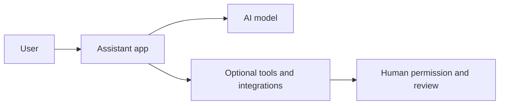

# Lesson 23 — AI Assistants and the AI Ecosystem

**Course:** Computer Fundamentals and Artificial Intelligence Foundation Course  
**Academy:** Next Generation Academy  
**Week:** 5 | **Duration:** 120 minutes | **Level:** Beginner

## Lesson purpose
Help students understand AI assistants, models, tools and connected services while making safe choices about accounts, privacy and access.

## Learning outcomes
- Distinguish an AI model from an assistant application.
- Compare common assistant products using task fit and trustworthy evidence.
- Explain tools, integrations, agents and reusable workflows at a basic level.
- Apply account, privacy and data-minimization rules.

## Key terms
AI assistant, model, tool, integration, connector, agent, workflow, account, privacy, data minimization, permission, subscription.

## Student lecture notes

### 1. What is an AI assistant?
An AI assistant is an application that lets a person interact with one or more AI models. The application may include chat, file upload, image input, search, voice, coding help or other features. Not every assistant offers the same features.

### 2. Examples of the ecosystem
Examples students may encounter include ChatGPT, Google Gemini and Claude. Products change frequently. A product may offer free and paid plans, regional restrictions, age requirements, usage limits or different features by account. Never promise that a particular tool or feature will be available to every student.

### 3. Models, tools and integrations
- **Model:** the AI system that processes input and generates output.
- **Tool:** an additional capability, such as search, calculation, code execution or image creation.
- **Integration/connector:** a controlled connection to another service or data source.
- **Workflow:** a repeatable set of steps to complete a task.
- **Agent:** a system that can plan or carry out multiple steps using permitted tools, often with human supervision.

A tool-enabled assistant may retrieve information or take actions, but permissions and reliability must be checked. Students should never grant broad access without understanding it.

### 4. Choosing a tool
Choose based on the task, quality, privacy policy, cost, accessibility, language support, file compatibility and school/academy rules. Compare outputs on the same test prompt. Do not choose only because a tool is popular.

### 5. Accounts and privacy
Use academy-approved accounts and follow age and account rules. Use strong unique passwords and multi-factor authentication when available. Never share passwords or one-time codes. Do not upload identity documents, private messages, student records, passwords, payment details or confidential academy files to public AI services.

Use fictional or anonymized examples for practice. Read the service's privacy and data controls with an instructor. Do not assume that deleting a chat removes every copy or that every service uses data in the same way.

### 6. Human review and safe use
Check output before using it. Ask permission before connecting apps, uploading files or enabling tools. Keep a record of AI assistance when required by an assignment. Do not use AI to impersonate people, create deceptive content or bypass rules.

## Practical activity — assistant comparison
Using academy-approved accounts or instructor demonstrations, test two available assistants with the same harmless prompt: “Explain the difference between RAM and storage to a beginner in five bullet points.” Compare clarity, accuracy, limitations, citations (if offered), privacy information and accessibility. If only one tool is available, compare two outputs/settings or use a teacher-provided sample.

## Understanding check
1. What is the difference between a model and an assistant app?
2. Give one example of a tool or integration.
3. Why do features vary between accounts?
4. Name three kinds of data students should not upload.
5. Why should an integration's permissions be checked?

## Homework
Write a one-page tool selection checklist with five criteria and three privacy rules.

## Instructor notes
Demonstrate only with approved accounts and non-sensitive sample content. Confirm current access, minimum age and local availability before class. Provide a teacher-led demonstration or printed screenshots if access is unavailable.

## Lesson delivery plan
| Time | Activity |
|---|---|
| 0–10 min | Welcome and introduce outcomes |
| 10–20 min | Explain model, assistant, tool and integration |
| 20–35 min | Instructor demonstration |
| 35–80 min | Guided comparison activity |
| 80–105 min | Independent tool-selection and privacy challenge |
| 105–115 min | Review and questions |
| 115–120 min | Exit check and homework |

## Topic workflow diagram

## Completion checklist
- [ ] Student distinguishes model, app and tool.
- [ ] Student compares tools fairly.
- [ ] Student explains account and privacy precautions.
