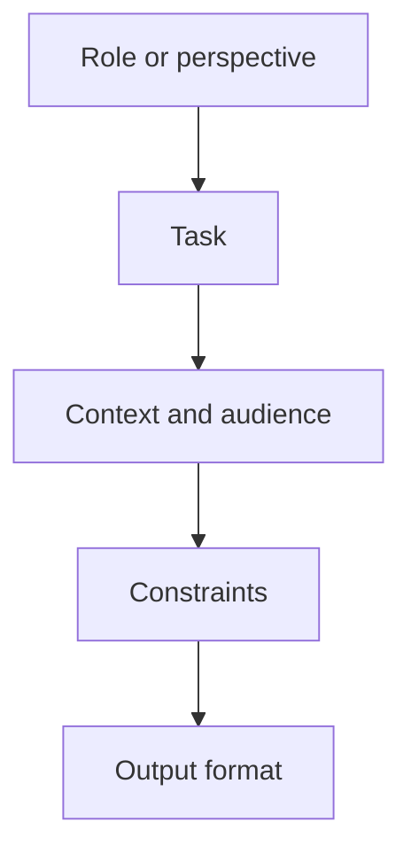

# Lesson 24 — Professional Prompt Engineering — Part 1

**Course:** Computer Fundamentals and Artificial Intelligence Foundation Course  
**Academy:** Next Generation Academy  
**Week:** 5 — AI Foundations and Professional Prompt Engineering  
**Duration:** 120 minutes  
**Level:** Beginner | **Teaching balance:** approximately 20 minutes theory, 90 minutes practical, 10 minutes review

## Lesson purpose
Teach students to write clear prompts that provide the task, context, constraints and expected format.

## Learning outcomes
- Identify the parts of a useful prompt.
- Improve vague prompts by adding context and constraints.
- Use role, task, audience, format and tone appropriately.
- Test a prompt and evaluate whether the output meets the request.

## Key terms
Prompt, instruction, context, role, task, audience, constraint, output format, tone, example, zero-shot, few-shot.

## Student lecture notes

### 1. What is a prompt?
A prompt is the instruction or input given to an AI system. A clear prompt explains what is needed and provides enough relevant context. A long prompt is not automatically a good prompt; clarity matters more than length.

### 2. Five useful prompt parts
1. **Role or perspective:** the kind of help requested, such as “Act as a beginner computer tutor.”
2. **Task:** the action, such as explain, compare, draft or check.
3. **Context and audience:** who the output is for and what they already know.
4. **Constraints:** length, scope, language level, facts to avoid inventing and other limits.
5. **Output format:** table, numbered steps, checklist, email or short paragraph.

### 3. Weak and improved prompts
Weak: “Explain Excel.”

Improved: “Explain what a spreadsheet is to a beginner who has never used Excel. Use simple English, give one school marks example, explain rows, columns and cells, and finish with three practice questions.”

### 4. Prompt Coach — turning a rough idea into a clear prompt

A **Prompt Coach** is a reusable instruction that asks an AI assistant to help improve another prompt. It is useful when a student knows what they want but is unsure how to explain it.

A good Prompt Coach should:
1. Understand the user's real goal and preserve the original meaning.
2. Identify missing context, audience, requirements or output format.
3. Improve clarity and organize instructions.
4. State assumptions instead of inventing facts or personal details.
5. Offer useful alternatives, such as simple, detailed and structured versions.
6. Explain the main improvements and recommend a version.

**Important:** Prompt Coach is a helper, not a guarantee. Students must review the rewritten prompt before using it. If an essential detail is missing, ask a question rather than allowing the AI to guess.

#### Instructor demonstration

Rough idea: “Make a presentation about computers.”

Ask Prompt Coach to improve it. A suitable result might specify:
- Audience: beginner students.
- Purpose: introduce computer fundamentals.
- Length: six slides.
- Topics: definition, hardware, software, input/output and everyday uses.
- Language: simple English.
- Output: slide-by-slide content with one example per slide.

Discuss what was added and whether it matches the original intention.

#### Reusable Prompt Coach template

Students can copy the complete template from [My Prompt Coach — Reusable Template](PROMPT-COACH-TEMPLATE.md). They should replace the rough-idea placeholder with their own request.

### 5. Zero-shot and few-shot prompting
Zero-shot prompting gives an instruction without examples. Few-shot prompting provides one or more examples of the desired style or structure. Examples are useful when the output must follow a pattern. They do not guarantee factual accuracy.

### 6. Ask for useful output structure
Specify headings, number of items, table columns or step order. For technical work, request assumptions, test cases and a concise explanation. Do not ask a model to reveal hidden private reasoning; ask for a short explanation, evidence and checks that can be verified.

### 7. Prompt quality checklist
- Is the task clear?
- Is the audience stated?
- Is relevant context included?
- Are constraints realistic?
- Is the format specified?
- Can the result be checked?

## Practical activity — prompt improvement and Prompt Coach

First, improve one vague prompt manually. Then use the Prompt Coach template on the same rough idea. Compare both improved versions. Check whether the AI preserved the original goal, added useful context and avoided invented details. Select the better prompt and explain why.

In pairs, improve five vague prompts: “Make a CV,” “Teach me computers,” “Write a report,” “Make a quiz,” and “Explain AI.” For each, add audience, context, output format and constraints. Test one prompt with an approved tool or use a teacher-provided output.

## Understanding check
1. What is a prompt?
2. Name five useful prompt components.
3. What is zero-shot prompting?
4. What is few-shot prompting?
5. Why specify an audience?
6. What should you request instead of hidden reasoning?
7. What is Prompt Coach, and why must you review its rewritten prompt?
8. What should it do when essential information is missing?

## Homework
Write five improved prompts for learning, writing, research, spreadsheet help and presentation planning. Label the task, audience and format.

## Instructor notes
Show before-and-after examples. Encourage students to revise one element at a time and judge output against the original task, not simply whether it sounds impressive.

## Completion checklist
- [ ] Student identifies prompt components.
- [ ] Student improves a vague prompt.
- [ ] Student specifies a useful output format.
- [ ] Student applies the prompt checklist.
- [ ] Student uses Prompt Coach and checks that it preserved the original intention.

## Lesson delivery plan
| Time | Activity |
|---|---|
| 0–10 min | Welcome, connect to prior learning and introduce outcomes |
| 10–20 min | Explain key ideas using simple examples |
| 20–35 min | Instructor demonstration with an approved tool or offline example |
| 35–80 min | Guided student practical activity |
| 80–105 min | Independent challenge, peer review and verification |
| 105–115 min | Review misconceptions, privacy and responsible use |
| 115–120 min | Exit question and homework |

## Topic workflow diagram

## Instructor assessment notes
Observe whether each student can explain their choices, identify limitations and verify output. Do not grade students on access to a paid product or on how much text an AI generates.

## Student sign-off
- [ ] I can explain today's key terms.
- [ ] I completed the practical activity.
- [ ] I checked the result rather than trusting it automatically.
- [ ] I followed privacy and academy rules.
