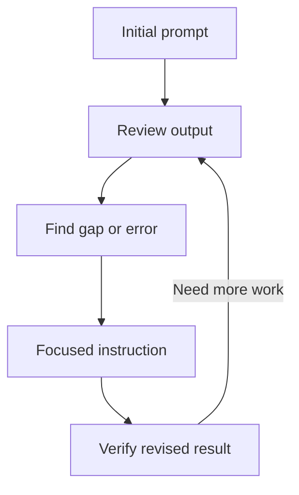

# Lesson 25 — Professional Prompt Engineering — Part 2

**Course:** Computer Fundamentals and Artificial Intelligence Foundation Course  
**Academy:** Next Generation Academy  
**Week:** 5 — AI Foundations and Professional Prompt Engineering  
**Duration:** 120 minutes  
**Level:** Beginner | **Teaching balance:** approximately 20 minutes theory, 90 minutes practical, 10 minutes review

## Lesson purpose
Develop a repeatable prompt-testing workflow and teach students to refine, verify and reuse prompts responsibly.

## Learning outcomes
- Refine an output through clear follow-up instructions.
- Break a complex task into manageable stages.
- Request structured output and check it against requirements.
- Identify common prompting mistakes and verify important claims.
- Build a small tested prompt library.

## Key terms
Iteration, decomposition, structured output, prompt template, evaluation criteria, assumption, verification, test case, revision.

## Student lecture notes

### 1. Iterative prompting
Prompting is often a cycle:
1. State the task and context.
2. Review the output against your goal.
3. Identify a specific gap or error.
4. Give a focused revision instruction.
5. Check the revised result again.

Avoid saying only “make it better.” Explain what should change, such as “Use shorter sentences, keep the five headings, and add one practical example.”

### 2. Use Prompt Coach as the first review step

Prompt Coach can help turn an unclear request into a better starting prompt. Use this controlled workflow:

1. Write your rough idea in your own words.
2. Ask Prompt Coach to clarify the goal and improve the prompt.
3. Read the rewritten prompt carefully. Check that it still means what you intended.
4. Remove assumptions or details that are incorrect.
5. Choose the version that best fits your task; do not automatically choose the longest version.
6. Test it with the AI assistant.
7. Evaluate the result and give a focused revision instruction.

Prompt Coach may suggest simple, detailed and structured versions. These are choices, not proof that any version is correct. Ask a short follow-up question if important information is missing.

**Example:** A student writes, “Help me study science.” Prompt Coach should not invent the student's grade, exam date or syllabus. It can ask for those details or create a clearly labelled general version.

### 3. Break large tasks into stages
A complex task is easier to control when divided into steps. For example, preparing a presentation:
- First create an outline.
- Review the outline.
- Draft slide content.
- Suggest suitable visuals.
- Check facts and sources.
- Prepare speaker notes.

Do not accept every stage automatically. Review and approve before moving forward.

### 4. Structured output
Ask for a table with named columns, a numbered procedure, a checklist or a consistent template. For data tasks, specify units, allowed values and how missing information should be shown. Structured output still needs checking.

### 5. Ask for assumptions and uncertainty
Useful instructions include:
- “List any assumptions you made.”
- “Mark information you cannot verify.”
- “Do not invent names, dates or sources.”
- “Give a short explanation and show the calculation.”
- “Suggest tests I can run to check this result.”

The assistant's claims about its own confidence are not proof. Verify important facts independently.

### 6. Common mistakes
- Task is too vague.
- Important context is missing.
- Several unrelated tasks are mixed together.
- Output format is not specified.
- The user assumes the first answer is correct.
- Private information is included unnecessarily.
- The prompt asks for a source but the source is not checked.
- Students copy output they cannot explain.

### 7. Build a prompt library
Store prompts with a title, purpose, prompt text, sample input, date tested, tool/version if known, result notes and known limitations. Remove private data. Re-test prompts because AI products change.

### 8. Responsible use
Use AI according to academy rules. Cite or disclose AI assistance when required. Do not submit generated work as independent work if that violates the assignment. Never use prompts to deceive, impersonate, harass or create harmful content.

## Practical activity — Prompt Coach test and 15-prompt library

Choose one rough prompt from Lesson 24. Run it through Prompt Coach, review the suggested alternatives, select one and test it. Use a simple evaluation table: Did it preserve the goal? Was context useful? Were assumptions labelled? Did the output meet the task? What would you revise?

Then complete the 15-prompt library. Include the Prompt Coach template as one reusable entry, and record when it is useful and its limitations.

Create and test 15 prompts across these categories:
1–3 learning and explanations; 4–6 research and source checking; 7–9 professional writing; 10–12 Office productivity; 13–15 presentations and creative planning.
For each, record the goal, complete prompt, output format, one result check and one limitation. Use fictional data only.

## Understanding check
1. What does iteration mean?
2. Why break a complex task into stages?
3. Name two ways to request structured output.
4. Why are model-provided sources still checked?
5. What information belongs in a prompt library record?
6. Give two examples of responsible AI use.

## Homework
Improve three prompts from Lesson 24. Keep the original and revised versions, explain what changed, and record how you checked the output.

## Instructor notes
Assess the student's prompt design and verification, not the amount of generated text. Use harmless sample tasks. Remind students that prompts do not override product rules, privacy policies or safety limits.

## Completion checklist
- [ ] Student refines an output with a focused instruction.
- [ ] Student decomposes a complex task.
- [ ] Student requests structured output.
- [ ] Student checks claims and assumptions.
- [ ] Student creates a 15-prompt library.
- [ ] Student reviews and tests a Prompt Coach rewrite instead of accepting it automatically.

## Lesson delivery plan
| Time | Activity |
|---|---|
| 0–10 min | Welcome, connect to prior learning and introduce outcomes |
| 10–20 min | Explain key ideas using simple examples |
| 20–35 min | Instructor demonstration with an approved tool or offline example |
| 35–80 min | Guided student practical activity |
| 80–105 min | Independent challenge, peer review and verification |
| 105–115 min | Review misconceptions, privacy and responsible use |
| 115–120 min | Exit question and homework |

## Topic workflow diagram

## Instructor assessment notes
Observe whether each student can explain their choices, identify limitations and verify output. Do not grade students on access to a paid product or on how much text an AI generates.

## Student sign-off
- [ ] I can explain today's key terms.
- [ ] I completed the practical activity.
- [ ] I checked the result rather than trusting it automatically.
- [ ] I followed privacy and academy rules.
