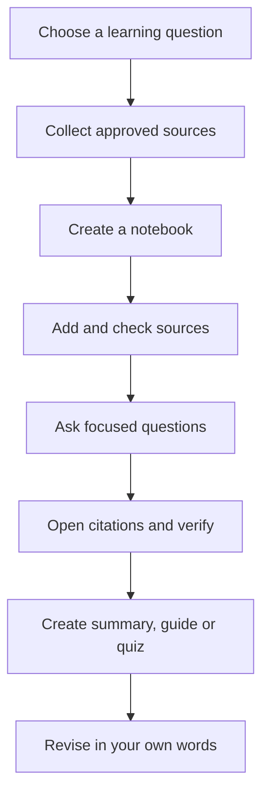

# Lesson 26 — AI for Learning and Research with NotebookLM

**Week:** 6 · **Duration:** 120 minutes · **Level:** Beginner  
**Practical focus:** 90 minutes · **Theory and demonstration:** 20 minutes · **Review:** 10 minutes

## Learning outcomes
By the end, students can:
1. Explain the difference between a general AI assistant and a source-grounded research notebook.
2. Create a notebook and add suitable learning sources where the service and account permit.
3. Ask questions that are clearly connected to the supplied sources.
4. create a summary, study guide and quiz, then check them against the original material.
5. Recognize missing evidence, inaccurate summaries and privacy risks.

## Key terms
Notebook, source, source-grounded answer, citation, summary, study guide, hallucination, verification, personal data.

## 1. What is NotebookLM?
NotebookLM is an AI-supported research and learning tool designed to help users work with a collection of sources. A notebook is a workspace for a particular topic. Sources may include supported documents, PDFs, text and web sources, depending on the current product and account.

A useful distinction:
- A general AI assistant can respond using its model knowledge and the context you provide.
- A source-grounded notebook is intended to answer using the sources added to that notebook and may provide references to the relevant source passages.

Source grounding is helpful, but it is not a guarantee that every answer is correct or complete.

## 2. A safe research workflow
1. Choose a clear topic, such as “Computer Hardware Basics”.
2. Collect reliable, relevant learning sources.
3. Check that you have permission to use each source.
4. Create a notebook with a descriptive title.
5. Add sources using the options currently available.
6. Confirm that the correct sources have loaded.
7. Ask one focused question at a time.
8. Open and read the cited passages.
9. Compare important claims with the original sources.
10. Save useful notes in your own words.

Do not upload private student records, passwords, identity documents, confidential academy files or another person's personal information. Use public, approved or fictional learning material.

## 3. Asking good research questions
Weak: “Tell me everything about computers.”

Better: “Using the sources in this notebook, explain the difference between RAM and long-term storage. Give a beginner-friendly example and identify which source supports each main point.”

Other useful prompts:
- “Create a 150-word summary using only the supplied sources. List any topic the sources do not explain.”
- “Make ten revision questions. Include the source section that supports each answer.”
- “Compare the two explanations of computer memory. Point out where they agree and differ.”
- “Explain this paragraph in simpler English without changing its meaning.”

## 4. Citations and verification
A citation is a pointer to a source passage. Open it and check:
- Does the passage actually support the answer?
- Has the AI removed an important condition or exception?
- Are dates, names, quantities and technical terms correct?
- Does another source disagree?
- Is the answer making a claim that no source supports?

If evidence is missing, write “The supplied sources do not establish this” rather than guessing.

## 5. Study materials
AI can help produce:
- Topic summaries and glossaries.
- Flashcards and revision questions.
- Study guides and lesson outlines.
- Comparison tables.
- Explanations at different reading levels.

Treat these as drafts. Students should correct errors, add their own examples and follow the teacher's instructions about acceptable AI assistance.

## Topic workflow

## Practical activity — Build a source-grounded study notebook
**Materials:** computer, browser, internet if available, teacher-provided public learning sources.

1. Open NotebookLM using the official service link provided by the instructor.
2. Sign in only if permitted by academy policy and the student's age/account eligibility.
3. Create a notebook titled “Computer Hardware Revision”.
4. Add two or three teacher-approved sources about CPU, RAM and storage.
5. Ask: “Explain the difference between CPU, RAM and storage using only these sources.”
6. Open at least two citations and record what each supports.
7. Ask for a short study guide and five quiz questions.
8. Check every answer against the sources; correct at least one weak or unsupported item.
9. Export or copy only the permitted learning output into the student's course folder.

**Offline alternative:** The instructor supplies printed or local PDF sources. Students create a source table and write the same questions manually. The learning objective is source evaluation, not dependence on a particular product.

## Understanding check
1. What is a source in a research notebook?
2. Why should a citation be opened and checked?
3. What should you do when the sources do not answer a question?
4. Name two types of private information that must not be uploaded.
5. Why should an AI-generated quiz be reviewed?

## Homework
Prepare a one-page study guide on a computer topic using two approved sources. Include the source names, three key facts checked against those sources, five revision questions and one limitation in the source material.

## Instructor notes
- Confirm service availability, account eligibility, current supported source types and institutional policy before class.
- Do not require students to create personal accounts if age, privacy or academy rules do not permit it.
- Use public sample documents or teacher-created material.
- Demonstrate that a citation can be relevant but still not fully support a broad answer.
- Assess source-checking, not merely the ability to click buttons.

## Completion checklist
- [ ] Student can explain source-grounded research.
- [ ] Student can add approved sources or complete the offline equivalent.
- [ ] Student checks citations against original material.
- [ ] Student creates and reviews a study guide or quiz.
- [ ] Student follows privacy rules.
