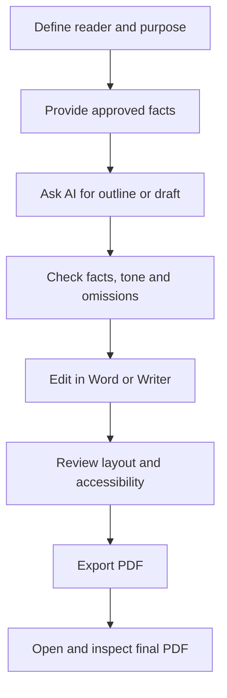

# Lesson 27 — AI for Word Documents, PDFs, Emails and Professional Writing

**Week:** 6 · **Duration:** 120 minutes · **Level:** Beginner  
**Practical focus:** 90 minutes · **Theory and demonstration:** 20 minutes · **Review:** 10 minutes

## Learning outcomes
Students will be able to use AI to plan and improve a professional document, extract and summarize appropriate PDF content, draft a clear email, format the result in Word or a compatible editor, and verify the final file before sharing.

## Key terms
Draft, prompt, tone, audience, PDF, OCR, proofreading, formatting, accessibility, metadata, personal data.

## 1. AI supports writing; the student remains responsible
AI can help brainstorm, organize, simplify, rewrite, proofread and create first drafts. It may also invent facts, change meaning, use an unsuitable tone or overlook important details. Never submit or send an AI draft without reading it.

A reliable writing cycle is:
1. Define the reader and purpose.
2. Gather correct facts.
3. Ask AI for an outline or draft.
4. Check names, dates, numbers, claims and tone.
5. Edit in Word or LibreOffice Writer.
6. Check layout and accessibility.
7. Save an editable copy and export a PDF when appropriate.
8. Open the exported PDF and inspect every page.

## 2. Prompt structure for documents
A useful prompt states:
- **Role:** the type of writing assistant needed.
- **Context:** who the document is for and why it is needed.
- **Task:** exactly what to create or revise.
- **Facts:** approved details to include.
- **Constraints:** length, language level, tone and items to avoid.
- **Format:** headings, paragraphs, table or bullet list.

Example:
“Act as a careful administrative writing assistant. Draft a polite application to the academy principal requesting permission to use the computer lab for a student project. Use only these facts: [insert approved facts]. Keep it under 180 words, use simple professional English, and do not invent dates or names. Mark any missing details with [TO CONFIRM].”

## 3. Working with PDFs
PDFs may contain selectable text, scanned page images, forms or a mixture. AI tools may:
- Summarize text that can be extracted.
- Explain a section in simpler language.
- Find key terms or compare sections.
- Extract text from scans if OCR is supported.

OCR can misread names, numbers, tables and symbols. Compare extracted information with the page image, especially for financial, academic or legal material. Respect copyright and document permissions.

## 4. Professional email
A good email has:
- A meaningful subject.
- A polite greeting.
- A short statement of purpose.
- Necessary details in a logical order.
- A clear next step or request.
- A suitable closing and correct signature.

Before sending, verify recipient addresses, attachments, names and dates. AI must not send a message or make commitments without the user's explicit review and approval.

## 5. Word formatting and PDF export
Use styles for headings rather than formatting every heading manually. Use readable fonts, consistent spacing, clear lists and properly sized tables. Add alternative text to meaningful images where supported. Avoid excessive colours and decorative effects.

Suggested file names:
- `Academy-Event-Application-Draft.docx`
- `Academy-Event-Application-Final.pdf`

Keep the editable file. Export a PDF for stable viewing or printing, then reopen it to check page breaks, images, fonts, tables and links.

## Writing workflow

## Practical activity — Create a professional application package
Use a fictional scenario and fictional names only.

1. Ask AI to draft a short application requesting permission to hold a student technology exhibition.
2. Require missing details to be marked `[TO CONFIRM]`; do not let AI invent them.
3. Review the draft for purpose, polite tone, clarity and accuracy.
4. Edit the document in Word or LibreOffice Writer.
5. Apply a title, appropriate paragraph spacing, date and signature area.
6. Use spelling and grammar tools, then read the document yourself.
7. Save the editable file and export a PDF.
8. Open the PDF and check all pages.
9. Draft a short email to accompany the attachment. Do not actually send it.

**Extension:** Ask AI to summarize a teacher-provided PDF, then verify three statements against the original pages.

**Offline alternative:** Use a teacher-provided sample draft and perform the editing, formatting and PDF export without an AI account.

## Understanding check
1. Why must you check an AI-generated document?
2. What does OCR do, and what errors can it make?
3. Why keep an editable copy as well as a PDF?
4. What should happen to missing details in a prompt?
5. What must be checked before an email is sent?

## Homework
Create a one-page fictional event report, save it in editable format and PDF, and write a short email draft that could accompany it. Highlight three facts you independently checked.

## Instructor notes
- Use fictional or public sample content; never upload private student records.
- Check account age restrictions, privacy settings and current tool terms.
- Do not use real recipient addresses or send messages during this exercise.
- Demonstrate a before/after edit and a PDF export check.
- Provide LibreOffice Writer as an alternative where Microsoft Word is unavailable.

## Completion checklist
- [ ] Student can write a task-specific prompt.
- [ ] Student reviews AI content for accuracy and tone.
- [ ] Student formats a professional document.
- [ ] Student exports and checks a PDF.
- [ ] Student drafts an email without sending it.
