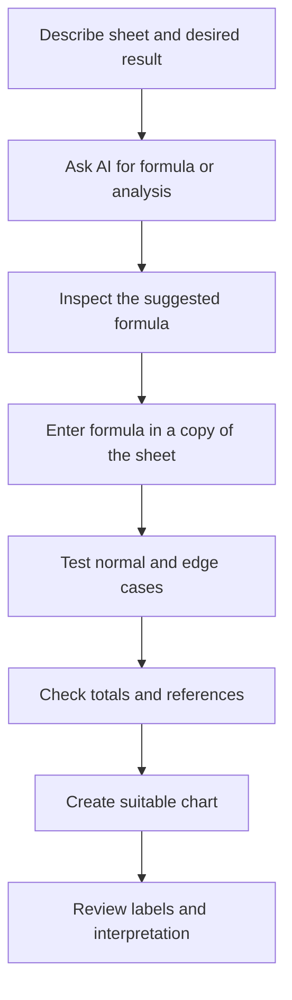

# Lesson 28 — AI for Excel, Data and Spreadsheet Productivity

**Week:** 6 · **Duration:** 120 minutes · **Level:** Beginner  
**Practical focus:** 90 minutes · **Theory and demonstration:** 20 minutes · **Review:** 10 minutes

## Learning outcomes
Students will use AI to explain spreadsheet concepts, suggest formulas, troubleshoot formula errors, plan a chart and check results with test data. They will understand that AI-generated formulas must be tested in the actual spreadsheet.

## Key terms
Workbook, worksheet, cell, range, formula, function, reference, relative reference, absolute reference, data validation, chart, test case.

## 1. Appropriate uses of AI in spreadsheets
AI can:
- Explain a formula in beginner-friendly language.
- Suggest a formula when the cell layout is described accurately.
- Explain common errors such as `#VALUE!`, `#DIV/0!` and `#NAME?`.
- Suggest a chart type for a particular question.
- Help plan a clean table and identify possible data-quality issues.

AI cannot see your workbook unless you deliberately provide data or use an approved connected feature. Never assume it knows your cell addresses, sheet names or data types.

## 2. Describe the spreadsheet clearly
A good request includes:
- The software (Excel or LibreOffice Calc).
- Sheet name and column headings.
- Example rows using fictional data.
- The desired result.
- Any rules or exceptions.
- The cell where the formula should go.

Example:
“In Excel, sheet Marks has student names in A2:A11 and marks in B2:B11. In C2, write a formula that displays ‘Pass’ when B2 is 50 or higher and ‘Needs Practice’ otherwise. Explain the formula and show how to fill it down. Use standard Excel formula syntax.”

The formula may need a comma or semicolon between arguments depending on regional settings.

## 3. Formula examples
| Purpose | Example formula | Meaning |
|---|---|---|
| Total | `=SUM(B2:B11)` | Adds values |
| Average | `=AVERAGE(B2:B11)` | Calculates mean |
| Highest | `=MAX(B2:B11)` | Finds largest value |
| Lowest | `=MIN(B2:B11)` | Finds smallest value |
| Count numbers | `=COUNT(B2:B11)` | Counts numeric cells |
| Conditional result | `=IF(B2>=50,"Pass","Needs Practice")` | Tests a condition |

Always confirm that the formula uses the correct range and that the result makes sense.

## 4. References and testing
A relative reference such as `B2` changes when a formula is copied. An absolute reference such as `$B$2` stays fixed. AI may misunderstand which reference should be fixed, so test the formula in more than one row.

A simple formula test:
1. Calculate one example manually.
2. Enter the formula.
3. Compare the spreadsheet result with the manual result.
4. Test a low value, a high value, a blank cell and a boundary value.
5. Check copied formulas and totals.

## 5. Data quality and privacy
Before analysis, check for blank rows, duplicate records, inconsistent date formats, spelling differences and numbers stored as text. Do not upload real student marks, phone numbers, identity details, payroll, health or financial records to a public AI service. Use a fictional dataset or data approved by the academy.

## 6. Charts and interpretation
Choose a chart to answer a question:
- Column/bar: compare categories.
- Line: show change over time.
- Pie: show parts of a whole only when there are a few meaningful categories.
- Avoid 3D effects and misleading axes.

A chart can be technically correct but still misleading. Check the labels, units, scale, categories and source data.

## Spreadsheet workflow

## Practical activity — Build and verify a marks workbook
Use fictional data for ten imaginary students.

1. Create columns: Student ID, Student Name, Quiz 1, Quiz 2, Practical and Total.
2. Ask AI to suggest a Total formula for the first student.
3. Check the formula manually for one row.
4. Fill the formula down and inspect the references.
5. Ask AI for a Pass/Needs Practice formula using a teacher-defined threshold.
6. Test a value below, at and above the threshold.
7. Ask AI to explain one formula error from a teacher-provided example.
8. Create a column chart comparing the fictional students' totals.
9. Add a clear title, axis labels and source note.
10. Save the workbook and record one limitation of AI assistance.

**Offline alternative:** Complete the same tasks with a printed fictional table and teacher-provided formula examples.

## Understanding check
1. What information should a prompt include before asking for a formula?
2. What is the difference between relative and absolute references?
3. Why test a formula at the boundary value?
4. Why should real student marks not be uploaded to a public AI tool?
5. Which chart is often suitable for comparing categories?

## Homework
Create a fictional monthly expense workbook with at least six categories. Use SUM and AVERAGE, ask AI to explain one formula, independently verify the result and create one chart.

## Instructor notes
- Provide a prepared fictional dataset and a clean workbook template.
- Check the spreadsheet locale and formula separator on lab computers.
- Demonstrate formula testing rather than accepting a generated answer immediately.
- Do not use live academy records.
- Use Excel or LibreOffice Calc; menu names may differ.

## Completion checklist
- [ ] Student describes workbook structure accurately.
- [ ] Student obtains and explains a suggested formula.
- [ ] Student tests formula results independently.
- [ ] Student identifies a data privacy risk.
- [ ] Student creates and labels a suitable chart.
