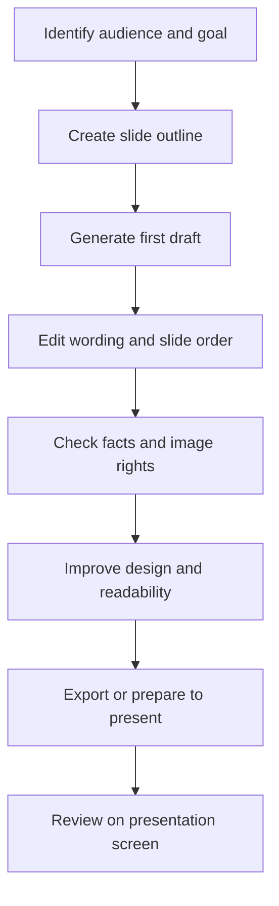

# Lesson 29 — AI for Presentations with Gamma

**Week:** 6 · **Duration:** 120 minutes · **Level:** Beginner  
**Practical focus:** 90 minutes · **Theory and demonstration:** 20 minutes · **Review:** 10 minutes

## Learning outcomes
Students will plan a presentation for a defined audience, use an AI presentation tool such as Gamma where available, improve the generated structure and visuals, check facts and sources, and export or present the final work.

## Key terms
Audience, objective, outline, slide hierarchy, visual, theme, speaker notes, citation, export, presentation review.

## 1. What is an AI presentation tool?
AI presentation tools can turn a topic or outline into a first draft of slides. Gamma is one example. Depending on current account access and product changes, it may offer different ways to generate, edit, share or export presentations. Features, free limits, branding and export options can change.

AI-generated slides are a starting point, not a finished presentation. The student must decide what the audience needs to learn and check the content.

## 2. Plan before generating
Answer these questions:
1. Who is the audience?
2. What should they understand or do?
3. How long is the presentation?
4. What are the three to five main points?
5. Which facts need reliable sources?
6. What visual would clarify each point?

A useful prompt:
“Create an outline for a six-slide beginner presentation for academy students titled ‘How to Stay Safe Online’. Use simple English. Include a title slide, four teaching slides and a final recap. Keep each slide focused on one idea. Suggest a suitable visual for each slide. Do not invent statistics or claim that a source was checked.”

## 3. Improve slide quality
A good slide:
- Has one main message.
- Uses a short heading.
- Contains concise, readable text.
- Uses a meaningful visual rather than decoration.
- Has consistent fonts, spacing and colours.
- Gives charts clear labels and units.
- Includes a source note for factual claims.

Avoid paragraphs copied directly from AI. Explain details verbally or in speaker notes. Use strong contrast and readable font sizes. Check the presentation on the screen or projector that students will use.

## 4. Verify images and facts
Check every statistic, date, quotation and technical claim against a reliable source. Confirm that images are licensed for the intended use or created by you. Do not use an image just because an AI tool supplied it. Add source credits where required. Avoid fake charts and invented citations.

## 5. Export and review
If export is available, save an editable version and a PDF or PowerPoint copy as appropriate. Open the exported file and check fonts, image placement, slide order, page breaks and links. If the product requires a paid plan for a particular export, use a permitted alternative such as PowerPoint or LibreOffice Impress.

## Presentation workflow

## Practical activity — Create a six-slide online safety presentation
1. Write the audience and learning goal.
2. Prepare a six-slide outline before opening the AI tool.
3. Use Gamma or another academy-approved tool to generate a first draft if access permits.
4. Edit slide titles so each communicates one clear point.
5. Replace any long paragraph with concise bullets or a visual.
6. Check at least three factual claims against reliable sources.
7. Add a source/credits slide.
8. Review colours, contrast, font size, alignment and image relevance.
9. Export to PDF or PowerPoint if available, then inspect the file.
10. Present the key message in two minutes.

**Offline alternative:** Use the same outline and design principles in PowerPoint or LibreOffice Impress. AI access is not required to meet the presentation learning outcomes.

## Understanding check
1. Why should an outline be created before generating slides?
2. What is one sign that a slide contains too much text?
3. Why must statistics and images be checked?
4. What should you inspect after exporting?
5. What can you use if Gamma export is unavailable?

## Homework
Create a five- to seven-slide presentation on a digital learning topic. Include a clear audience, one main idea per slide, readable visuals and a source/credits slide. Write a short reflection describing two changes you made to the AI draft or template.

## Instructor notes
- Verify Gamma availability, account requirements and export limits before class.
- Never require a paid subscription. Prepare PowerPoint/Impress templates as alternatives.
- Students must not enter private academy information into public tools.
- Evaluate communication and verification, not the number of AI-generated slides.
- Ask students to explain why they selected each visual.

## Completion checklist
- [ ] Student identifies audience and purpose.
- [ ] Student creates a slide outline.
- [ ] Student improves the generated or template-based draft.
- [ ] Student checks factual claims and image credits.
- [ ] Student reviews the exported or presentation-ready file.
