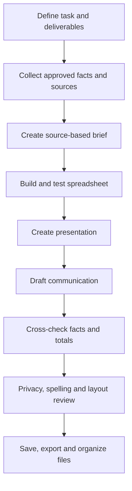

# Lesson 30 — AI for Complete Office Workflows

**Week:** 6 · **Duration:** 120 minutes · **Level:** Beginner  
**Practical focus:** 90 minutes · **Theory and demonstration:** 20 minutes · **Review:** 10 minutes

## Learning outcomes
Students will plan a small office task, use suitable AI assistance across research, Word, Excel and presentations, maintain consistent information, check all outputs, organize files and explain where AI was used.

## Key terms
Workflow, deliverable, source of truth, version, quality check, file naming, review, disclosure, privacy.

## 1. Think in workflows, not isolated prompts
A real office task often creates several connected files. For example, an academy technology-awareness event may need:
- A source-based one-page information brief.
- An Excel budget or participant-planning sheet.
- A presentation for the event.
- A short email draft to share the materials.

The files should use consistent dates, names, totals and messages. Choose one approved source of facts and keep it as the source of truth.

## 2. A reliable end-to-end process
1. Define the task, audience, deadline and deliverables.
2. List what information is known and what needs confirmation.
3. Gather and verify approved sources.
4. Create an outline and plan the files.
5. Use AI for suitable first drafts, explanations or formula suggestions.
6. Build and format each file in the correct office application.
7. Check facts, calculations, spelling, accessibility and visual quality.
8. Compare details across files for consistency.
9. Save editable versions and final export copies.
10. Organize the folder and record how AI was used.

## 3. Quality gates
**Research gate:** Are sources reliable and claims supported?

**Writing gate:** Are the purpose, tone, names and dates correct?

**Spreadsheet gate:** Are formulas tested and totals reconciled?

**Presentation gate:** Are slides readable, accurate and credited?

**Privacy gate:** Is the information approved for the tool?

**Final delivery gate:** Do files open correctly and use clear names?

## 4. Responsible AI use
- Never invent missing facts. Mark them for confirmation.
- Do not paste private student, employee, customer or financial records into public AI services.
- Keep a human review step before sharing or publishing.
- Follow academy rules about disclosure and academic honesty.
- Keep original files and use version names such as `Draft` and `Final`.
- Do not assume that a tool's output is confidential or that it owns the rights to generated material.

## Integrated workflow

## Practical activity — Academy Digital Safety Event Package
Use fictional dates, names, attendance figures and costs.

Create one folder named `Week-06-Integrated-Office-Project` with these deliverables:

1. **Research brief (Word/PDF):** one page explaining three online safety practices. Use two teacher-approved sources and list them.
2. **Planning workbook (Excel/Calc):** fictional event costs, quantity, unit cost and total. Use formulas and verify the grand total manually.
3. **Presentation (PowerPoint/Gamma/Impress):** five or six slides for students, with concise points and source credits.
4. **Email draft:** a short message to the fictional academy coordinator explaining the package and listing attachments. Do not send it.
5. **AI use note:** a short record of which tools were used, what they helped with and what the student checked or changed.

Final review:
- Are the date, event name and key facts consistent?
- Do spreadsheet totals match manual calculations?
- Are presentation claims supported?
- Do the PDF and presentation open correctly?
- Are file names clear?
- Is any private information included by mistake?

**Offline alternative:** Complete the workflow with teacher-provided source sheets, templates and formula examples. Students still perform all verification and file-management steps.

## Understanding check
1. What is a source of truth?
2. Why should the same event date be checked across every file?
3. What is a quality gate?
4. Why must spreadsheet totals be checked independently?
5. What should an AI use note explain?

## Homework
Improve the integrated package using instructor feedback. Submit the folder with editable files, final exports, source list and AI use note.

## Instructor notes
- Prepare fictional event facts, approved sources and a sample folder structure.
- Provide an alternative workflow that does not depend on paid tools or student accounts.
- Review student files for personal data before any public upload.
- Assess consistency and verification across deliverables, not just visual polish.
- Ask each student to explain one AI suggestion they rejected or changed and why.

## Completion checklist
- [ ] Student plans multiple connected deliverables.
- [ ] Student creates research, spreadsheet, presentation and email outputs.
- [ ] Student checks consistency across files.
- [ ] Student verifies formulas and source claims.
- [ ] Student organizes final files and documents AI use.
