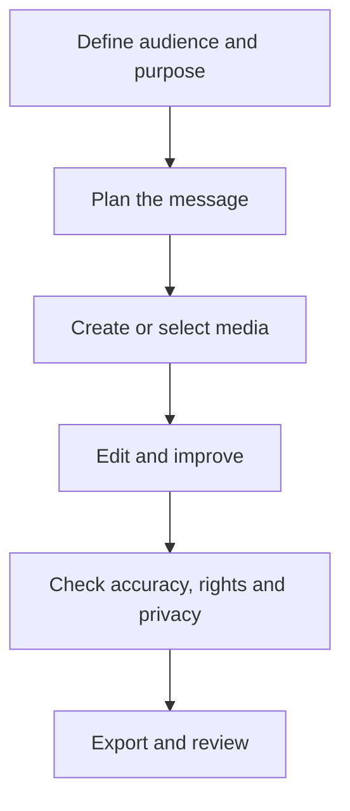

# Lesson 31 — AI Image Generation and Graphic Design

**Course:** Computer Fundamentals and Artificial Intelligence Foundation Course  
**Academy:** Next Generation Academy  
**Week:** 7 of 8  
**Duration:** 120 minutes  
**Level:** Beginner  
**Delivery:** Instructor-led, practical-first; simple English

## Lesson purpose
Learn how text-to-image systems work at a practical level, write clear image prompts, evaluate generated images and use visuals responsibly.

## Learning outcomes
By the end of this lesson, students should be able to:
- Explain text-to-image generation in simple terms and identify suitable uses.
- Write prompts that specify subject, purpose, setting, composition, style and aspect ratio.
- Generate and compare image variations using an available tool or an instructor-provided demonstration.
- Identify common image errors and revise a prompt or edit the result.
- Check rights, privacy, attribution and suitability before using an image.

## Key terms
text-to-image, prompt, subject, composition, aspect ratio, resolution, variation, artefact, licensing, attribution

## Student lecture notes

## 1. What is AI image generation?
An AI image generator creates a new image from a written description or other supported input. The result is a generated image, not proof that the described event or object exists. A generated picture can look realistic and still contain errors.

## 2. Where can it help?
Examples include concept art, classroom illustrations, background ideas, storyboards, poster backgrounds and visual brainstorming. It can save time when exploring ideas. It does not replace checking facts, design judgment or permission to use a person's likeness.

## 3. Build a useful image prompt
A clear prompt tells the tool what to create and why. Use this beginner-friendly order:
1. **Purpose and audience:** what is the image for, and who will see it?
2. **Subject:** the main person, object or scene.
3. **Action and setting:** what is happening and where?
4. **Composition:** framing, viewpoint, subject position and empty space.
5. **Style:** photograph, clean vector illustration, 3D render, watercolor, diagram, etc.
6. **Lighting and mood:** soft daylight, dramatic side light, bright and friendly, calm and professional.
7. **Format:** landscape, square or portrait; add an aspect ratio if useful and supported.
8. **Text:** provide exact wording in quotation marks, or ask for no text and add it later.
9. **Limits:** what must stay unchanged, and what should be avoided?

**Reusable pattern:** “Create a [type of image] for [purpose/audience]. Show [subject] [action] in [setting]. Use [composition] and [visual style]. Set the mood with [lighting/colour]. Format: [shape/ratio]. Text: [exact words or no text]. Keep [important details] and avoid [unwanted details].”

Example: “Create a clean, student-friendly vector illustration for a beginner computer class. Show a student using a desktop computer in a bright classroom. Keep the computer and student clearly visible, use simple shapes and readable visual hierarchy, landscape 16:9, no words, no logos.”

A prompt does not need every element. Start with the purpose, subject and style; add more detail only when it improves the result. See the [Image Generation and Prompting Guide](IMAGE-GENERATION-PROMPTING-GUIDE.md) for templates and examples.

## 4. Composition and quality
A good image has one clear focal point, balanced space, suitable contrast and a layout that supports its purpose. Useful terms include close-up, medium shot, wide shot, high angle, low angle, rule of thirds, negative space and leading lines. Negative space is especially useful when a poster or thumbnail needs room for a real headline.

Lighting words can shape mood: soft light gives gentle shadows; hard light creates strong shadows; side lighting reveals shape; backlighting can outline a subject. Photography terms such as 85mm lens, shallow depth of field, bokeh and Rembrandt lighting are optional style cues. They do not guarantee accurate physical camera simulation. Beginners do not need to memorise camera models, ISO or aperture settings.

Choose a format that suits the task: landscape 16:9 for a slide or video frame, square 1:1 for a square post, portrait 4:5 for a vertical feed graphic, or 9:16 for a short-video frame. Confirm current platform and tool settings before export.

Check hands, faces, object geometry, screen text, labels, repeated objects, shadows and background details. AI systems can still misspell or invent details. Some tools render text better than others, but always proofread important names, dates, numbers and claims. Add or correct critical text in a design editor.

## 5. Generate, edit and refine
Generating a new image means describing the whole scene. Editing an existing image means stating exactly what should change and what must remain the same. For example: “Change only the backpack colour to dark blue. Keep the person's pose, clothing, face, background, lighting and framing unchanged.”

Use reference images only when the tool supports them and explain each image's role (for example, pose reference, colour reference or product-shape reference). Obtain permission before using a person's likeness. Do not use private student photos or confidential information. Check the tool's current age and school-account rules; some image-editing features have higher age restrictions than image generation. Never bypass an age restriction.

Improve a result in small steps: generate a first draft, identify the biggest issue, change one or two details, compare versions and keep the best result. Do not assume every tool has the same editing controls.

## 6. Rights, privacy and responsible use
Tool terms and commercial-use rights differ. Read the current terms before publishing or selling an output. Do not upload private student photographs, identity documents, confidential records or another person's image without permission. Do not create deceptive evidence, impersonations or harmful images. Label AI-generated content when the audience could reasonably mistake it for documentary photography.

## 7. Accessibility
Use visuals that support learning, not decoration alone. Provide meaningful alternative text when publishing online. Keep important information in text as well as images, use sufficient contrast and avoid tiny labels.

## Visual learning map

## Instructor preparation
- Review this lesson and prepare one safe demonstration or sample project.
- Test the selected software and internet connection before class; prepare screenshots or offline samples.
- Use fictional scenarios and approved assets. Do not display student personal data, private accounts or passwords.
- Check current tool terms, age requirements, access and export options. Never make a paid tool compulsory.
- Prepare a non-AI alternative so every student can complete the learning objective.

## 120-minute lesson plan

| Time | Teaching activity |
|---|---|
| 0–10 min | Starter question, connect to prior learning and explain the lesson goal |
| 10–20 min | Explain core concepts and key terms |
| 20–35 min | Instructor demonstration and quality/safety review |
| 35–65 min | Guided practical activity with step-by-step support |
| 65–100 min | Independent or pair task; instructor observes and supports |
| 100–110 min | Peer review and improvement |
| 110–120 min | Quiz, recap, save work and assign homework |

## Instructor demonstration
Demonstrate one prompt with a clear purpose. Generate or show two variations. Model a quality review: purpose, focal point, composition, errors, privacy and usage terms. Improve the prompt by changing only one or two details.

## Practical activity
Students create a visual concept for a computer-safety lesson. They write a prompt, generate one or more options if a tool is available, then score the result using the workbook checklist. If generation is unavailable, they annotate a supplied sample and practise rewriting its prompt.

### Evidence students should save
- A clearly named project folder.
- Prompt, script or planning notes used.
- Draft and final output (or the completed offline alternative).
- A short quality and responsible-use checklist.

## Understanding check
Answer orally or in writing:
1. What does a text-to-image tool produce?
2. Name four useful parts of an image prompt.
3. Why should important words usually be added in a design editor?
4. Name three visual errors to inspect.
5. Why must tool usage rights be checked before publication?

## Homework
Prepare a prompt and a one-paragraph design rationale for an educational illustration. Record the tool used (or state that a sample was used), the changes made and the checks completed.

## Instructor notes
- Demonstrate one step at a time; allow students to repeat each step before moving on.
- Ask students to explain why they made a design or production choice, not only which button they clicked.
- Do not treat a polished AI output as proof of understanding. Ask students to identify edits, errors and checks.
- If a tool is unavailable, use the prepared sample, paper storyboard, presentation software or conventional editor.
- Assess learning outcomes, not access to premium accounts or expensive devices.

## Lesson completion checklist
- [ ] Student can explain the key terms in simple language.
- [ ] Student completes the practical task or approved alternative.
- [ ] Student checks output quality and accuracy.
- [ ] Student follows privacy, consent and copyright rules.
- [ ] Student saves evidence in the correct Week 7 folder.
- [ ] Instructor records support needs and next steps.

---
*This lesson is part of the academy's internal teaching programme. Tool interfaces and availability may change; verify them before delivery.*
