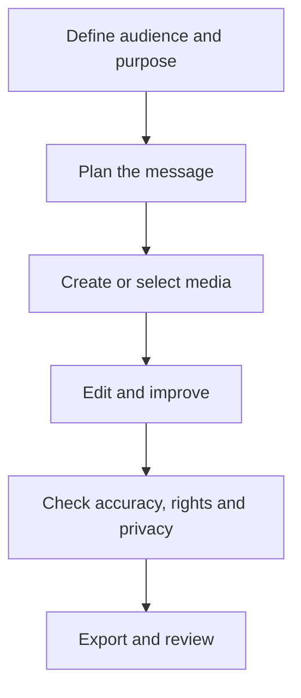

# Lesson 32 — AI Posters, Thumbnails and Social Media Design

**Course:** Computer Fundamentals and Artificial Intelligence Foundation Course  
**Academy:** Next Generation Academy  
**Week:** 7 of 8  
**Duration:** 120 minutes  
**Level:** Beginner  
**Delivery:** Instructor-led, practical-first; simple English

## Lesson purpose
Apply basic graphic-design principles and AI assistance to create clear posters, thumbnails and social posts for a defined audience.

## Learning outcomes
By the end of this lesson, students should be able to:
- Identify audience, purpose and one main message before designing.
- Use hierarchy, alignment, contrast, spacing, colour and typography.
- Create a poster, thumbnail and social post using an available editor or paper-based alternative.
- Use AI for ideas and assets while checking facts, text, rights and accessibility.
- Export a suitable image and keep an editable source file.

## Key terms
visual hierarchy, alignment, contrast, whitespace, typography, brand consistency, thumbnail, call to action, export

## Student lecture notes

## 1. Design starts with communication
Before opening an editor, answer: Who is the audience? What should they understand? What should they do next? A design with one clear message is usually stronger than a crowded design containing many unrelated details.

## 2. Six useful design principles
- **Hierarchy:** make the most important information easiest to notice.
- **Alignment:** line up related elements to create order.
- **Contrast:** make text and important objects easy to distinguish.
- **Spacing:** leave breathing room; do not fill every empty area.
- **Typography:** use a small number of readable typefaces and clear size differences.
- **Consistency:** repeat colours, shapes and logo placement in a controlled way.

## 3. Posters
A poster usually needs a clear headline, one supporting visual, essential details, a date/time or contact if relevant, and a clear call to action. Check every spelling, date, location and contact detail manually. Do not invent academy events or contact information.

## 4. Video thumbnails
A thumbnail should communicate the video topic quickly. Use one main subject, strong contrast and very few words. Text must remain readable at small size. Avoid misleading expressions, fake results or visuals that promise something the video does not deliver.

## 5. Social media posts
Match the design to the platform's current size recommendations. These can change, so check the platform or editor before export. Keep the core message readable on a phone. Do not publish student faces or personal details without approved consent.

## 6. Using AI and an editor together
Ask AI for headline options, layout ideas, colour suggestions or a design checklist. Generate background concepts separately if useful. Assemble and correct the final layout in an editor such as Canva, a presentation application or another available tool. Never trust generated text without proofreading.

## 7. Export and review
Keep an editable project where possible and export a final PNG or JPG for ordinary graphics. Check dimensions, file size, cropping, spelling, contrast, image rights and mobile readability. Include attribution where required.

## Visual learning map

## Instructor preparation
- Review this lesson and prepare one safe demonstration or sample project.
- Test the selected software and internet connection before class; prepare screenshots or offline samples.
- Use fictional scenarios and approved assets. Do not display student personal data, private accounts or passwords.
- Check current tool terms, age requirements, access and export options. Never make a paid tool compulsory.
- Prepare a non-AI alternative so every student can complete the learning objective.

## 120-minute lesson plan

| Time | Teaching activity |
|---|---|
| 0–10 min | Starter question, connect to prior learning and explain the lesson goal |
| 10–20 min | Explain core concepts and key terms |
| 20–35 min | Instructor demonstration and quality/safety review |
| 35–65 min | Guided practical activity with step-by-step support |
| 65–100 min | Independent or pair task; instructor observes and supports |
| 100–110 min | Peer review and improvement |
| 110–120 min | Quiz, recap, save work and assign homework |

## Instructor demonstration
Show a poor crowded poster and improve it using hierarchy, spacing and contrast. Demonstrate an AI-assisted headline brainstorm, then manually verify and place the final wording in the editor.

## Practical activity
Create (1) an academy computer-safety poster, (2) a thumbnail for a beginner technology lesson and (3) a square social post announcing a fictional learning activity. Use only approved academy details or clearly marked fictional details.

### Evidence students should save
- A clearly named project folder.
- Prompt, script or planning notes used.
- Draft and final output (or the completed offline alternative).
- A short quality and responsible-use checklist.

## Understanding check
Answer orally or in writing:
1. What is visual hierarchy?
2. Why should a thumbnail use very little text?
3. Name four design principles.
4. Why must poster details be checked manually?
5. What is the benefit of keeping an editable source file?

## Homework
Revise one design after peer feedback. Submit the exported image, editable file if available, and a short checklist explaining audience, message, hierarchy, readability and rights checks.

## Instructor notes
- Demonstrate one step at a time; allow students to repeat each step before moving on.
- Ask students to explain why they made a design or production choice, not only which button they clicked.
- Do not treat a polished AI output as proof of understanding. Ask students to identify edits, errors and checks.
- If a tool is unavailable, use the prepared sample, paper storyboard, presentation software or conventional editor.
- Assess learning outcomes, not access to premium accounts or expensive devices.

## Lesson completion checklist
- [ ] Student can explain the key terms in simple language.
- [ ] Student completes the practical task or approved alternative.
- [ ] Student checks output quality and accuracy.
- [ ] Student follows privacy, consent and copyright rules.
- [ ] Student saves evidence in the correct Week 7 folder.
- [ ] Instructor records support needs and next steps.

---
*This lesson is part of the academy's internal teaching programme. Tool interfaces and availability may change; verify them before delivery.*
