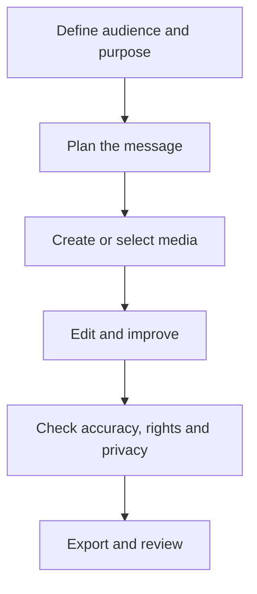

# Lesson 33 — YouTube Channel Planning and Content Strategy

**Course:** Computer Fundamentals and Artificial Intelligence Foundation Course  
**Academy:** Next Generation Academy  
**Week:** 7 of 8  
**Duration:** 120 minutes  
**Level:** Beginner  
**Delivery:** Instructor-led, practical-first; simple English

## Lesson purpose
Plan a useful, responsible educational channel and create a realistic content plan before recording or publishing.

## Learning outcomes
By the end of this lesson, students should be able to:
- Define a channel purpose, audience and topic focus.
- Develop suitable video ideas and titles without misleading viewers.
- Create a simple content calendar and video outline.
- Explain basic copyright, privacy, community and platform-safety responsibilities.
- Use AI to brainstorm and organise ideas while verifying claims.

## Key terms
niche, target audience, channel promise, content pillar, hook, title, description, call to action, content calendar, copyright

## Student lecture notes

## 1. Start with a channel purpose
A channel should help a specific audience with a recognisable type of content. A beginner-friendly education channel might explain computer skills, study techniques or safe technology use. Choose a topic that the creator can research and sustain.

## 2. Define the audience
Describe the intended viewers by their learning needs, not by private personal information. Ask what they already know, what they want to learn and what language/format is accessible. Avoid targeting or collecting information about children unnecessarily.

## 3. Create content pillars
Content pillars are a small number of recurring topic groups. Example for a computer-learning channel:
- Computer basics
- Windows and digital productivity
- Responsible AI and digital safety
Each video should fit the channel purpose and provide a clear benefit.

## 4. Video ideas, titles and hooks
A good title is accurate and specific. A hook is the opening that tells viewers why the video is useful. Do not use false urgency, fake promises, misleading thumbnails or fabricated expertise. AI can brainstorm ideas, but the creator must verify facts and suitability.

## 5. Outline and content calendar
A simple educational outline can include: opening question, learning goal, explanation, demonstration, recap and next step. A calendar records topic, intended audience, format, preparation, recording and review dates. Plan a sustainable schedule rather than promising frequent uploads that cannot be maintained.

## 6. Descriptions and sources
Write a concise description of the video's real content. Add source links for claims and credit third-party material when required. Do not paste AI-generated references without checking that they exist and support the claim.

## 7. Responsible publishing
Respect copyright and licence terms for music, images, video clips and fonts. Obtain appropriate consent before recording identifiable people, especially students. Avoid showing phone numbers, email inboxes, passwords, student records, home addresses or private screens. Review the platform's current community guidelines and child-safety requirements before publishing.

## 8. Measure quality
Use meaningful signals such as viewer questions, completion of learning objectives and constructive feedback. Views alone do not prove educational quality. Improve one aspect at a time: clarity, audio, pacing, title accuracy or visual readability.

## Visual learning map

## Instructor preparation
- Review this lesson and prepare one safe demonstration or sample project.
- Test the selected software and internet connection before class; prepare screenshots or offline samples.
- Use fictional scenarios and approved assets. Do not display student personal data, private accounts or passwords.
- Check current tool terms, age requirements, access and export options. Never make a paid tool compulsory.
- Prepare a non-AI alternative so every student can complete the learning objective.

## 120-minute lesson plan

| Time | Teaching activity |
|---|---|
| 0–10 min | Starter question, connect to prior learning and explain the lesson goal |
| 10–20 min | Explain core concepts and key terms |
| 20–35 min | Instructor demonstration and quality/safety review |
| 35–65 min | Guided practical activity with step-by-step support |
| 65–100 min | Independent or pair task; instructor observes and supports |
| 100–110 min | Peer review and improvement |
| 110–120 min | Quiz, recap, save work and assign homework |

## Instructor demonstration
Model a one-page channel plan for a fictional beginner computer-skills channel. Use AI to suggest topic ideas, then reject ideas that are inaccurate, too broad or unsuitable for the audience.

## Practical activity
In pairs, create a channel purpose, audience description, three content pillars, ten video ideas, three accurate titles and a four-week content calendar for a fictional educational channel.

### Evidence students should save
- A clearly named project folder.
- Prompt, script or planning notes used.
- Draft and final output (or the completed offline alternative).
- A short quality and responsible-use checklist.

## Understanding check
Answer orally or in writing:
1. What is a channel niche or focus?
2. What makes a title misleading?
3. What is a content pillar?
4. Why should AI-suggested facts and sources be checked?
5. Name four privacy or copyright checks before publishing.

## Homework
Write a 60–90 second outline for one planned video. Include the hook, learning objective, three main points, demonstration and recap. Add source notes for factual claims.

## Instructor notes
- Demonstrate one step at a time; allow students to repeat each step before moving on.
- Ask students to explain why they made a design or production choice, not only which button they clicked.
- Do not treat a polished AI output as proof of understanding. Ask students to identify edits, errors and checks.
- If a tool is unavailable, use the prepared sample, paper storyboard, presentation software or conventional editor.
- Assess learning outcomes, not access to premium accounts or expensive devices.

## Lesson completion checklist
- [ ] Student can explain the key terms in simple language.
- [ ] Student completes the practical task or approved alternative.
- [ ] Student checks output quality and accuracy.
- [ ] Student follows privacy, consent and copyright rules.
- [ ] Student saves evidence in the correct Week 7 folder.
- [ ] Instructor records support needs and next steps.

---
*This lesson is part of the academy's internal teaching programme. Tool interfaces and availability may change; verify them before delivery.*
