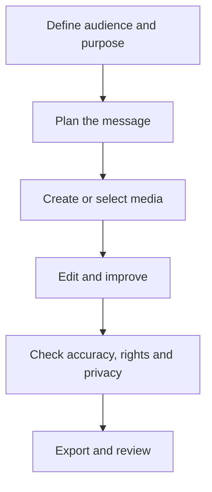

# Lesson 34 — AI Video Creation and YouTube Shorts

**Course:** Computer Fundamentals and Artificial Intelligence Foundation Course  
**Academy:** Next Generation Academy  
**Week:** 7 of 8  
**Duration:** 120 minutes  
**Level:** Beginner  
**Delivery:** Instructor-led, practical-first; simple English

## Lesson purpose
Plan and produce a short, clear video using a script, storyboard, safe media, basic editing and a final quality check.

## Learning outcomes
By the end of this lesson, students should be able to:
- Explain a simple short-video production workflow.
- Write a short script with a hook, useful content and conclusion.
- Create a storyboard with shots, visuals and narration.
- Use an available AI video tool or conventional editor safely and critically.
- Review aspect ratio, pacing, captions, audio, accuracy and export.

## Key terms
short-form video, script, storyboard, shot, scene, aspect ratio, timeline, transition, caption, render/export

## Student lecture notes

## 1. Plan before generating
A short video still needs a purpose and audience. Decide what one idea the viewer should remember. Keep the scope small enough to explain clearly in the available time.

## 2. A simple script structure
- **Hook:** introduce a question or useful result honestly.
- **Context:** explain what the viewer will learn.
- **Main steps:** show a small number of clear actions.
- **Recap:** repeat the key learning.
- **Next step:** invite a relevant action without pressure or false claims.

Write for speech. Use short sentences and familiar words. Read the script aloud and remove unnecessary phrases.

## 3. Storyboard
A storyboard is a sequence of planned shots. For each shot, record its purpose, what appears on screen, narration, on-screen text and approximate duration. This prevents random clips from being assembled without a clear story.

## 4. AI video tools and alternatives
Some tools can generate clips from text or images; others help with editing, captions or scene planning. Features, access, prices and regional availability change. Use only tools currently available to the class and check their terms. A normal phone camera, screen recorder, slideshow or basic video editor is a valid alternative. Students must still understand the planning and editing process.

## 5. Editing fundamentals
Arrange clips in a logical timeline. Remove long pauses and accidental footage. Use transitions only when they help. Keep text away from screen edges and make it readable on a phone. Use a consistent visual style and avoid excessive effects.

## 6. YouTube Shorts and format
Short-form platform specifications can change. Check the current YouTube requirements before publishing. A vertical 9:16 frame is commonly used for Shorts, but verify the current duration and eligibility rules rather than memorising a permanent limit. Keep important content inside safe margins.

## 7. Review and export
Check factual accuracy, visual continuity, audio level, captions, spelling, crop, resolution, file format and rights. Watch the complete export on a phone-sized display if possible. Never publish a generated clip that misrepresents a real person or event.

## Visual learning map

## Instructor preparation
- Review this lesson and prepare one safe demonstration or sample project.
- Test the selected software and internet connection before class; prepare screenshots or offline samples.
- Use fictional scenarios and approved assets. Do not display student personal data, private accounts or passwords.
- Check current tool terms, age requirements, access and export options. Never make a paid tool compulsory.
- Prepare a non-AI alternative so every student can complete the learning objective.

## 120-minute lesson plan

| Time | Teaching activity |
|---|---|
| 0–10 min | Starter question, connect to prior learning and explain the lesson goal |
| 10–20 min | Explain core concepts and key terms |
| 20–35 min | Instructor demonstration and quality/safety review |
| 35–65 min | Guided practical activity with step-by-step support |
| 65–100 min | Independent or pair task; instructor observes and supports |
| 100–110 min | Peer review and improvement |
| 110–120 min | Quiz, recap, save work and assign homework |

## Instructor demonstration
Turn a 45-second computer-safety script into a four- or five-shot storyboard. Demonstrate a simple edit with title, clips, narration or captions, and final playback.

## Practical activity
Create a 30–60 second educational short on one safe topic: creating a strong password (without revealing real passwords), identifying a phishing message, or organising files. Use recorded demonstration footage, slides or permitted AI-generated visuals.

### Evidence students should save
- A clearly named project folder.
- Prompt, script or planning notes used.
- Draft and final output (or the completed offline alternative).
- A short quality and responsible-use checklist.

## Understanding check
Answer orally or in writing:
1. What is a storyboard?
2. Name the five parts of a simple educational script.
3. Why should platform format rules be checked before publishing?
4. Name four editing or export checks.
5. Why is a conventional editor a valid alternative to generative AI video?

## Homework
Improve the short after peer review. Submit the script, storyboard, final video or prototype, and a quality-control checklist. If equipment or tool access prevents export, submit a complete storyboard and edited sequence plan.

## Instructor notes
- Demonstrate one step at a time; allow students to repeat each step before moving on.
- Ask students to explain why they made a design or production choice, not only which button they clicked.
- Do not treat a polished AI output as proof of understanding. Ask students to identify edits, errors and checks.
- If a tool is unavailable, use the prepared sample, paper storyboard, presentation software or conventional editor.
- Assess learning outcomes, not access to premium accounts or expensive devices.

## Lesson completion checklist
- [ ] Student can explain the key terms in simple language.
- [ ] Student completes the practical task or approved alternative.
- [ ] Student checks output quality and accuracy.
- [ ] Student follows privacy, consent and copyright rules.
- [ ] Student saves evidence in the correct Week 7 folder.
- [ ] Instructor records support needs and next steps.

---
*This lesson is part of the academy's internal teaching programme. Tool interfaces and availability may change; verify them before delivery.*
