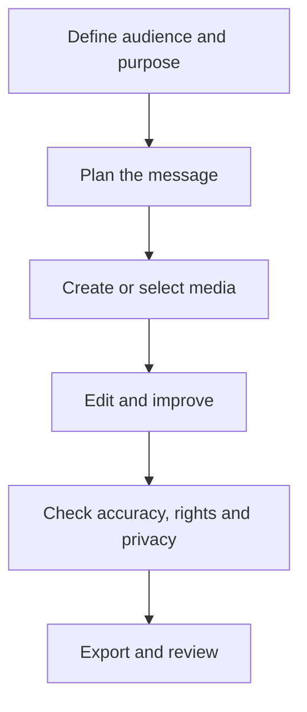

# Lesson 35 — AI Audio, Voice, Captions and Complete Content Production

**Course:** Computer Fundamentals and Artificial Intelligence Foundation Course  
**Academy:** Next Generation Academy  
**Week:** 7 of 8  
**Duration:** 120 minutes  
**Level:** Beginner  
**Delivery:** Instructor-led, practical-first; simple English

## Lesson purpose
Understand audio and caption workflows, create accessible content and apply consent, identity and deepfake safeguards.

## Learning outcomes
By the end of this lesson, students should be able to:
- Distinguish text-to-speech, speech-to-text and voice generation.
- Record or prepare clear narration and improve basic audio quality.
- Create and correct captions or a transcript.
- Explain consent and risks around voice cloning and synthetic media.
- Assemble and quality-check a complete short educational content package.

## Key terms
text-to-speech, speech-to-text, voice cloning, narration, transcript, captions, subtitle, noise reduction, deepfake, consent

## Student lecture notes

## 1. Audio tools
- **Text-to-speech (TTS):** converts written text into spoken audio.
- **Speech-to-text (STT):** converts spoken audio into written text.
- **Voice generation or cloning:** creates synthetic speech, sometimes designed to resemble a particular voice.
These functions may be built into separate tools or combined in one product. Access and quality vary.

## 2. Record clear narration
Choose a quiet room. Place the microphone at a steady distance. Speak clearly and at a comfortable pace. Record a short test and listen before recording the full script. Avoid background music that competes with speech.

## 3. Basic audio editing
Remove accidental silence and distracting noise where possible. Keep volume consistent. Use fades when they make an edit smoother. Do not apply effects that make speech difficult to understand. Always listen to the exported file.

## 4. Captions and transcripts
Captions make video more accessible and help viewers in noisy environments. Automatic captions can mishear names, technical terms, accents and numbers. Review every line against the audio. Use readable contrast, sensible line breaks and enough display time. A transcript is the written version of spoken content; captions are timed to the media.

## 5. Consent and voice identity
Do not clone, imitate or publish another person's voice without explicit permission and compliance with the tool's rules and applicable law. Never use synthetic audio to impersonate someone, fabricate a statement or deceive an audience. Clearly disclose synthetic voice use when needed to prevent confusion.

## 6. Deepfakes and media literacy
A deepfake is synthetic or altered media that can make a person appear to say or do something they did not. Do not assume a voice or video is authentic just because it sounds or looks convincing. Check the source, context and corroborating evidence before sharing.

## 7. Complete production workflow
Plan → script → storyboard → prepare visuals → record or generate permitted narration → edit → create captions → verify facts and rights → export → review. Keep project files organised and protect private information.

## Visual learning map

## Instructor preparation
- Review this lesson and prepare one safe demonstration or sample project.
- Test the selected software and internet connection before class; prepare screenshots or offline samples.
- Use fictional scenarios and approved assets. Do not display student personal data, private accounts or passwords.
- Check current tool terms, age requirements, access and export options. Never make a paid tool compulsory.
- Prepare a non-AI alternative so every student can complete the learning objective.

## 120-minute lesson plan

| Time | Teaching activity |
|---|---|
| 0–10 min | Starter question, connect to prior learning and explain the lesson goal |
| 10–20 min | Explain core concepts and key terms |
| 20–35 min | Instructor demonstration and quality/safety review |
| 35–65 min | Guided practical activity with step-by-step support |
| 65–100 min | Independent or pair task; instructor observes and supports |
| 100–110 min | Peer review and improvement |
| 110–120 min | Quiz, recap, save work and assign homework |

## Instructor demonstration
Show a short narration recording and an automatic caption draft. Deliberately identify a likely caption error and correct it. Explain why a real person's voice must not be cloned without consent.

## Practical activity
Students produce a 30–60 second audio-supported educational clip or narrated slide sequence. Include a transcript or captions, a source note and a statement describing whether any AI-generated voice or visual was used.

### Evidence students should save
- A clearly named project folder.
- Prompt, script or planning notes used.
- Draft and final output (or the completed offline alternative).
- A short quality and responsible-use checklist.

## Understanding check
Answer orally or in writing:
1. What is the difference between TTS and STT?
2. Why must automatic captions be reviewed?
3. What is voice cloning?
4. Why is consent essential when using another person's voice?
5. Name four checks before publishing audio-video content.

## Homework
Submit the final clip or narrated-slide prototype, corrected transcript/captions and a short responsible-use reflection covering consent, copyright, accuracy and accessibility.

## Instructor notes
- Demonstrate one step at a time; allow students to repeat each step before moving on.
- Ask students to explain why they made a design or production choice, not only which button they clicked.
- Do not treat a polished AI output as proof of understanding. Ask students to identify edits, errors and checks.
- If a tool is unavailable, use the prepared sample, paper storyboard, presentation software or conventional editor.
- Assess learning outcomes, not access to premium accounts or expensive devices.

## Lesson completion checklist
- [ ] Student can explain the key terms in simple language.
- [ ] Student completes the practical task or approved alternative.
- [ ] Student checks output quality and accuracy.
- [ ] Student follows privacy, consent and copyright rules.
- [ ] Student saves evidence in the correct Week 7 folder.
- [ ] Instructor records support needs and next steps.

---
*This lesson is part of the academy's internal teaching programme. Tool interfaces and availability may change; verify them before delivery.*
