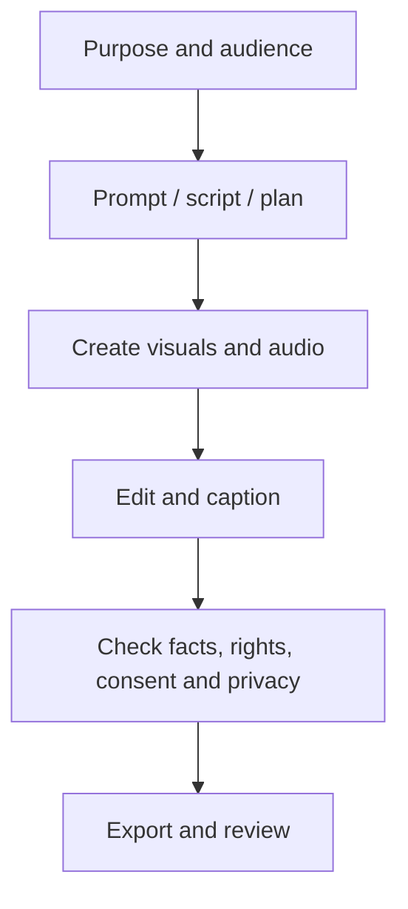
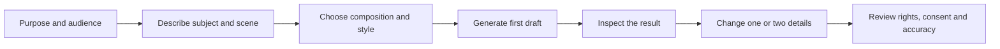

# Week 7 — Visual and Screenshot Guide
## Genuine learning aids for AI design, video and digital content

This guide identifies visuals that should be captured or created. It does not claim that real screenshots or academy photographs are already included. Capture current interfaces from the software actually used in class.

## Visuals to place inside lesson files

| Lesson | Recommended visual | Placement / teaching purpose |
|---|---|---|
| 31 | Prompt anatomy diagram; composition and negative-space examples; first-draft/revision comparison; image quality review grid | Beside prompt-writing, composition and iterative-editing sections |
| 32 | Poster hierarchy example; thumbnail safe-area example | Beside design principles and export |
| 33 | Channel planning flow; sample content calendar | Beside channel strategy |
| 34 | Script-to-storyboard sequence; simple editing timeline | Beside video workflow |
| 35 | TTS/STT comparison; caption correction example; production workflow | Beside audio and accessibility |

## Suggested diagram

## Additional prompt-learning visual

The new [Image Generation and Prompting Guide](IMAGE-GENERATION-PROMPTING-GUIDE.md) provides reusable prompt structures and examples. A one-page classroom visual can show this workflow:

## Screenshot capture plan
1. Capture the actual image editor or generation interface available at the academy.
2. Capture a sample prompt and its output only when the prompt and image are safe for classroom use.
3. Capture poster and thumbnail editing steps, including text placement and export.
4. Capture the video editor timeline, audio track and caption correction workflow.
5. Capture export settings only from the current version of the software in use.

## Screenshot and photo standards
- Use a consistent crop and readable resolution.
- Add a short caption explaining what students should notice.
- Use arrows or numbered labels sparingly.
- Hide personal accounts, email addresses, notifications, browser tabs containing private information and API keys.
- Do not show real student records or identifiable students without approved consent.
- Do not present a conceptual illustration as a genuine software screenshot.
- Record source, creator, date captured and licence/permission where applicable.

## Tool-neutral alternatives
If a tool is unavailable, use a sample image, printed storyboard, conventional presentation editor, phone camera, offline video editor or teacher demonstration. The learning objective is design and media literacy, not mastery of a particular brand.

## Accessibility checks
Use high contrast, readable labels, meaningful alt text for online images, captions/transcripts for audio-video and explanations that do not rely on colour alone.
