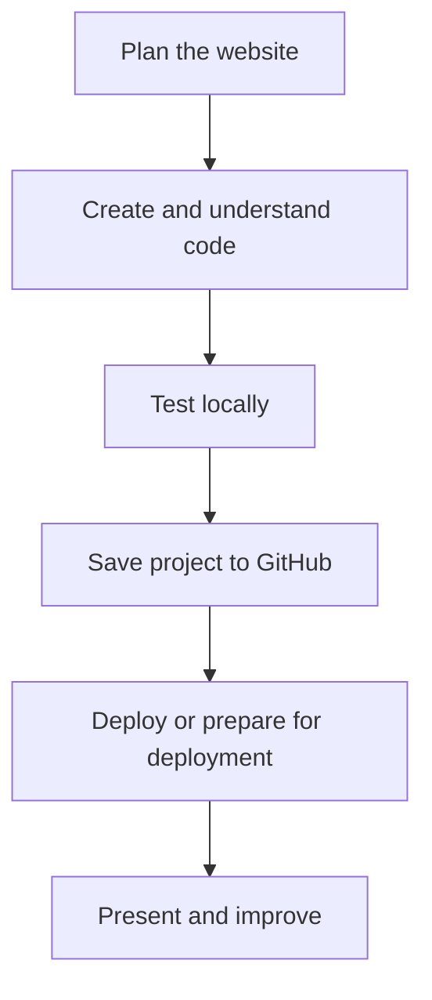

# Lesson 36 — Introduction to AI-Assisted Website Development

**Course:** Computer Fundamentals and Artificial Intelligence Foundation Course  
**Academy:** Next Generation Academy  
**Week:** 8 of 8 | **Duration:** 120 minutes | **Level:** Beginner

## Lesson purpose
Understand websites, HTML, CSS, JavaScript, frontend/backend basics and prepare a safe development workspace.

## Learning outcomes
- Explain website versus webpage.
- Describe HTML, CSS and JavaScript roles.
- Recognise frontend and backend at an introductory level.
- Organise a project folder and open files in an editor and browser.
- Plan a small responsive and accessible website.

## Key terms
website, webpage, HTML, CSS, JavaScript, frontend, backend

## Student lecture notes

Website: a collection of related webpages. Webpage: one document displayed in a browser. HTML provides structure and content such as headings, links and images. CSS controls presentation such as colour, spacing and layout. JavaScript adds behaviour such as menu interaction. The frontend is what visitors use in a browser; a backend may handle accounts, databases or server-side work. This beginner project is a static frontend site, so do not pretend a login or contact form works without a real backend or approved service.

Plan before coding: identify purpose, audience, required sections, content, visual style and the visitor's main action. Sketch a wireframe. Use approved content and images only. A responsive layout adapts to screen sizes. Accessibility basics include semantic headings, descriptive links, alt text for informative images, keyboard access, form labels and sufficient contrast.

Use an editor such as Visual Studio Code and a browser. Keep files together: index.html, style.css, optional script.js and an images folder. Match file names and paths exactly. Never enter passwords, API keys or private student records into an unapproved AI tool.

## Visual learning map

## Instructor preparation
- Test editor, browser, internet and demonstration project before class.
- Prepare a working sample and an offline backup.
- Use fictional or approved content only.
- Never enter passwords, API keys, recovery codes or private student records into AI prompts or repositories.
- Check current account and hosting requirements; interfaces and eligibility may change.
- Provide an offline alternative if internet or account access is unavailable.

## 120-minute lesson plan

| Time | Activity |
|---|---|
| 0–10 min | Starter, prior-learning connection and lesson goal |
| 10–20 min | Core concepts and key terms |
| 20–35 min | Instructor demonstration |
| 35–65 min | Guided practical activity |
| 65–100 min | Independent or pair task |
| 100–110 min | Peer review and improvement |
| 110–120 min | Quiz, recap, save work and homework |

## Instructor demonstration
Show a simple website in a browser and its HTML/CSS files in the editor. Point out a heading, link, image and matching CSS rule. Sketch a four-section information site before coding.

## Practical activity
Create a project folder, draw a wireframe for Home, About, Courses/Services and Contact, then create index.html, style.css and script.js. Link the stylesheet in the HTML.

### Evidence to save
- Project folder and files.
- Prompt, plan or notes used.
- README and repository URL.
- Live URL if deployed, or deployment worksheet.
- Short test/change log and responsible AI-use note.

## Understanding check
1. What is the difference between a website and a webpage?
2. What is the main role of HTML?
3. What does CSS control?
4. What is JavaScript commonly used for?
5. Why plan a website before asking AI to generate code?

## Homework
Submit a one-page project brief and labelled wireframe. Explain what HTML, CSS and JavaScript will do in the planned site.

## Instructor notes
- Let students type and edit files themselves; avoid passive AI demonstrations.
- Ask students to explain one code section and one change in their own words.
- A static form must not be described as a working message system.
- Never publish secrets, private information or unapproved photographs.
- Assess understanding and project quality, not speed or premium-tool access.

## Lesson completion checklist
- [ ] Student explains key terms in simple language.
- [ ] Student completes the practical task or approved alternative.
- [ ] Student tests and improves the project.
- [ ] Student follows account, privacy and publication safety rules.
- [ ] Student saves evidence in the Week 8 folder.
- [ ] Instructor records support needs and next steps.

---
*Internal academy teaching material. Check current software interfaces and platform requirements before delivery.*
