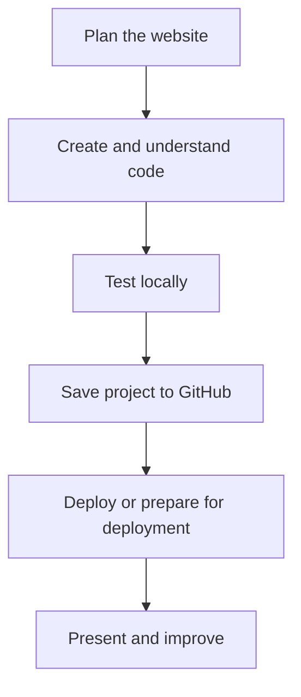

# Lesson 37 — Building a Website with a Large Language Model

**Course:** Computer Fundamentals and Artificial Intelligence Foundation Course  
**Academy:** Next Generation Academy  
**Week:** 8 of 8 | **Duration:** 120 minutes | **Level:** Beginner

## Lesson purpose
Use an LLM as a coding assistant to create, inspect, edit and test a small website while developing genuine understanding.

## Learning outcomes
- Write a clear website-generation prompt.
- Generate or obtain a simple HTML/CSS/JavaScript project.
- Save files and open the site locally.
- Test links, layout, images and responsive behaviour.
- Fix simple errors and explain changes made.

## Key terms
CSS, JavaScript, frontend, backend, responsive design, accessibility, project folder

## Student lecture notes

An LLM can draft code, explain it and suggest fixes, but it may invent file names, use outdated patterns or create features that do not work. Treat its output as a draft. A useful prompt states the website purpose, audience, required sections, technologies, file structure, design, mobile behaviour, accessibility requirements and restrictions. Ask for separate files and explanations suitable for a beginner.

Example prompt: “Create a static information website for a fictional learning academy using HTML, CSS and vanilla JavaScript. Provide index.html, style.css and script.js separately. Include Home, About, Courses and Contact sections, responsive navigation, semantic HTML and readable contrast. Do not create a fake backend or invent contact details.”

Review output before saving. Check that HTML links to the correct CSS and JS files and that asset paths exist. Open index.html in a browser. Test every link, button, image and form. A static contact form does not send messages unless a backend or approved service is configured. For debugging, describe one problem at a time, inspect the relevant file and change one thing at a time. Students must be able to explain and edit the main parts of their project.

## Visual learning map

## Instructor preparation
- Test editor, browser, internet and demonstration project before class.
- Prepare a working sample and an offline backup.
- Use fictional or approved content only.
- Never enter passwords, API keys, recovery codes or private student records into AI prompts or repositories.
- Check current account and hosting requirements; interfaces and eligibility may change.
- Provide an offline alternative if internet or account access is unavailable.

## 120-minute lesson plan

| Time | Activity |
|---|---|
| 0–10 min | Starter, prior-learning connection and lesson goal |
| 10–20 min | Core concepts and key terms |
| 20–35 min | Instructor demonstration |
| 35–65 min | Guided practical activity |
| 65–100 min | Independent or pair task |
| 100–110 min | Peer review and improvement |
| 110–120 min | Quiz, recap, save work and homework |

## Instructor demonstration
Generate a small static site from a clear prompt. Save its files, open index.html, inspect one HTML section and one CSS rule, then make a student-directed change and retest.

## Practical activity
Build the first working version of the planned website. Change the title, text, colours and at least one section yourself. Test links and resize the browser.

### Evidence to save
- Project folder and files.
- Prompt, plan or notes used.
- README and repository URL.
- Live URL if deployed, or deployment worksheet.
- Short test/change log and responsible AI-use note.

## Understanding check
1. Name five useful details in a website-generation prompt.
2. Why is generated code a draft?
3. What is a relative file path?
4. Why might a static contact form not send messages?
5. What evidence shows that a student understands AI-generated code?

## Homework
Improve the website after a peer test. Record one issue, the change made, the result and one code section you can explain.

## Instructor notes
- Let students type and edit files themselves; avoid passive AI demonstrations.
- Ask students to explain one code section and one change in their own words.
- A static form must not be described as a working message system.
- Never publish secrets, private information or unapproved photographs.
- Assess understanding and project quality, not speed or premium-tool access.

## Lesson completion checklist
- [ ] Student explains key terms in simple language.
- [ ] Student completes the practical task or approved alternative.
- [ ] Student tests and improves the project.
- [ ] Student follows account, privacy and publication safety rules.
- [ ] Student saves evidence in the Week 8 folder.
- [ ] Instructor records support needs and next steps.

---
*Internal academy teaching material. Check current software interfaces and platform requirements before delivery.*
