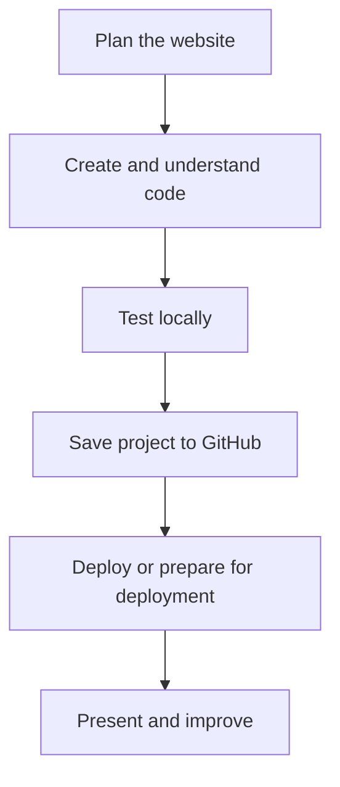

# Lesson 38 — GitHub Fundamentals and Project Management

**Course:** Computer Fundamentals and Artificial Intelligence Foundation Course  
**Academy:** Next Generation Academy  
**Week:** 8 of 8 | **Duration:** 120 minutes | **Level:** Beginner

## Lesson purpose
Create and organise a GitHub repository, upload website files, make meaningful commits and document a project safely.

## Learning outcomes
- Explain Git versus GitHub.
- Identify repositories, commits, branches and README files.
- Use an account safely and follow current account terms.
- Upload files and make a meaningful commit.
- Create a README and avoid publishing secrets or private information.

## Key terms
backend, responsive design, accessibility, project folder, LLM, repository, commit

## Student lecture notes

Git is a version-control system that records changes to files. GitHub is an online platform for hosting Git repositories and collaboration. A repository is a project space containing files and history. A commit is a saved set of changes with a message. A branch is a separate line of work. A README introduces the project and explains how to use it.

Use a unique password and two-factor authentication where available. Never share passwords or recovery codes. Follow GitHub's current age requirements and account terms. Choose a clear repository name and description. A public repository can be viewed by anyone; a private repository restricts access, but neither is a place for secrets.

Upload HTML, CSS, JavaScript and approved assets. Use meaningful commit messages such as “Add first website version”. A README should explain purpose, features, file structure, how to view the site, tools, credits and limitations. Update the repository after changes and make another commit. Never upload passwords, API keys, tokens, private student data or confidential files. If a secret is exposed, revoke or rotate it immediately; deleting the line is not enough.

## Visual learning map

## Instructor preparation
- Test editor, browser, internet and demonstration project before class.
- Prepare a working sample and an offline backup.
- Use fictional or approved content only.
- Never enter passwords, API keys, recovery codes or private student records into AI prompts or repositories.
- Check current account and hosting requirements; interfaces and eligibility may change.
- Provide an offline alternative if internet or account access is unavailable.

## 120-minute lesson plan

| Time | Activity |
|---|---|
| 0–10 min | Starter, prior-learning connection and lesson goal |
| 10–20 min | Core concepts and key terms |
| 20–35 min | Instructor demonstration |
| 35–65 min | Guided practical activity |
| 65–100 min | Independent or pair task |
| 100–110 min | Peer review and improvement |
| 110–120 min | Quiz, recap, save work and homework |

## Instructor demonstration
Show a repository page, file list, README and commit history. Demonstrate adding a website file and committing with a clear message.

## Practical activity
Create a repository for the website, upload the project files and approved assets, then add a README with purpose, features, file structure and current status.

### Evidence to save
- Project folder and files.
- Prompt, plan or notes used.
- README and repository URL.
- Live URL if deployed, or deployment worksheet.
- Short test/change log and responsible AI-use note.

## Understanding check
1. What is Git?
2. What is GitHub?
3. What is a repository?
4. What does a commit record?
5. Name four types of information that must never be uploaded to a public repository.

## Homework
Make one improvement, upload the changed file and create a second commit. Add the repository URL to the workbook and explain both commit messages.

## Instructor notes
- Let students type and edit files themselves; avoid passive AI demonstrations.
- Ask students to explain one code section and one change in their own words.
- A static form must not be described as a working message system.
- Never publish secrets, private information or unapproved photographs.
- Assess understanding and project quality, not speed or premium-tool access.

## Lesson completion checklist
- [ ] Student explains key terms in simple language.
- [ ] Student completes the practical task or approved alternative.
- [ ] Student tests and improves the project.
- [ ] Student follows account, privacy and publication safety rules.
- [ ] Student saves evidence in the Week 8 folder.
- [ ] Instructor records support needs and next steps.

---
*Internal academy teaching material. Check current software interfaces and platform requirements before delivery.*
