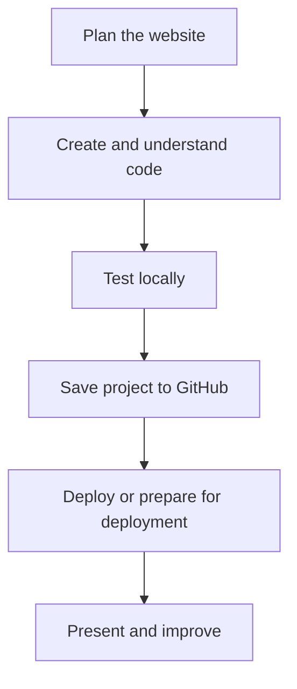

# Lesson 39 — Website Deployment and Online Publishing

**Course:** Computer Fundamentals and Artificial Intelligence Foundation Course  
**Academy:** Next Generation Academy  
**Week:** 8 of 8 | **Duration:** 120 minutes | **Level:** Beginner

## Lesson purpose
Publish a static website using GitHub Pages and understand basic deployment, testing, maintenance and privacy responsibilities.

## Learning outcomes
- Explain local versus published websites.
- Describe static website hosting.
- Configure GitHub Pages for an eligible repository.
- Test the live site on desktop and mobile.
- Update a site and troubleshoot common deployment problems.

## Key terms
project folder, LLM, repository, commit, README, deployment

## Student lecture notes

A local website is opened from files on a computer. A published website is hosted so visitors can access it through a web address. Static hosting serves files such as HTML, CSS, JavaScript and images; it does not automatically provide databases, private accounts or server-side processing.

Before publishing, check that index.html is in the expected location, file paths are correct, assets are included and no private information is present. Confirm that you have permission to publish images, fonts and other assets. The instructor should demonstrate the current GitHub Pages interface: open repository settings, find Pages, select an eligible source/branch and folder, save, wait for deployment and open the URL GitHub provides. Options and eligibility can change.

Test the live URL in another browser. Check navigation, images, links, layout and mobile width. A 404 may mean wrong deployment settings or missing index.html. Missing CSS/images often mean an incorrect path, spelling/capitalisation mismatch or missing upload. If an old version appears, check the latest commit and allow deployment/cache to update. Make one change at a time. Netlify and Vercel are optional alternatives; verify current terms and free-tier limits before use.

Public content can be copied and shared. Do not publish private student details, unapproved photographs or academy information without approval.

## Visual learning map

## Instructor preparation
- Test editor, browser, internet and demonstration project before class.
- Prepare a working sample and an offline backup.
- Use fictional or approved content only.
- Never enter passwords, API keys, recovery codes or private student records into AI prompts or repositories.
- Check current account and hosting requirements; interfaces and eligibility may change.
- Provide an offline alternative if internet or account access is unavailable.

## 120-minute lesson plan

| Time | Activity |
|---|---|
| 0–10 min | Starter, prior-learning connection and lesson goal |
| 10–20 min | Core concepts and key terms |
| 20–35 min | Instructor demonstration |
| 35–65 min | Guided practical activity |
| 65–100 min | Independent or pair task |
| 100–110 min | Peer review and improvement |
| 110–120 min | Quiz, recap, save work and homework |

## Instructor demonstration
Demonstrate a prepared static project, the current Pages settings and a live example. Show how to diagnose a missing asset path.

## Practical activity
Publish the static website with GitHub Pages if eligible. If access or internet prevents this, complete the deployment worksheet using the instructor demonstration.

### Evidence to save
- Project folder and files.
- Prompt, plan or notes used.
- README and repository URL.
- Live URL if deployed, or deployment worksheet.
- Short test/change log and responsible AI-use note.

## Understanding check
1. What is the difference between a local and published website?
2. What is a static website?
3. What is a common main file name for a basic site?
4. Name three causes of missing CSS or images after deployment.
5. Why check a public site for private information before publishing?

## Homework
Test the live URL on a phone or narrow browser. Record one issue, its correction and the final test result. Update README with the live URL if deployed.

## Instructor notes
- Let students type and edit files themselves; avoid passive AI demonstrations.
- Ask students to explain one code section and one change in their own words.
- A static form must not be described as a working message system.
- Never publish secrets, private information or unapproved photographs.
- Assess understanding and project quality, not speed or premium-tool access.

## Lesson completion checklist
- [ ] Student explains key terms in simple language.
- [ ] Student completes the practical task or approved alternative.
- [ ] Student tests and improves the project.
- [ ] Student follows account, privacy and publication safety rules.
- [ ] Student saves evidence in the Week 8 folder.
- [ ] Instructor records support needs and next steps.

---
*Internal academy teaching material. Check current software interfaces and platform requirements before delivery.*
