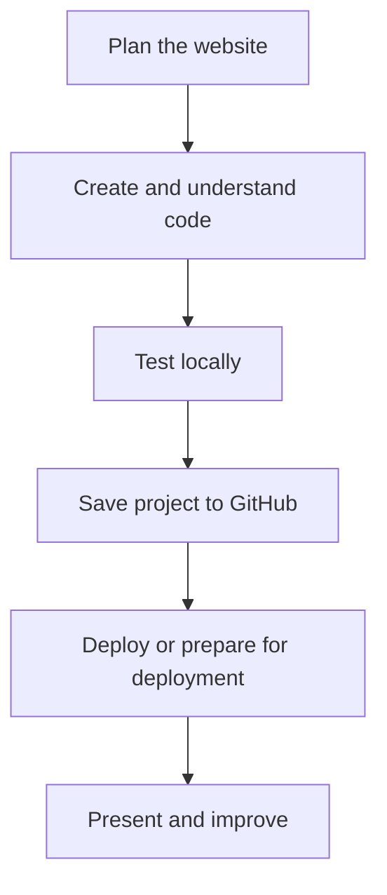

# Lesson 40 — Final Project, Presentation and Career Readiness

**Course:** Computer Fundamentals and Artificial Intelligence Foundation Course  
**Academy:** Next Generation Academy  
**Week:** 8 of 8 | **Duration:** 120 minutes | **Level:** Beginner

## Lesson purpose
Complete, present and explain a beginner website while reflecting on responsible AI use and planning next learning steps.

## Learning outcomes
- Complete a small responsive information website.
- Explain HTML, CSS and any JavaScript used.
- Demonstrate editing, testing and basic troubleshooting.
- Present the repository and live URL or deployment-ready project.
- Describe responsible AI use and realistic next learning pathways.

## Key terms
commit, README, deployment

## Student lecture notes

The final project is a personal portfolio or academy information site with Home, About, Services/Courses and Contact. It should include navigation, suitable approved images, working links, responsive layout and readable content. A contact form must not be described as working unless a backend or approved form service is configured.

Check spelling, accuracy, spacing, headings, contrast, image alt text, keyboard navigation, mobile layout, links and loading. Students should point to the HTML structure, a CSS rule and any JavaScript used. They should explain one AI suggestion, one change they made and one problem they solved.

A 3–5 minute presentation can cover project purpose, audience, sections, design choices, responsive demonstration, repository/README, live URL or deployment-ready status, AI assistance and limitations, and future improvements. Listen to feedback and record one strength and one improvement. Do not claim a feature works if it has not been tested.

Describe AI assistance honestly: what it drafted, what the student edited and how facts and assets were checked. Next steps may include deeper HTML/CSS, JavaScript, accessibility, Git/GitHub, responsive design, debugging, APIs, databases, testing and backend development. These are future pathways, not passing requirements. Be honest about skill level and do not promise clients expertise not yet developed.

## Visual learning map

## Instructor preparation
- Test editor, browser, internet and demonstration project before class.
- Prepare a working sample and an offline backup.
- Use fictional or approved content only.
- Never enter passwords, API keys, recovery codes or private student records into AI prompts or repositories.
- Check current account and hosting requirements; interfaces and eligibility may change.
- Provide an offline alternative if internet or account access is unavailable.

## 120-minute lesson plan

| Time | Activity |
|---|---|
| 0–10 min | Starter, prior-learning connection and lesson goal |
| 10–20 min | Core concepts and key terms |
| 20–35 min | Instructor demonstration |
| 35–65 min | Guided practical activity |
| 65–100 min | Independent or pair task |
| 100–110 min | Peer review and improvement |
| 110–120 min | Quiz, recap, save work and homework |

## Instructor demonstration
Present a sample beginner website using the assessment rubric. Explain its code, repository, live URL, AI assistance and known limitations.

## Practical activity
Complete final checks, prepare a 3–5 minute presentation and demonstrate the site. Each student must make one small live edit or explain a previously completed change.

### Evidence to save
- Project folder and files.
- Prompt, plan or notes used.
- README and repository URL.
- Live URL if deployed, or deployment worksheet.
- Short test/change log and responsible AI-use note.

## Understanding check
1. Name the four required sections of the final project.
2. Why explain the HTML and CSS used?
3. What should a short project presentation include?
4. How should AI assistance be described honestly?
5. Name three useful next learning topics.

## Homework
Submit repository URL, live URL if deployed, README, presentation notes and a reflection with three skills to practise next.

## Instructor notes
- Let students type and edit files themselves; avoid passive AI demonstrations.
- Ask students to explain one code section and one change in their own words.
- A static form must not be described as a working message system.
- Never publish secrets, private information or unapproved photographs.
- Assess understanding and project quality, not speed or premium-tool access.

## Lesson completion checklist
- [ ] Student explains key terms in simple language.
- [ ] Student completes the practical task or approved alternative.
- [ ] Student tests and improves the project.
- [ ] Student follows account, privacy and publication safety rules.
- [ ] Student saves evidence in the Week 8 folder.
- [ ] Instructor records support needs and next steps.

---
*Internal academy teaching material. Check current software interfaces and platform requirements before delivery.*
